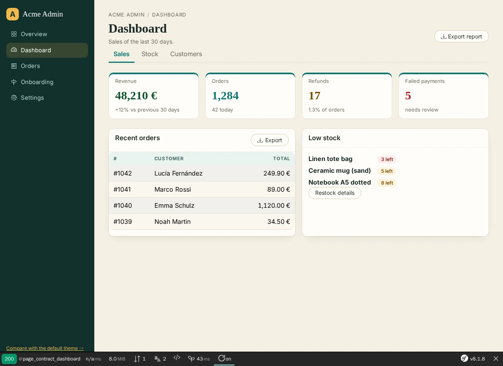

# Nowo UiKit Bundle

[](https://github.com/nowo-tech/UiKitBundle/actions/workflows/ci.yml) [](https://packagist.org/packages/nowo-tech/ui-kit-bundle) [](https://packagist.org/packages/nowo-tech/ui-kit-bundle) [](LICENSE) [](https://php.net) [](https://symfony.com) [](https://github.com/nowo-tech/UiKitBundle) [](#tests-and-coverage)

> ⭐ **Found this useful?** [Install from Packagist](https://packagist.org/packages/nowo-tech/ui-kit-bundle) · Give it a **star** on [GitHub](https://github.com/nowo-tech/UiKitBundle) so more developers can find it.

Canonical **admin UI kit** for Nowo Symfony bundles and host apps: Twig macros, semantic `nowo-ui-*` CSS, pagination/tabs/modals/toasts/confirm/loader, cards/filters, shell chrome (aside / nested nav / burger / avatar / user menu / footer / width toggle), theme/locale/kebab helpers, **Thinking Orbs** (local canvas, no CDN), and multi-framework class helpers (`bootstrap5`, `tailwind`, `foundation`, `custom`, …) per **REQ-UI-001**.

**Compatible with Symfony 7.4+ and 8.x** (PHP 8.2+; Symfony 8 requires PHP 8.4+).


This bundle is **FrankenPHP worker mode friendly** (including when the kernel is **not** reset between requests). See [docs/FRANKENPHP-WORKER-AUDIT.md](docs/FRANKENPHP-WORKER-AUDIT.md).

<table>
  <tr>
    <td align="center" width="33%">
      
      <br /><sub>List scaffold — host theme (tokens + class map + partial override)</sub>
    </td>
    <td align="center" width="33%">
      
      <br /><sub>Dashboard scaffold — KPI tiles and cards grid</sub>
    </td>
    <td align="center" width="33%">
      
      <br /><sub>Same list, UiKit default theme — row delete confirm dialog</sub>
    </td>
  </tr>
</table>

## Table of contents

- [What this is / is not](#what-this-is--is-not)
- [Features](#features)
- [Installation](#installation)
- [Quick start](#quick-start)
- [Page contract (UiKit 2.0)](#page-contract-uikit-20)
- [Demos](#demos)
- [Documentation](#documentation)
- [Tests and coverage](#tests-and-coverage)
- [License](#license)
- [Contributing](#contributing)

## What this is / is not

| Is | Is not |
|----|--------|
| Buttons, toolbars, tables, lists, pagination, tabs, flashes/toasts, empty states, modal/confirm, cards/filters, icons, **aside (nested) / burger / avatar / user menu / footer**, theme/locale/kebab/width, Thinking Orbs | DashboardMenu / BreadcrumbKit navigation chrome |
| Shared `nowo-ui-*` look-and-feel | Domain CRUD pages / manage routes |
| Multi-framework class macros | Form widget themes (use FormKit) |

## Features

- Twig macros (`@NowoUiKitBundle/macros/ui.html.twig`) with optional per-call `framework` override
- Semantic stylesheet `css/nowo-ui.css` (asset package `nowo_ui_kit`), including dark `[data-theme="dark"]` tokens
- Complete `--nowo-ui-*` theming tokens (1.13): every colour, radius, font, focus ring, overlay and shadow in kit output reads a token — no hard-coded Tailwind palette / Bootstrap colour utilities; a host theme is a short `:root` block ([docs/THEMING.md](docs/THEMING.md)); opt-in `.nowo-ui-bs-tokens` bridge for Bootstrap 5.3 stacks
- Optional **appearance SPI** (1.16): presets (ocean, slate, sandstone, midnight, obsidian, aurora, ember + host presets), corner / border styles, a `--nowo-ui-*` token emitter with host aliases, `nowo_ui_appearance_style()` (CSP nonce), host storage behind `AppearanceProviderInterface`, optional `AppearanceType` form — see [docs/THEMING.md](docs/THEMING.md#appearance-spi)
- **Host chrome** (1.17, opt-in): responsive tables (scroll ↔ responsive, row detail dialog, host-owned persistence), foldable filter cards, card corner tabs, disclosure chevrons, page-edge tab + `nowo_ui_route_link()` route map, unified thin scrollbars (CSS + SCSS mixin), optional morphicons module — see [docs/USAGE.md](docs/USAGE.md#host-chrome-117-opt-in)
- **Locale tabs** (2.5): `locale_tabs` partial — one panel per locale for per-locale form fields, WAI-ARIA tabs (keyboard, RTL, error / required / default markers with screen-reader text), stacked fieldsets without JavaScript, browser validation opens the hidden panel, `nowo-ui:tabs:change` for editors, Live Component safe — see [docs/USAGE.md](docs/USAGE.md#locale-tabs-25)
- **Kit templates** (2.6): branded HTTP error pages for every status code (`@NowoUiKit/error/status.html.twig`: illustration, retry / back links, 429 `Retry-After`, 5xx self-reload, skip link, CSP nonce), the Stimulus `confirm_dialog` wrapper, the signed-in app shell (open / close halves, cookie-rendered aside, morph burger) and a compact pagination with an auto-submitting per-page select — see [docs/USAGE.md](docs/USAGE.md#kit-templates-26)
- TypeScript → IIFEs: modal, shell, toast, confirm, page-loader, theme, theme-boot, orb, clipboard, tabs, release, open-modal
- Pre-paint theme boot (1.15): `_theme_boot.html.twig` inlines a blocking script (CSP nonce) that applies theme / density / motion / font scale / contrast from `<html>` attributes before first paint, sharing storage keys with the theme toggle
- Opt-in three-mode sidebar (1.15): expanded / icons-only rail / hidden, cookie + localStorage sync with configurable keys (`data-nowo-ui-sidebar-rail`)
- Deep link "open modal on load" (`?new=1`): `_open_modal_on_load.html.twig` JSON island + `nowo-ui-open-modal.js` (CSP-safe, no inline JS)
- Opt-in filter bar / data table chrome: `.nowo-ui-filter-bar` (38px / compact 34px controls, actions on one row) + `_filter_actions.html.twig` (icon / icon-only actions since 1.15), `table.nowo-ui-data-table`
- Page loader: veil (spinner / orb) or minimal indicators (top bar, looping bar, corner spinner, dots, glow, corner logo); cross-page fades via `_page_transition.html.twig` (View Transitions, no JS)
- Optional Stimulus peers under `src/Resources/assets/stimulus-peers/` (see [docs/STIMULUS.md](docs/STIMULUS.md)) — `confirm-submit` (form submit or single button click, `blocked` value), `confirm-dialog`, `tabs`, `toast-stack`, `clipboard-copy`, `page-loader`, `release-status`, `auto-refresh`, `temporary-reveal`, `collapse-panel`, `datatable` (optional DataTables dependency), `responsive-table`, `filters-collapse`, `disclosure-icon` (1.17), `listing-customizer`, `product-tour` (2.13, optional driver.js), `multi-select` (2.14: Tom Select chips for `ChoiceType` `multiple` filters via the `nowo_ui_multi_select` option, optional `tom-select`, skin `css/nowo-ui-multi-select.css`), `date-range` (2.15: one labelled from / to filter field `DateRangeType` with a range calendar, optional `cally`; two native date inputs without JavaScript)
- Optional **release check** (off by default): installed-version button + lazy GitHub “newer release?” dialog (`release_check` config, `_release_version.html.twig`, `nowo-ui-release.js`) — see [docs/CONFIGURATION.md](docs/CONFIGURATION.md#release-check)
- Thinking Orbs: `_thinking_orb` + `nowo-ui-orb.js`; page loader `visual: orb|spinner` ([THIRD_PARTY.md](docs/THIRD_PARTY.md))
- Config: `css_framework`, `icon_set`, `row_actions_display`, `appearance`, `route_links`; i18n domain `NowoUiKitBundle` (`en`, `es`, `it`, `fr`, `pt`, `de`, `nl`)
- Twig namespace overrides under `templates/bundles/NowoUiKitBundle/`
- Adoption + Stimulus contracts: [docs/ADOPTION.md](docs/ADOPTION.md), [docs/STIMULUS.md](docs/STIMULUS.md)

## Installation

```bash
composer require nowo-tech/ui-kit-bundle
php bin/console assets:install
```

With Flex, the recipe creates `config/packages/nowo_ui_kit.yaml`. See [docs/INSTALLATION.md](docs/INSTALLATION.md) and [docs/RECIPE.md](docs/RECIPE.md).

## Quick start

```yaml
# config/packages/nowo_ui_kit.yaml
nowo_ui_kit:
    css_framework: bootstrap5   # or: tailwind | foundation | custom
    icon_set: bootstrap-icons
    row_actions_display: icon   # or: text | icon_text
    # panel_path_rewrites:      # optional (1.9.0+): rewrite kit routes + 301 legacy URLs
    #     '/admin/blog': '/panel/blog'
    # release_check:            # optional (1.10.0+): footer version + GitHub release dialog
    #     enabled: true
    #     github_repo: 'acme/my-app'
    #     current_version: '%app.version%'
```

```twig


<link rel="stylesheet" href="{{ asset('css/nowo-ui.css', 'nowo_ui_kit') }}">

<button type="button" class="{{ ui.btn('primary') }}">Save</button>
```

See [docs/USAGE.md](docs/USAGE.md) and [docs/CONFIGURATION.md](docs/CONFIGURATION.md).

## Page contract (UiKit 2.0)

**REQ-UI-003** — UiKit owns the page shell of every Nowo UI bundle: canonical layouts, one scaffold per view type
(`@NowoUiKit/page/{list,show,form,settings,dashboard,confirm,wizard,auth}.html.twig`), immutable view models
(`Nowo\UiKitBundle\View\*`) and one global theme (`nowo_ui_kit.theme`: slot classes, attributes, partial overrides,
`--nowo-ui-*` tokens, per-bundle exceptions). A host themes each view type once; bundles fill data blocks only.

Screenshots of every scaffold (host theme and default theme): [docs/PAGE_CONTRACT.md](docs/PAGE_CONTRACT.md#example-host-integration).

- [Page contract](docs/PAGE_CONTRACT.md) — concepts, layouts, scaffolds and data blocks, view models, bundle and host examples
- [Theme slots](docs/THEME_SLOTS.md) — slot vocabulary with defaults per `css_framework`, partials, tokens, per-bundle exceptions
- [Migrating bundles](docs/MIGRATING_BUNDLES.md) — recipe for UI bundles (view models, scaffolds, bridges, config aliases, contract test, `docs/TEMPLATES.md`)
- `Nowo\UiKitBundle\Test\PageContractTestCase` — shared contract test for UI bundles (needs `phpunit/phpunit` in the bundle's `require-dev`)

## Demos

FrankenPHP demos (Caddy + PHP). Runtime mode: **`FRANKENPHP_MODE`** (`worker` default; `classic` for per-request PHP). See [docs/DEMO-FRANKENPHP.md](docs/DEMO-FRANKENPHP.md).

| Demo | Port | Notes |
|------|------|--------|
| [demo/symfony8](demo/symfony8/) | 8092 | Bootstrap 5 kitchen sink; page contract host-theme demo at `/page-contract` |
| [demo/symfony8-tailwind](demo/symfony8-tailwind/) | 8093 | Tailwind kitchen sink |

```bash
make -C demo up-symfony8
# open http://localhost:8092/
```

## Documentation

Developer-facing docs are **English only** ([Contributing — Language policy](docs/CONTRIBUTING.md#language-policy)).

- [Installation](docs/INSTALLATION.md)
- [Configuration](docs/CONFIGURATION.md)
- [PSR evaluation (REQ-CS-007)](docs/PSR.md)
- [Usage](docs/USAGE.md)
- [Theming (`--nowo-ui-*` tokens)](docs/THEMING.md)
- [Page contract (REQ-UI-003)](docs/PAGE_CONTRACT.md)
- [Theme slots](docs/THEME_SLOTS.md)
- [Migrating bundles to the page contract](docs/MIGRATING_BUNDLES.md)
- [Row actions (canonical kinds)](docs/ROW_ACTIONS.md)
- [Adoption (Beacon + bundles)](docs/ADOPTION.md)
- [Stimulus / data contracts](docs/STIMULUS.md)
- [Third-party notices](docs/THIRD_PARTY.md)
- [Roadmap](docs/ROADMAP.md)
- [Flex recipe](docs/RECIPE.md)
- [FrankenPHP demos](docs/DEMO-FRANKENPHP.md)
- [FrankenPHP worker audit](docs/FRANKENPHP-WORKER-AUDIT.md)
- [Contributing](docs/CONTRIBUTING.md)
- [Code of Conduct](CODE_OF_CONDUCT.md)
- [Security](docs/SECURITY.md)
- [Changelog](docs/CHANGELOG.md)
- [Upgrading](docs/UPGRADING.md)
- [Release](docs/RELEASE.md)
- [Coverage](docs/COVERAGE.md)
- [GitHub Actions CI](docs/GITHUB_CI.md)
- [Spec-driven development](docs/SPEC-DRIVEN-DEVELOPMENT.md)
- [Spec Kit](docs/SPEC-KIT.md)

## Tests and coverage

| Suite | Coverage |
|-------|----------|
| PHP (PHPUnit) | 100% lines (fail under 99% in CI) |
| TypeScript (Vitest) | ≥90% lines (Vitest thresholds) |
| Python | N/A |

```bash
composer install
make test
make test-coverage
make test-ts
pnpm install && pnpm run build
```

See [docs/COVERAGE.md](docs/COVERAGE.md).

## License

MIT — see [LICENSE](LICENSE).

## Contributing

See [docs/CONTRIBUTING.md](docs/CONTRIBUTING.md). Install hooks with `make setup-hooks` (REQ-GIT-001).
