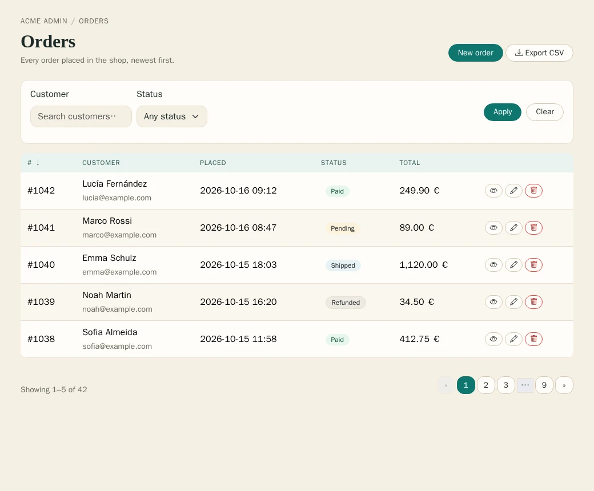
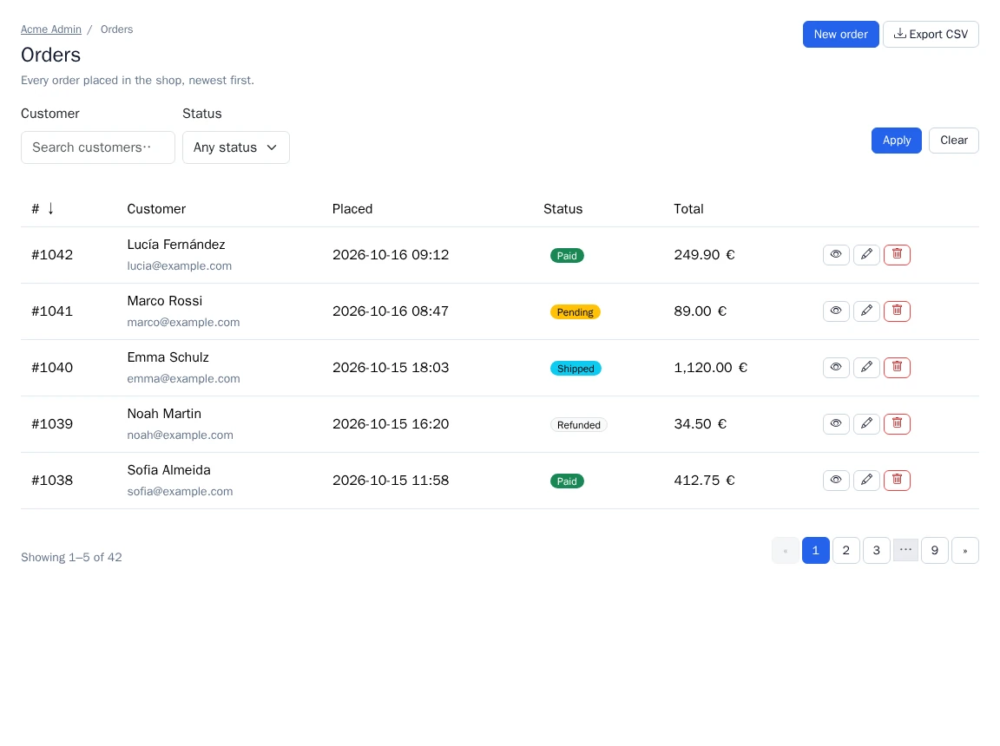

# Page contract (REQ-UI-003)

UiKit 2.0 owns the **page shell** of every Nowo UI bundle: canonical layouts, one **scaffold** per view type, immutable
**view models** and a **global theme** (classes, attributes, partials, tokens). A host themes each view type once and
every bundle page inherits it; a bundle ships data and data blocks, not chrome.

Normative spec: REQ-UI-003 in `BUNDLES_FULL_SPECS_DETAILS.md` · design and migration plan:
`BUNDLES_UI_PAGE_CONTRACT.md` · slot vocabulary: [`THEME_SLOTS.md`](THEME_SLOTS.md) · bundle recipe:
[`MIGRATING_BUNDLES.md`](MIGRATING_BUNDLES.md) · live demo: `demo/symfony8` → `/page-contract`.

## Table of contents

- [Concepts](#concepts)
- [Configuration](#configuration)
- [Twig API](#twig-api)
- [Layouts](#layouts)
- [Scaffolds](#scaffolds)
  - [List](#list)
  - [Show](#show)
  - [Form](#form)
  - [Settings](#settings)
  - [Dashboard](#dashboard)
  - [Confirm](#confirm)
  - [Wizard](#wizard)
  - [Auth](#auth)
- [View models](#view-models)
- [Partials](#partials)
- [Template contract](#template-contract)
- [Tokens and CSS](#tokens-and-css)
  - [Token precedence](#token-precedence)
  - [Cascade layers](#cascade-layers)
- [Example: a bundle page](#example-a-bundle-page)
- [Example: host integration](#example-host-integration)
- [Contract test](#contract-test)
- [Compatibility and versioning](#compatibility-and-versioning)
- [Deviations from REQ-UI-003](#deviations-from-req-ui-003)

## Concepts

```
host app                              UiKit                                        UI bundle
──────────────────────────            ───────────────────────────────────────      ─────────────────────────────
layouts/admin.html.twig  ◄─────────── nowo_ui_kit.layouts.admin                   controller: new ListPage(…)
(renders the nowo_ui_* blocks)        @NowoUiKit/layout/{document,admin,guest}      │
                                      @NowoUiKit/page/{list,show,form,…}  ◄─────────┘ items/index.html.twig:
nowo_ui_kit.theme (once):               header, filters, table, row actions,        
  classes / attributes / partials /     pagination, empty state, confirm dialogs    …
  tokens (+ per-bundle exceptions)      rendered from the view model with slots
optional: templates/bundles/          View\{PageHeader, Action, Confirm, …}
  NowoUiKitBundle/page/*.html.twig    Test\PageContractTestCase  ◄──────────────── tests/PageContractTest.php
```

| Term | Meaning |
| --- | --- |
| **Layout** | The document / page shell. Scaffolds extend `nowo_ui_layout.admin` (or `.guest`), which the host points at its own layout or at a bridge that renders the canonical blocks. |
| **Scaffold** | `@NowoUiKit/page/<type>.html.twig`: renders every structural region of a view type from a view model (`page`) and exposes **data blocks** for bundle content. Overriding a scaffold in `templates/bundles/NowoUiKitBundle/page/` re-skins that view type for every bundle. |
| **View model** | Immutable `Nowo\UiKitBundle\View\*` object the controller builds (labels as translation keys, no services, no request state — worker safe). |
| **Data block** | A Twig block of the scaffold a bundle page fills (row cells, detail sections, form body…). Block names and context variables are part of the published contract. |
| **Theme slot** | A named styling hook (`table`, `btn_primary`, `page_header`…). Markup prints `nowo_ui_class('slot')` = semantic `nowo-ui-*` class + framework defaults (per `css_framework`) + host classes. Vocabulary: [`THEME_SLOTS.md`](THEME_SLOTS.md). |
| **Theme partial** | A UiKit partial resolved through `nowo_ui_partial('name')`, replaceable once by the host (`theme.partials`). |
| **Token** | `--nowo-ui-<name>` custom property; `theme.tokens` sets them once for UiKit and every bundle. |
| **Per-bundle exception** | `theme.bundles.<Bundle>`: classes replace, attributes merge, partials replace, tokens are scoped to `[data-nowo-ui-bundle="<Bundle>"]`. View models carry `bundle` to select it. |

Rules for bundle pages (summary of REQ-UI-003): extend a scaffold (or, for a genuinely unique page, the layout
directly — listed in `docs/TEMPLATES.md`); no `<html>`, no CDN assets, no inline `on*=` / `confirm()`; framework
classes only through slots; no local copies of UiKit partials; no own layout global.

## Configuration

```yaml
nowo_ui_kit:
  css_framework: bootstrap5           # bootstrap5 | bootstrap4 | tailwind | foundation | tabler | custom | none
  layouts:
    admin: 'layouts/admin.html.twig'  # default '@NowoUiKit/layout/admin.html.twig'
    guest: 'layouts/guest.html.twig'  # default '@NowoUiKit/layout/guest.html.twig'
  breadcrumbs:
    breadcrumb_kit: true              # render PageHeader trails with BreadcrumbKit's breadcrumb_render() when installed
    collection: null                  # BreadcrumbKit collection (PageHeader::breadcrumbCollection overrides)
  theme:
    framework_defaults: true                                           # false = no UiKit framework classes on any slot
    classes:    { btn_primary: 'btn-moss', table: 'data-table' }        # slot => classes (string or list)
    #           badge_success: { value: 'acme-badge', framework_defaults: false }   # per slot: drop btn/badge/card… defaults
    attributes: { toasts: { data-controller: toast-stack } }           # slot => attributes (no on*)
    partials:   { pagination: 'kit/_pagination.html.twig' }            # partial name => template
    tokens:      { primary: 'var(--color-moss)', radius: '0.75rem' }   # --nowo-ui-<name> on :root
    tokens_dark: { primary: '#9c9' }                                   # on [data-theme="dark"]
    bundles:
      NowoHttpLogBundle: { classes: { table: 'data-table data-table--dense' } }
    pages:                                                             # per page type (scaffold)
      list: { classes: { table: 'data-table data-table--sticky' } }    # bundle slot > bundle > page slot > page > host
      # list: { header_actions_in_filters: true }                      # list header actions at the end of the filter row
```

Validation (container compile time): unknown slots and partial names, class entries with keys other than `value` /
`framework_defaults` or a non-boolean `framework_defaults`, `on*` attributes, attribute names outside
`[a-zA-Z_:][a-zA-Z0-9_:.-]*`, class lists with control characters or invalid UTF-8, token names outside `[a-z0-9-]` and token values with
`{ } ; < >` and unknown page types under `theme.pages` are rejected with an explicit message. Class lists may contain
any printable character (`"`, `'`, `<`, `>`, `&` included), so Tailwind arbitrary and child variants such as
`[&>li]:mt-1` or `content-['·']` work: UiKit always prints them HTML-escaped inside a quoted `class` attribute
(contract-tested on every scaffold and partial). Full reference: [`THEME_SLOTS.md`](THEME_SLOTS.md).

## Twig API

| Function / filter / global | Result |
| --- | --- |
| `nowo_ui_class(slot, bundle = null, framework = null, page = null)` | semantic `nowo-ui-*` + framework defaults (`css_framework`, or `framework`; unless `framework_defaults` drops them) + host classes (or the page type's / bundle's exception); `page` defaults to `nowo_ui_page_type` (set by every scaffold) |
| `nowo_ui_attrs(slot, bundle = null, extra = {}, page = null)` | escaped attribute string with leading spaces (`true` = bare attribute, `false`/`null` = omitted): host → page type → bundle → `extra` |
| `nowo_ui_html_attrs(attributes)` | escaped attribute string of a plain map (page model `attributes`; same rules, no `on*`) |
| `nowo_ui_partial(name, bundle = null)` | template name of a UiKit partial (bundle > host > UiKit default) |
| `nowo_ui_theme_tokens(nonce = null)` | `<style data-nowo-ui-theme-tokens>` with the tokens ('' without tokens; nonce defaults to the `csp_nonce` request attribute) |
| `nowo_ui_theme_css()` | the token stylesheet text (for a host that inlines it elsewhere) |
| `nowo_ui_tokens(nonce = null)` | every token stylesheet in precedence order: `nowo_ui_theme_tokens()` (host defaults), then `nowo_ui_appearance_style()` (user choice) when the appearance SPI is enabled |
| `nowo_ui_breadcrumb_kit(collection = null)` / `nowo_ui_breadcrumb_kit_available()` | BreadcrumbKit bridge used by the page header |
| `value\|nowo_ui_trans(params = {})` | translates a `View\Label` (or `{key, domain, params}`); plain strings pass through (escaped by Twig) |
| global `nowo_ui_layout` | `{admin, guest}` — the configured layouts |
| global `nowo_ui_theme` | the `Theme\Theme` object (used by the 1.x partials: `macroClasses()`, `extraClasses()`, `frameworkDefaults()`, `renderAttributes()`, `partial()`, `hasTokens()`) |
| global `nowo_ui_breadcrumbs` | `{breadcrumb_kit, collection}` |

## Layouts

| Template | Canonical blocks | Notes |
| --- | --- | --- |
| `@NowoUiKit/layout/document.html.twig` | `nowo_ui_document_title`, `nowo_ui_head`, `nowo_ui_styles`, `nowo_ui_scripts`, `nowo_ui_body` | `<html>` skeleton: theme boot, `nowo-ui.css` + `nowo_ui_tokens()` (theme tokens, then the appearance), UiKit scripts (asset package `nowo_ui_kit`, never a CDN); `<html data-nowo-ui-host-tokens>` when the theme has tokens |
| `@NowoUiKit/layout/admin.html.twig` | + `nowo_ui_navigation`, `nowo_ui_page_header`, `nowo_ui_flashes`, `nowo_ui_content`, `nowo_ui_modals` | `nowo_ui_navigation` is empty (hosts put their shell / DashboardMenu there); flashes default to `nowo_ui_partial('flashes')` |
| `@NowoUiKit/layout/guest.html.twig` | same as admin without `nowo_ui_navigation` | login, reset, setup wizard, maintenance, public status |

Variables: `nowo_ui_document_title` (title when the block is not overridden), `nowo_ui_theme_boot` (`false` skips
the pre-paint theme boot), `nowo_ui_bundle` (set by every scaffold from `page.bundle`; the layouts print it as
`data-nowo-ui-bundle` on `<main>` so bundle-scoped tokens apply). Stack assets with `{{ parent() }}`:

```twig
{{ parent() }}<script src="{{ asset('js/board.js') }}" defer></script>
```

## Scaffolds

Every scaffold: `` (`.guest` for auth), sets `nowo_ui_bundle`,
fills `nowo_ui_document_title` with the page title and renders the page header through
`nowo_ui_partial('page_header')`. Context variables of data blocks are listed in parentheses.

### List

`@NowoUiKit/page/list.html.twig` · `page: ListPage` · `data-nowo-ui-page="list"`

| Region | From |
| --- | --- |
| header + actions + breadcrumbs | `page.header` (`PageHeader`); with `page.headerActionsInFilters` (or `theme.pages.list.header_actions_in_filters`) and filters, the header actions render at the end of the filter row instead (`nowo-ui-filters__header-actions`, region `header-actions`) |
| filters (GET form, apply / clear, extra actions) | `page.filters` (`FormView`, REQ-TWIG-003 child loop) through the `list_filters` partial; `page.filterFields` (`FilterField`: placeholder, `width` `xs`…`full`, widget / row classes and attributes; every row gets the `filters_field` slot), `page.filtersSubmit` (`Action`: label, icon, variant of the apply button), `page.filtersClear` (`Action`, rendered through the `action` partial; default a plain link to `page.filtersClearHref`), `page.filterActions` — all in the `filters_actions` slot; `page.filtersDisplay` (`icon` / `text` / `icon_text`) for these buttons |
| table frame, sortable headers (`aria-sort`) | `page.columns` (`Column`), `page.sort`, `page.direction`, `page.caption`; slots `table_wrap`, `table`, `table_head`, `table_head_row`, `table_head_cell`, `table_row`, `table_cell` |
| row actions + confirm `<dialog>`s | `page.rowActions` (list of `Action`, or `callable(row, key): list<Action>`); actions column header `table_actions_head` with `page.actionsLabel` (default `table.actions`), visually hidden unless `page.actionsLabelVisible`; body cells `table_actions_cell`; `page.actionsAlign` (`start` / `center` / `end`, default `end`) aligns header, cells and the action cluster (`nowo-ui-cell--<align>`) |
| pagination | `page.pagination` (`Pagination`) |
| empty state | `page.empty` (`EmptyState`) when `page.rows` is empty |

| Data block | Default | Context |
| --- | --- | --- |
| `nowo_ui_list_filters` | the `list_filters` partial when `page.filters` is set | `page` |
| `nowo_ui_list_head` | one `<th>` per column; sortable columns add the `sortable_header` slot and a `sort_link` (`nowo-ui-sort`, `--asc` / `--desc` when active) | `page` |
| `nowo_ui_list_row` | one `<td>` per column: `row[column.key]`; a cell without a value (`null`, `''`, `false`) prints a muted `—` with the `table_cell_muted` slot | `row`, `row_key`, `loop` |
| `nowo_ui_list_after` | empty (after the table / empty state) | `page` |

**Filter row layout.** The `filters` form is a wrapping flex row: the field rows (`filters_field`, sized by
`FilterField::width`), then one `filters_actions` group (`nowo-ui-filters__actions`, pushed to the row end by
`margin-left: auto`) holding apply, clear, `filterActions` and — with `headerActionsInFilters` — the page-header
actions (`nowo-ui-filters__header-actions`) **right after the filter actions**, as in most admin UIs. The group does
not grow; if your theme makes the fields grow (e.g. Tailwind `classes.filters_field: 'flex-1'`), add `flex-none` to
`filters_actions` so the buttons stay on one line instead of shrinking and wrapping inside the group:

```yaml
nowo_ui_kit:
  theme:
    pages:
      list:
        classes: { filters_field: 'flex-1 min-w-48', filters_actions: 'flex-none' }
```

**Responsive tables.** With `page.responsive = 'cards'` (default) the table wrap is a CSS size container
(`data-nowo-ui-responsive="cards"`, table class `nowo-ui-table--cards`): columns with `Column::priority` 3 hide
below 60rem of table width, priority 2 below 48rem (`required` columns never hide), and below 40rem every row turns
into a card of labelled cells — every column shows again, each cell labelled from its `data-label` (the column
label). CSS only, no JavaScript, works in any host. Cells of an overridden `nowo_ui_list_row` add
`data-label="{{ column.label|nowo_ui_trans }}"` (and `data-nowo-ui-priority`) themselves. `responsive: 'scroll'`
keeps the 1.x horizontal scroll. In card mode inline cell content (badges, links) keeps its own width
(`justify-self: start`); a list inside a bordered panel adds `nowo-ui-table-wrap--flush` to the `table_wrap` slot
(e.g. `theme.pages.list.classes.table_wrap`) so the cards become divided rows instead of bordered boxes inside the
panel's border. For the Scroll / Responsive toggle with a row-detail dialog (Stimulus peer), embed
`partials/_responsive_table.html.twig` in `nowo_ui_list_after` or a bundle template instead.

### Show

`page/show.html.twig` · `page: ShowPage` (`header`, `sections: list<DetailSection>`, `meta: list<DetailItem>`)

| Data block | Default | Context |
| --- | --- | --- |
| `nowo_ui_show_sections` | one card (title: `card_title` slot) + definition list per `DetailSection` (booleans as ✓ / —, links via `DetailItem::href`; slots `detail_list`, `detail_item`, `detail_term`, `detail_value` — add `nowo-ui-detail-list--stacked` to `detail_list` for label over value). `page.meta` renders after the sections as one more list with the `detail_list` + `detail_list_meta` slots (`nowo-ui-detail-list--meta`) | `page` |
| `nowo_ui_show_after` | empty (related tables, history) | `page` |

### Form

`page/form.html.twig` · `page: FormPage` (`header`, `form`, `submitLabel`, `cancelHref`, `cancelLabel`,
`secondaryActions`, `deleteAction`). The form theme comes from the host / FormKit profile (`form_start` /
`form_end` with the `form` slot class).

| Data block | Default | Context |
| --- | --- | --- |
| `nowo_ui_form_body` | REQ-TWIG-003 loop: `form_row()` of every child not yet rendered (call `{{ parent() }}` after custom rows) | `form`, `page` |
| `nowo_ui_form_aside` | empty (side column after the main column) | `page` |

The form renders inside the `form_panel` slot (wrapper on the form scaffold only). Submit + cancel render in the
`form_actions` slot; `secondaryActions` in the page-header toolbar after the header actions
(`secondaryActionsInHeader: true`, the default) or in a `toolbar` below the form (`false`); `deleteAction` in the
`danger_zone` through the confirm contract, titled `dangerZoneTitle` (default `form.danger_zone`, slot
`danger_zone_title`) with an optional `dangerZoneIntro` (slot `danger_zone_intro`).

### Settings

`page/settings.html.twig` · `page: SettingsPage` (`header`, `sections: list<SettingsSection>`, `current`). Tabs render
when sections have `href`s (`tabs`, `tab`, `tab_active` slots); every visible section (the current one when tabs are
links) renders as a card.

| Data block | Default | Context |
| --- | --- | --- |
| `nowo_ui_settings_section` | `section.form` with the child loop and a submit button (`section.submitLabel`) | `section`, `page` |

### Dashboard

`page/dashboard.html.twig` · `page: DashboardPage` (`header`, `kpis: list<KpiTile>`). KPI tiles render in the `kpis`
/ `kpi` slots (`nowo-ui-kpi--<variant>`: `neutral`, `success`, `warning`, `danger`, `info`) with `kpi_label`,
`kpi_value` and `kpi_hint`; a tile with `href` links its value, or — with `linkTile: true` — the whole tile is the
`<a>` (slot `kpi_link`, `nowo-ui-kpi--link`; the kit's `color: inherit` has zero specificity, so host link colours
and hover apply).

| Data block | Default | Context |
| --- | --- | --- |
| `nowo_ui_dashboard_cards` | empty, inside the `cards` grid — include `nowo_ui_partial('card')` per card (`title`, `body`, `actions`, `bundle: page.bundle`), or use the `card` / `card_header` / `card_body` slots | `page` |

### Confirm

`page/confirm.html.twig` · `page: ConfirmPage` (`header`, `confirm: Confirm`, `action: Action` (non-GET),
`cancelHref`). Full-page fallback of the confirm dialog (no JS): cancel link + POST form (CSRF `FormView` or token).
No data blocks. The page root is a `<section>` with the **`confirm_page`** slot (`nowo-ui-confirm-page`) and the
`card` slot — never the dialog root slot `confirm`, so host dialog CSS (e.g. `.confirm-dialog:not([open]) { display:
none }` on `theme.classes.confirm`) and UiKit's own `<dialog>` box rules cannot hide or reshape the page. Same
internal slots as the dialog: `confirm_title`, `confirm_message`, `confirm_expect` (type-to-confirm wrapper),
`confirm_expect_label` (semantic + host classes) and `confirm_panel` / `confirm_header` / `confirm_body` /
`confirm_footer` (host classes on the page's `card_body` panel, `<header>`, message wrapper and `form_actions` row).
`Confirm::messageInHeader` (or `theme.confirm_message_in_header`) moves the message under the title, as in the
dialog.

### Wizard

`page/wizard.html.twig` · `page: WizardPage` (`header`, `steps: list<WizardStep>`, `current`, `form`, `backHref`,
`nextLabel`, `backLabel`). Steps indicator (`wizard_steps`, `wizard_step`, `wizard_step_active`; done steps link to
their `href`), "Step n of m", one card with the current step.

| Data block | Default | Context |
| --- | --- | --- |
| `nowo_ui_wizard_step` | `page.form` child loop + back link + next button | `step` (current `WizardStep`), `page` |

### Auth

`page/auth.html.twig` · `page: AuthPage` (`title`, `form`, `intro`, `brand`, `error`, `submitLabel`, `links:
list<Link>`) on the **guest** layout; panel in the `auth_panel` slot, footer `auth_footer`, link list `auth_links`.

| Data block | Default | Context |
| --- | --- | --- |
| `nowo_ui_auth_fields` | child loop of `page.form` | `form`, `page` |
| `nowo_ui_auth_actions` | submit button (`page.submitLabel`) | `form`, `page` |
| `nowo_ui_auth_footer` | `page.links` | `page` |

## View models

All `final readonly` under `Nowo\UiKitBundle\View\`, no services (worker safe). `Label|string` fields take a
`Label(key, domain = 'messages', params = [])` that the scaffolds translate (REQ-I18N-003: pass the bundle domain),
or a plain string printed escaped. Never pre-render HTML into a view model.

| Class | Constructor |
| --- | --- |
| `Label` | `(key, domain = 'messages', params = [])`, `Label::kit(key)` (UiKit domain), `withParams()` |
| `PageHeader` | `(title, intro = null, actions = [], breadcrumbs = [], breadcrumbCollection = null)`, `withActions(actions)` |
| `Action` | `(kind = 'custom', label = null, href = null, route = null, params = [], method = 'GET', csrfToken = null, confirm = null, icon = null, variant = null, attributes = [], form = null, csrfField = '_token', modalId = null, disabled = false, visible = true, display = null, confirmScope = null)`; factories `create()`, `edit()`, `view()`, `delete()`, `route()`; `isPost()`, `resolvedVariant()`, `confirmId()`, `confirmKey()`, `withConfirmScope()`, `toArray()` |
| `Confirm` | `(title, message = null, confirmLabel = null, variant = 'danger', cancelLabel = null, id = null, expectedValue = null, expectedLabel = null, messageInHeader = null)`, `Confirm::delete(message = null)`, `expectedPattern()` |
| `Crumb` | `(label, href = null)` |
| `Link` | `(label, href, attributes = [])` |
| `Pagination` | `(page, perPage, total, totalPages = null, route = null, query = [], routeParams = null, pageParam = 'page', perPageParam = 'per_page')`; `fromArray()`, `fromPagerfanta()`, `fromKnp()` (duck typed); `from()`, `to()`, `hasPrevious()`, `hasNext()`, `toArray()` — the **only** pagination shape |
| `Column` | `(key, label = null, sortable = false, align = 'start', class = null, required = false, priority = null)` — `priority` 1–3 for responsive tables |
| `FilterField` | `(name, placeholder = null, width = null, class = null, rowClass = null, attributes = [], rowAttributes = [])` — `width`: `xs`, `sm`, `md`, `lg`, `full` |
| `EmptyState` | `(title = null, message = null, action = null)` |
| `DetailItem` / `DetailSection` | `(label, value, href = null)` / `(title = null, items = [], id = null)` |
| `KpiTile` | `(label, value, hint = null, href = null, variant = 'neutral', linkTile = false)` |
| `SettingsSection` | `(id, label, href = null, form = null, intro = null, submitLabel = null)` |
| `WizardStep` | `(id, label, href = null)` |
| `ListPage` | `(header, columns = [], rows = [], filters = null, rowActions = [] \| callable(row, key), pagination = null, empty = null, filtersClearHref = null, sort = null, direction = 'asc', caption = null, bundle = null, layout = null, attributes = [], actionsLabel = null, actionsLabelVisible = false, filterFields = [], filtersSubmit = null, filtersClear = null, filterActions = [], responsive = 'cards', filtersDisplay = null, headerActionsInFilters = null)`; `rowActions(row, key)`, `confirmDialogs(actions)` |
| `ShowPage` | `(header, sections = [], meta = [], bundle = null, layout = null, attributes = [])` |
| `FormPage` | `(header, form, submitLabel = null, cancelHref = null, cancelLabel = null, secondaryActions = [], deleteAction = null, bundle = null, layout = null, attributes = [], secondaryActionsInHeader = true, dangerZoneTitle = null, dangerZoneIntro = null)` |
| `SettingsPage` | `(header, sections = [], current = null, bundle = null, layout = null, attributes = [])` |
| `DashboardPage` | `(header, kpis = [], bundle = null, layout = null, attributes = [])` |
| `ConfirmPage` | `(header, confirm, action (non-GET), cancelHref = null, bundle = null, layout = null, attributes = [])` |
| `WizardPage` | `(header, steps, current, form = null, backHref = null, nextLabel = null, backLabel = null, bundle = null, layout = null, attributes = [])` |
| `AuthPage` | `(title, form = null, intro = null, brand = null, error = null, submitLabel = null, links = [], bundle = null, layout = null, attributes = [])` |

`bundle` selects the per-bundle theme exception (`theme.bundles.<bundle>`); `layout` is the bundle's
`web_ui.layout_template` override (null = `nowo_ui_layout.admin`, `.guest` for `AuthPage`); `attributes` (no `on*`)
are printed on the scaffold root next to `data-nowo-ui-page` — e.g. `['data-testid' => 'orders-list']`.
`Pagination` and `Action` implement `ArrayAccess` (read-only) with their 1.x snake_case keys (`per_page`,
`total_pages`, `csrf_token`, `confirm_id`, `modal_id`, `attr`…), so templates written for the 1.x hashes read them
from the objects too.

`Action` kinds: `create`, `edit`, `delete`, `view`, `export`, `import`, `custom`, `copy`, `save`, `cancel`, `restore`,
`share`, `config`, `filter`, `prev`, `next`, `close`; variants `primary`, `secondary`, `danger`, `neutral`, `outline`,
`link` — `resolvedVariant()`: explicit, else `danger` (delete), `primary` (create / save), `neutral` (any other kind;
painted like secondary, toolbar `btn_secondary`).
Non-GET actions render a POST form (CSRF-only `FormView` in `form`, REQ-TWIG-005, or `csrfToken`). A `FormView`
action prints the hidden leaf fields of its form (the CSRF token) on **every** render, whatever their rendered flag
(other children render through `form_end`, first render only): the scaffolds pre-render the 1.x `toolbar` before a
host `page_header` override renders `actions` again, and one CSRF `FormView` may back every row. An action with a
`Confirm` renders a toggle button + UiKit confirm `<dialog>` (`nowo-ui-confirm.js`) — never an inline `confirm()`.
The dialog buttons read the theme slots `btn_secondary` (cancel) and `btn_<variant>` (confirm), so host classes and
`framework_defaults: false` apply to them like to any toolbar button.

**Type-to-confirm.** `new Confirm(…, expectedValue: 'acme-prod')` adds a text input (slot `input`; prompt
`confirm.type_to_confirm` "Type %value% to confirm", or `expectedLabel` — a `Label` receives `%value%`) and renders
the confirm button `disabled` with `data-nowo-confirm-submit`; `nowo-ui-confirm.js` enables it only while the input
holds exactly the value, and clears + focuses the input each time the dialog opens. The input also carries `required`
and an escaped `pattern` and joins the POST form through `form="…"`, so the full-page `ConfirmPage` enforces the
value without JavaScript. CSP-safe: data attributes only. The label + input wrapper is the `confirm_expect` slot
(`nowo-ui-confirm__expect`).

**Message placement.** The message renders in the body (`confirm_body` > `confirm_message`) by default. Hosts whose
dialog header is title + message set `theme.confirm_message_in_header: true` (or a bundle sets
`new Confirm(…, messageInHeader: true)`, which wins either way): the `<p class="nowo-ui-confirm__message">` then sits in
the header under the title and the body wrapper is omitted. A 1.x `body` (HTML) passed to the `confirm` partial
stays in the body; it is wrapped in a `<div>` carrying the `confirm_message` slot classes / attributes only when the
theme sets them (1.x markup unchanged with an empty theme).

**Display modes.** `Action::display` — `icon` (icon only: the label stays as a visually-hidden span plus
`aria-label` / `title`), `text` (label only) or `icon_text` — applies in every context. Without it, toolbar / header
/ card / filter buttons show icon + label when `icon` is set (else the label), and row actions follow
`nowo_ui_kit.row_actions_display`. The `action` partial also takes a `display` context option for toolbar context
(`ListPage::filtersDisplay` uses it for the apply / clear / extra filter buttons). Icon-only toolbar buttons get the
`btn_icon` slot (`nowo-ui-btn--icon`, square padding) and fall back to the kind icon when `icon` is null.

**Confirm dialog ids.** An explicit `Confirm::$id` is used as is. Otherwise `Action::confirmId()` is
`nowo-ui-confirm-` + a hash of `confirmKey()` — kind, method, target (`href` / `route` + `params`), CSRF token (also
from a `FormView`), `disabled` and the whole `Confirm` (title, message, labels, variant, expected value) — and of
`confirmScope`. The list scaffold scopes every row action by its row key (`ListPage::rowActions()` returns
`withConfirmScope(key)` copies), so rows that share a target or a static action list never share a dialog id, and
renders the dialogs once after the table through `ListPage::confirmDialogs()`: one dialog per id (the same action and
Confirm repeated renders once); two actions with the **same explicit id but different content** throw a
`LogicException` (they would print duplicate DOM ids) — give each its own id or omit it.

**Row actions per variant.** In row context an action keeps the `ui.action` classes (slot `action`) and adds the
host classes of `action_primary`, `action_secondary`, `action_danger` or `action_neutral` for its resolved variant
(`delete` → danger, `create` / `save` → primary, otherwise neutral, or the explicit `variant` — so an explicit
`secondary` can be styled apart from the neutral default), so a delete looks dangerous on stacks
whose defaults carry no palette (Tailwind): `theme.classes.action_danger: 'text-red-700 border-red-300'`. The same
applies to 1.x row-action hashes. These slots have no framework defaults; the `action` slot's `framework_defaults`
still governs the `ui.action` classes.

## Partials

New in 2.0: `_action` (one `Action`: link, modal trigger, POST form, confirm `<dialog>`), `_action_post`,
`_breadcrumbs`. Upgraded (1.x inputs unchanged): `_card` (`card`, `card_header`, `card_body`, `card_footer`, `cards`
slots; `Label` title / intro, `actions`, `id`, `attr`, `cards` grid), `_pagination` (`Pagination`), `_page_header` (`header`),
`_row_actions` (`Action` objects), `_confirm` (`confirm`, `action`), `_empty` (`empty`), `_toasts` / `_flashes`
(`trans_domain`, slot hooks), `_shell` / `_burger` (`root_class`, `label_attr_names`, `attr`, `header_class`,
`main_class`, `burger_*`). All accept `bundle`. Bundles include them through `nowo_ui_partial('<name>')` so a host
override applies everywhere — never a local copy. Names: [`THEME_SLOTS.md#partials`](THEME_SLOTS.md#partials).

## Template contract

What a host override or a bundle data block can rely on. Changing any of it is a breaking change documented under
"Template contract" in [`UPGRADING.md`](UPGRADING.md).

**Every include goes through `nowo_ui_partial()`.** Scaffolds and partials resolve each other through the theme
(`page_header`, `breadcrumbs`, `action`, `confirm`, `row_actions`, `pagination`, `empty`, `list_filters`,
`detail_list`, `section_form`, `wizard_form`, `tabs`, `card`), so one `theme.partials` entry replaces a partial on
every page, including inside other partials. Only `_action_post`, `_action_form_view`, `_action_inner` and the
scaffold macros (`page/_scaffold`) are internal.

**1.x shapes next to the view models.** Host overrides of the partials hosts commonly fork keep working unchanged:

| Partial | 1.x input passed by the scaffolds | 2.0 input passed too |
| --- | --- | --- |
| `page_header` | `title`, `intro` (translated strings), `toolbar` (the header actions — and FormPage secondary actions — pre-rendered through the `action` partial) | `header` (`PageHeader`), `actions` (`list<Action>` of the toolbar), `header_actions_rendered: true` |
| `pagination` | `pagination` = `Pagination::toArray()` (`page`, `per_page`, `total`, `total_pages`, `route`, `query`, `route_params`, `page_param`, `per_page_param`), `item_count`, and the top-level `route` (`Pagination::route`, else the current route), `route_params` (`Pagination::routeParams`, else the current ones) and `query` (current request query without the page / per-page parameters, merged with `Pagination::query`) — so an untouched 1.x override keeps filters and sort across pages | `pagination_model` (`Pagination`), `page_param`, `per_page_param` |
| `row_actions` | `actions` = 1.x hashes: `kind`, `label` (translated), `href` (route resolved), `method` (`POST` for any non-GET), `csrf_token` / `csrf_field` (also taken from a CSRF `FormView`), `confirm_id`, `icon`, `variant`, `attr`, `modal_id`, `disabled`, `visible` | each hash's `view` (`Action`); `confirm_external: true` |
| `empty` | `message` (translated) | `empty` (`EmptyState`) |
| `flashes` / `toasts` | `bundle` only (flashes from `app.flashes`) | — |

The list scaffold renders the confirm `<dialog>` of every row action with a `Confirm` **once, after the table**
(region `confirms`, through the `confirm` partial), so a 1.x `_row_actions` override that prints a toggle for
`confirm_id` (`data-nowo-confirm-open data-nowo-confirm-target="…"`) opens it. Limits of the 1.x hashes: methods
other than GET / POST lose their `_method` spoofing (an override that needs it reads `view.method`), and the label
of an icon-only action is the visible text the override chooses to print.

**Regions.** Scaffold roots carry `data-nowo-ui-page="<type>"` plus the page model's `attributes`; standard regions
carry `data-nowo-ui-region` for tests and host styling:

| Scaffold | Regions |
| --- | --- |
| every scaffold but auth | `header` (page header partial root) |
| list | `filters`, `table`, `confirms`, `pagination`, `empty` |
| show | `section` (each), `meta` |
| form | `form`, `secondary-actions` (when below the form), `danger-zone` |
| settings | `tabs`, `section` (each), `form` (each section form) |
| dashboard | `kpis`, `cards` |
| confirm | `confirm` |
| wizard | `steps`, `step`, `form` |
| auth | `panel`, `form` |

Partials print `data-nowo-ui-region` only when they receive `region` (1.x callers get the 1.x markup).

## Tokens and CSS

`nowo-ui.css` paints every component from `--nowo-ui-*` tokens ([`THEMING.md`](THEMING.md)). Its palette is
declared on `:root` for hosts without tokens. With `<html data-nowo-ui-host-tokens>` (set by `layout/document` when
`theme.tokens` is configured, or by the host layout) the palette blocks have **zero specificity**, so the host's
`nowo_ui_theme_tokens()` output — or any host declaration — wins regardless of load order: no `!important` remaps.

### Token precedence

Two sources set `--nowo-ui-*`: `theme.tokens` / `tokens_dark` (host defaults, `nowo_ui_theme_tokens()`) and the
appearance SPI (`nowo_ui_appearance_style()`, user-chosen, incl. `appearance.token_aliases`). The **appearance
overrides the theme tokens**: both blocks use the same selectors' specificity (`:root`, `[data-theme="dark"]`), and
`nowo_ui_tokens()` prints the theme tokens first and the appearance last. `layout/document` calls it after
`nowo-ui.css`; a host layout calls `{{ nowo_ui_tokens() }}` there too (instead of the two functions).

### Cascade layers

`nowo-ui.css` ships inside the cascade layer **`nowo-ui`** and starts with the order statement
`@layer theme, base, nowo-ui, components, utilities;` (Tailwind v4 layer names). Consequences:

- **Tailwind v4 hosts** (Vite, `@import "tailwindcss"`): utilities placed in theme slots (`theme.classes.*`) beat the
  kit rules, and the kit still beats Tailwind's preflight. `nowo-ui` must stay **above `base`** — below it, the
  preflight reset of `<dialog>` breaks the confirm / row-detail dialog positioning. The order is fixed by the
  **first** stylesheet that names the layers, so either link `nowo-ui.css` before the Tailwind stylesheet (the
  UiKit document layout does: `nowo_ui_styles` prints it first, host styles follow with `{{ parent() }}`), or put the
  same statement at the very top of the host stylesheet:

  ```css
  /* assets/app.css */
  @layer theme, base, nowo-ui, components, utilities;
  @import "tailwindcss";
  ```

  Importing the kit from the host bundle works too:
  `@import "../public/bundles/nowouikit/css/nowo-ui.unlayered.css" layer(nowo-ui);` after the statement above.
- **Hosts without layers** (Bootstrap / Tabler from a CDN, a plain host theme file): unlayered CSS always beats
  layered CSS, so host rules win over the kit whatever their specificity or load order. That includes the framework:
  where 1.x kit rules overrode an unlayered framework rule of equal specificity (e.g. pagination `.page-link`
  colours, button paddings), the framework now wins. Two ways back to the 1.x look:
  - put the framework into the `base` layer, below the kit (what `demo/symfony8` does with Bootstrap from a CDN):

    ```html
    <style>@layer theme, base, nowo-ui, components, utilities; @import url("…/bootstrap.min.css") layer(base);</style>
    <link rel="stylesheet" href="{{ asset('css/nowo-ui.css', 'nowo_ui_kit') }}">
    ```

    Host stylesheets stay unlayered (they win), and host utilities can live in `@layer utilities`;
  - or link **`nowo-ui.unlayered.css`** (same rules, no layer) instead of `nowo-ui.css` — also the choice for
    Tailwind v3 / the Tailwind play CDN, whose output (preflight included) is unlayered. The UiKit kitchen sink
    (`demo/kitchen_sink.html.twig`) links it for that reason.

`nowo-ui.css` is generated from `nowo-ui.unlayered.css` (`pnpm run build:css`); token fallbacks on `:root` and the
`data-nowo-ui-host-tokens` zero-specificity palette work the same in both files.

## Example: a bundle page

Controller (data only):

```php
use Nowo\UiKitBundle\View\{Action, Column, Confirm, EmptyState, Label, ListPage, PageHeader, Pagination};

$t = static fn (string $key): Label => new Label($key, 'NowoHttpLogBundle');

return $this->render('@NowoHttpLog/admin/index.html.twig', ['page' => new ListPage(
    new PageHeader($t('http_log.title'), $t('http_log.intro'), [Action::route('export', 'nowo_http_log_export', label: $t('http_log.export'))]),
    [new Column('method', $t('http_log.method')), new Column('url', $t('http_log.url')), new Column('status', $t('http_log.status'), true, 'end')],
    $pager->getCurrentPageResults(),
    $filters->createView(),
    fn (HttpLog $log): array => [
        Action::view($this->generateUrl('nowo_http_log_show', ['id' => $log->getId()])),
        Action::delete($this->generateUrl('nowo_http_log_delete', ['id' => $log->getId()]), form: $this->csrfForm($log), confirm: Confirm::delete()),
    ],
    Pagination::fromPagerfanta($pager, 'nowo_http_log_index', $request->query->all()),
    new EmptyState($t('http_log.empty')),
    $this->generateUrl('nowo_http_log_index'),
    bundle: 'NowoHttpLogBundle',
    layout: $this->webUi['layout_template'],   // null = UiKit layout (nowo_ui_layout.admin)
)]);
```

Template (data blocks only, slots for anything styled):

```twig



    <td class="{{ nowo_ui_class('table_cell', page.bundle) }}"><code>{{ row.method }}</code></td>
    <td class="{{ nowo_ui_class('table_cell', page.bundle) }}">{{ row.url }}</td>
    <td class="{{ nowo_ui_class('table_cell', page.bundle) }} nowo-ui-cell--end">
        <span class="{{ nowo_ui_class(row.status >= 500 ? 'badge_danger' : 'badge_success', page.bundle) }}">{{ row.status }}</span>
    </td>

```

A unique page (kanban board, canvas) extends the layout directly and still fills the canonical blocks:

```twig


{{ 'board.title'|trans({}, 'NowoTaskBoardBundle') }}
{{ include(nowo_ui_partial('page_header', nowo_ui_bundle), {header: header, bundle: nowo_ui_bundle}) }}
<div class="{{ nowo_ui_class('cards', nowo_ui_bundle) }} nowo-task-board">…</div>
```

## Example: host integration

1. **Layouts — once.** Point the layouts at your layout or a one-file bridge. A host with its own layout must render
   every canonical block, add `data-nowo-ui-host-tokens` on `<html>` and print `nowo_ui_theme_tokens()` after
   `nowo-ui.css`:

   ```yaml
   nowo_ui_kit:
     layouts: { admin: 'layouts/admin.html.twig', guest: 'layouts/guest.html.twig' }
   ```

   ```twig
   {# templates/layouts/admin.html.twig — bridge into the project base #}
   
    data-nowo-ui-host-tokens
    · Acme
   
       <link rel="stylesheet" href="{{ asset('css/nowo-ui.css', 'nowo_ui_kit') }}">
       {{ nowo_ui_theme_tokens() }}
       {{ parent() }}
       
   
   
       <aside>{{ include('_sidebar.html.twig') }}</aside>
       <main id="nowo-ui-content" data-nowo-ui-bundle="{{ nowo_ui_bundle }}">
           
           {{ include(nowo_ui_partial('flashes', nowo_ui_bundle|default(null)), {bundle: nowo_ui_bundle|default(null)}) }}
           
       </main>
       
   
   
       {{ parent() }}
       
           <script src="{{ asset('js/' ~ s ~ '.js', 'nowo_ui_kit') }}" defer></script>
       
       
   
   ```

2. **Theme — once.** `nowo_ui_kit.theme.tokens` (~15–20 tokens) + `theme.classes` for the slots your design system
   restyles, optionally `theme.partials` for a structural change (e.g. your page header). See
   [`THEME_SLOTS.md`](THEME_SLOTS.md).
3. **Scaffold overrides — optional, once per view type.** `templates/bundles/NowoUiKitBundle/page/list.html.twig`
   re-skins every bundle list page; keep the data block names and the `page` variable.
4. **No bundle page overrides.** For a genuinely bundle-specific need use the bundle's `web_ui.templates.<page>`
   with a thin `` + block override, and record it in your override inventory.

The demo (`demo/symfony8`, `/page-contract`) is a complete host integration: bridges in
`templates/page_contract/layouts/`, theme in `config/packages/nowo_ui_kit.yaml`, partial override in
`templates/page_contract/theme/_page_header.html.twig`, host CSS in `public/css/acme-theme.css`.

| Host theme | Default theme |
| --- | --- |
|  |  |

Every scaffold with the host theme: [overview](images/demo/page-contract-overview.webp) ·
[list](images/demo/page-contract-list.webp) · [show](images/demo/page-contract-show.webp) ·
[form](images/demo/page-contract-form.webp) · [settings](images/demo/page-contract-settings.webp) ·
[dashboard](images/demo/page-contract-dashboard.webp) · [confirm](images/demo/page-contract-confirm.webp) ·
[wizard](images/demo/page-contract-wizard.webp) · [auth](images/demo/page-contract-auth.webp).

## Contract test

`Nowo\UiKitBundle\Test\PageContractTestCase` (shipped in `src/Test`, used as a **dev** dependency: PHPUnit is not a
runtime requirement of UiKit, so a bundle needs `phpunit/phpunit` — and `symfony/form` for form pages — in
`require-dev`). One test class per UI bundle:

```php
use Nowo\UiKitBundle\Test\{PageContractTestCase, PageFixture};

final class PageContractTest extends PageContractTestCase
{
    public static function pageFixtures(): iterable
    {
        yield 'index' => new PageFixture('@NowoHttpLog/admin/index.html.twig', ['page' => new ListPage(/* … */)]);
        yield 'show' => new PageFixture('@NowoHttpLog/admin/show.html.twig', ['page' => new ShowPage(/* … */)]);
    }

    protected static function templatePaths(): array { return ['NowoHttpLog' => \dirname(__DIR__).'/src/Resources/views']; }
    protected static function translationDirs(): array { return [\dirname(__DIR__).'/src/Resources/translations']; }
    protected static function templatesDocument(): ?string { return \dirname(__DIR__).'/docs/TEMPLATES.md'; }
}
```

Each fixture is rendered with a real Twig environment (UiKit + bundle views, translator with UiKit's and the bundle's
catalogues, Symfony Form when installed, stub `path` / `url` / `asset` / `csrf_token` / `is_granted` /
`logout_path`) inside a **stub host layout** (every canonical block wrapped in a marker, no `<html>`) and a **stub
theme** (marker class `pc-<slot>` and attribute `data-pc-<slot>` on every slot, one token, `page_header` partial
override that renders the header `actions` itself through the `action` partial, like a typical host override). Seven
tests per fixture:

| Test | Fails when |
| --- | --- |
| `testPageExtendsAScaffoldOrIsDeclaredUnique` | no UiKit scaffold in the inheritance chain and the template is not under "Unique pages" in `docs/TEMPLATES.md`, or a unique page does not extend the layout |
| `testPageFillsTheCanonicalBlocks` | the page does not render through the host layout exactly once, a canonical block is missing, or `nowo_ui_document_title` / `nowo_ui_content` is empty |
| `testPageHasNoForbiddenMarkup` | `<html>` / `<head>` / `<body>` / doctype, CDN `<script src>` / `<link rel=stylesheet\|preload>`, inline `on*=`, `confirm(`, `javascript:` URLs |
| `testPageUsesFrameworkClassesOnlyThroughThemeSlots` | a Bootstrap / Tabler / Tailwind / Foundation class that is not a slot default of the rendered `css_framework` (rendered with every framework of `cssFrameworks()`, default `none`, `bootstrap5`, `tailwind`) |
| `testPageReflectsTheStubTheme` | no `pc-*` slot class or `data-pc-*` slot attribute in `nowo_ui_content`, or a page header that bypasses `nowo_ui_partial('page_header')` |
| `testPageHasNoRawTranslationKeys` | a dotted id the translator could not find, or a `*.label\|placeholder\|help\|title` key in the output |
| `testPageActionFormsKeepTheirHiddenFields` | a rendered `<form name="…">` of a `FormView`-backed `Action` found in the fixture context lacks a hidden field of that `FormView` (the CSRF token), or carries it more than once (e.g. a template that calls `form_start` / `form_end` on an already rendered `FormView` instead of the `action` partial) |

Hooks: `templatePaths()`, `inlineTemplates()`, `translationDirs()`, `templatesDocument()`, `cssFrameworks()`,
`allowedClasses()` (documented exceptions), `formThemes()` (null disables the Form extension; add your FormKit
theme), `locale()`, `configureTwig(Environment)` (register the bundle's Twig extensions; functions added there
override the stubs). The assertion helpers (`assertExtendsScaffoldOrUnique()`, `assertCanonicalBlocksFilled()`,
`assertNoForbiddenMarkup()`, `assertNoFrameworkUtilityClasses()`, `assertStubThemeReflected()`,
`assertNoRawTranslationKeys()`, `assertActionFormsKeepHiddenFields()`) and `renderPage()` / `createTwig()` are protected for the bundle's own tests.
Fixtures are rendered several times; their `FormView`s are reset between renders.

## Compatibility and versioning

- Opt-in: hosts and bundles that do not use the layouts / scaffolds / theme see no change; 1.x partials and macros
  keep their inputs and output.
- Adding an optional view-model field, a slot, a partial name or a data block is **minor**; renaming or removing one,
  or changing scaffold markup a host may depend on, is **breaking** and documented under **"Template contract"** in
  [`UPGRADING.md`](UPGRADING.md) and the CHANGELOG.

## Deviations from REQ-UI-003

- Template namespace: config defaults use `@NowoUiKit/…` (Symfony's bundle namespace); internal includes keep
  `@NowoUiKitBundle/…` like the 1.x partials. Both resolve to the same files and host overrides.
- Token keys are the UiKit token names without the prefix (`primary`, `surface`, `radius`…); the spec example
  `color-primary` would emit `--nowo-ui-color-primary`, which the kit does not read. `tokens_dark` was added.
- `Action` POSTs prefer a CSRF-only `FormView` (`form`, REQ-TWIG-005); the `csrfToken` fallback renders a small
  `<form>` inside UiKit's own partial (as `_row_actions` already did).
- BreadcrumbKit renders its own configured trail (it cannot take `PageHeader::breadcrumbs`); it is used when
  installed and `breadcrumbs.breadcrumb_kit` is true, otherwise the plain trail.
- The 1.x pagination list markup (`ul.pagination > li.page-item > .page-link`) stays for every framework (BC); the
  contract test allows these three classes.
