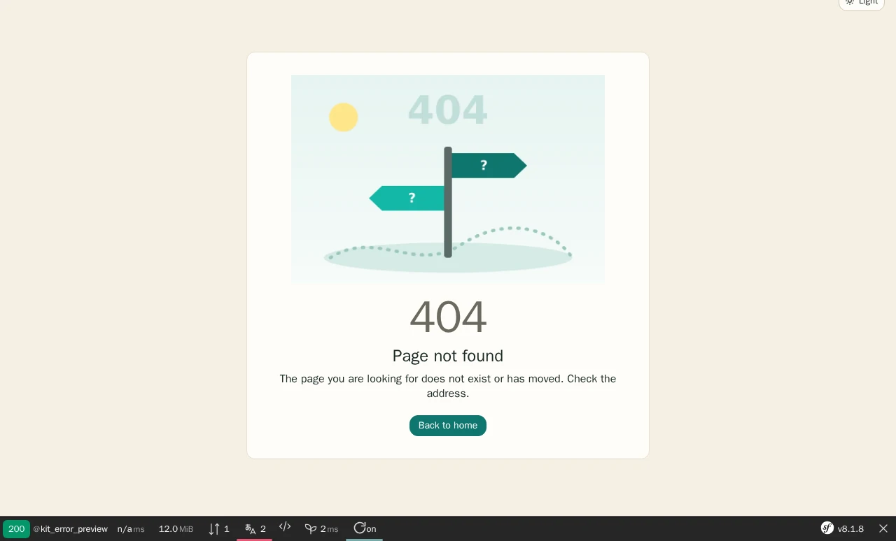
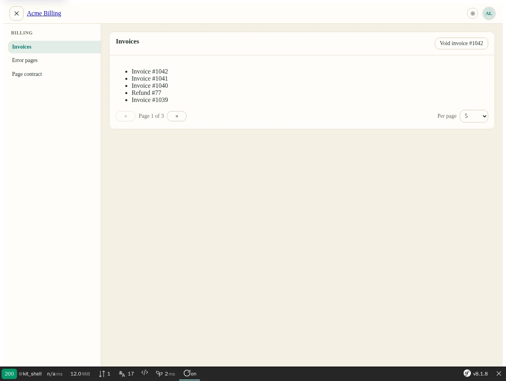
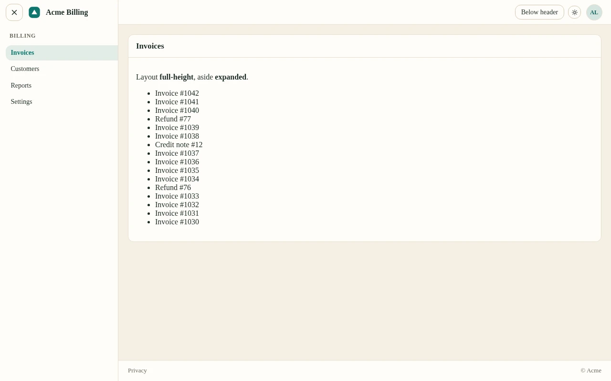
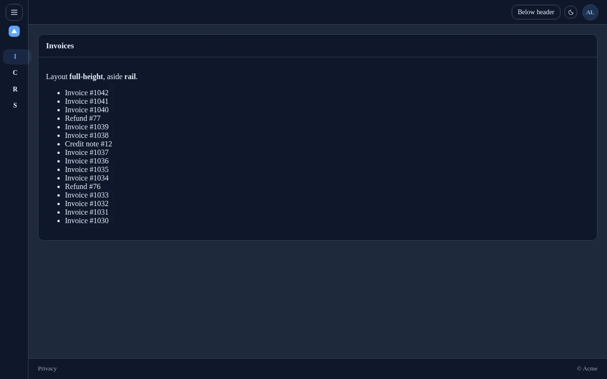
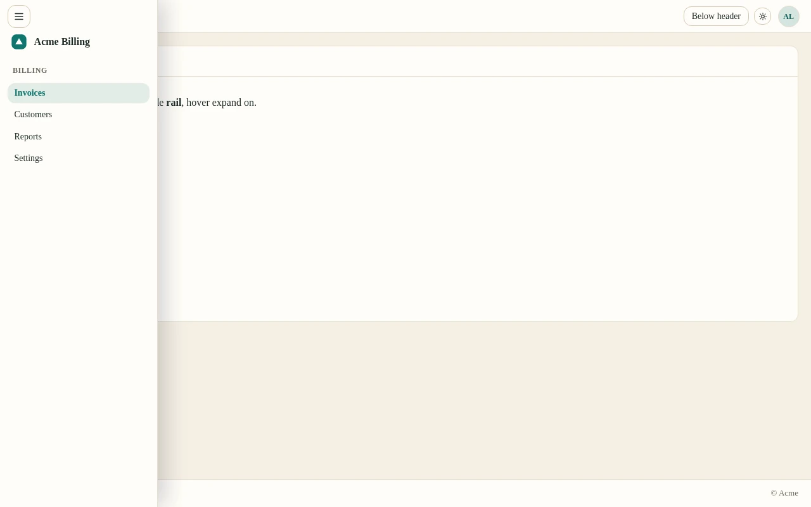

# Usage — Nowo UiKit Bundle

## Table of contents

- [Import macros](#import-macros)
- [Partials](#partials)
  - [Forms in the partials (REQ-TWIG-005)](#forms-in-the-partials-req-twig-005)
- [Assets](#assets)
- [Locale tabs (2.5)](#locale-tabs-25)
  - [Migrating your locale UI](#migrating-your-locale-ui)
- [Page loader and page transitions](#page-loader-and-page-transitions)
- [Open a modal on load (deep link)](#open-a-modal-on-load-deep-link)
- [Filter bar and data table (opt-in)](#filter-bar-and-data-table-opt-in)
- [List scaffold filter options (2.30)](#list-scaffold-filter-options-230)
- [Sortable column headers (2.20)](#sortable-column-headers-220)
  - [Server-side lists](#server-side-lists)
  - [Client-side tables](#client-side-tables)
  - [Host tables and customizable listings](#host-tables-and-customizable-listings)
- [Detail pages (2.21)](#detail-pages-221)
- [Live item attributes (2.23)](#live-item-attributes-223)
- [Pagination modes (2.23)](#pagination-modes-223)
- [Provider-dependent fields (2.23)](#provider-dependent-fields-223)
- [Host chrome (1.17, opt-in)](#host-chrome-117-opt-in)
  - [Responsive table](#responsive-table)
  - [Foldable filter card](#foldable-filter-card)
  - [Card corner tab](#card-corner-tab)
  - [Disclosure chevron](#disclosure-chevron)
  - [Back link](#back-link)
  - [Page-edge tab and route links](#page-edge-tab-and-route-links)
  - [Page-edge tabs on phones (2.41)](#page-edge-tabs-on-phones-241)
  - [Thin scrollbars](#thin-scrollbars)
  - [Morphicons (animated icons)](#morphicons-animated-icons)
- [Listing customizer](#listing-customizer)
  - [Host example](#host-example)
  - [Server-side store](#server-side-store)
  - [Multi-select filter (2.14)](#multi-select-filter-214)
  - [Date-range filter (2.15)](#date-range-filter-215)
- [Guided tour](#guided-tour)
- [Kit templates (2.6)](#kit-templates-26)
  - [Error pages](#error-pages-26)
    - [Error illustration provider (2.47)](#error-illustration-provider-247)
  - [Confirm dialog](#confirm-dialog-26)
  - [App shell](#app-shell-26)
  - [Full-height sidebar layout (2.32)](#full-height-sidebar-layout-232)
  - [Compact pagination](#compact-pagination-26)
  - [Auth panel brand (2.44)](#auth-panel-brand-244)
- [Pre-paint theme boot](#pre-paint-theme-boot)
- [App chrome](#app-chrome-aside-avatar-user-menu-footer)
  - [Avatars (2.26)](#avatars-226)
- [Sidebar rail (opt-in)](#sidebar-rail-opt-in)
- [Side panel and drawer (2.25)](#side-panel-and-drawer-225)
- [Remote form dialog (2.28)](#remote-form-dialog-228)
- [Small element options (2.34)](#small-element-options-234)
- [Focusable scroll regions (2.28)](#focusable-scroll-regions-228)
- [Dialog back button](#dialog-back-button)
- [Emoji picker](#emoji-picker)
- [Show more](#show-more)
- [Image crop](#image-crop)
  - [Image crop attribute contract](#image-crop-attribute-contract)
  - [How the crop is made (decisions)](#how-the-crop-is-made-decisions)
  - [Image crop accessibility contract](#image-crop-accessibility-contract)
  - [Host recipe: InstanceSettings image fields](#host-recipe-instancesettings-image-fields)
  - [Host recipe: avatars](#host-recipe-avatars)
- [Image input (2.47)](#image-input-247)
- [Sortable](#sortable)
- [Overlays and the shell (2.28)](#overlays-and-the-shell-228)
- [Menu semantics (2.28)](#menu-semantics-228)
- [Compact header (2.27)](#compact-header-227)
  - [Page header variants (2.39)](#page-header-variants-239)
- [Overriding templates (REQ-TWIG-001)](#overriding-templates-req-twig-001)
- [Override vs upgrade](#override-vs-upgrade)
- [Overridable `<subpath>` values](#overridable-subpath-values)
- [Freeze rule](#freeze-rule)
- [Procedure](#procedure)
- [Remap CSS tokens (theming)](#remap-css-tokens)
- [Using it from a DDD / hexagonal application](#using-it-from-a-ddd--hexagonal-application)
- [Feature bundles](#feature-bundles)
- [Kitchen sink](#kitchen-sink)
- [Related docs](#related-docs)

## Import macros

```twig


<button class="{{ ui.btn('primary') }}">Primary</button>
<button class="{{ ui.btn('danger', 'sm') }}">Delete</button>
{# Pass a framework override (feature bundle’s own css_framework): #}
<button class="{{ ui.btn('primary', null, 'tailwind') }}">Tailwind</button>

<div class="{{ ui.toolbar() }}">…</div>
<div class="{{ ui.table_wrap() }}"><table class="{{ ui.table() }}">…</table></div>
<span class="{{ ui.badge('success') }}">OK</span>
<div class="{{ ui.card() }}">…</div>
<div class="{{ ui.progress() }}"><div class="{{ ui.progress_bar() }}" style="width:40%"></div></div>
<span class="{{ ui.spinner('sm') }}"></span>
```

Macros always emit semantic `nowo-ui-*` classes. Named stacks also emit Bootstrap / Tailwind / Foundation classes. With `custom` or `none`, only `nowo-ui-*` remain.

`ui.badge()` keeps BC: `ui.badge('tailwind')` is still a framework override; `ui.badge('success')` / `ui.badge('danger', 'bootstrap5')` set variants.

Twig globals (from config):

- `nowo_ui_kit_css_framework`
- `nowo_ui_kit_icon_set`
- `nowo_ui_kit_row_actions_display`

## Partials

| Subpath | Purpose |
|---------|---------|
| `partials/_pagination.html.twig` | Server-side pagination |
| `partials/_empty.html.twig` | Empty state |
| `partials/_flashes.html.twig` | Inline Symfony flashes |
| `partials/_toasts.html.twig` | Fixed toast stack from flashes (string or `{title, message}`). 2.9: `toast_roles`, `timeouts`, `toast_classes`, `toast_type_classes` and the blocks `toast_attributes` / `toast_text` / `toast_dismiss_attributes` — see [Toasts in a host](#toasts-in-a-host) |
| `partials/_row_actions.html.twig` | Edit / delete / view / copy cluster (`display`: `icon` \| `text` \| `icon_text`) |
| `partials/_page_header.html.twig` | Title + intro + toolbar HTML |
| `partials/_tabs.html.twig` | Tab **link** nav (no JS). In-page panels: `nowo-ui-tabs.js` / Stimulus `tabs` peer. 2.16: `icon` per item; the host's `data-tab-style` (`text`, `icon-text`, `icon`) on `<html>` picks what shows |
| `partials/_filters.html.twig` | Search + apply/clear + actions slot |
| `partials/_filter_actions.html.twig` | Opt-in filter bar actions: optional pager row + Filter + Clear on one row. See [Filter bar and data table](#filter-bar-and-data-table-opt-in) |
| `partials/_open_modal_on_load.html.twig` | CSP-safe JSON island that opens a modal on load (`?new=1` deep link). See [Open a modal on load](#open-a-modal-on-load-deep-link) |
| `partials/_card.html.twig` | Card / panel (header/body/footer) |
| `partials/_modal_shell.html.twig` | Modal shell (Bootstrap-JS structure, kept for BC) |
| `partials/_dialog.html.twig` | Generic native `<dialog>` (2.1, framework-free; `data-nowo-ui-dialog-open="<id>"`, `js/nowo-ui-dialog.js`) — preferred in page-contract bundles. `placement: 'end'` / `'start'` (2.12) turns it into a full-height **side panel** sliding in from that edge; with `data-nowo-ui-dialog-src="<url>"` on the opener it loads the panel content on demand (help, manuals, customizers) while the opener's `href` stays the no-JS fallback |
| `partials/_confirm.html.twig` | Confirm `<dialog>` (host owns POST+CSRF) |
| `partials/_page_loader.html.twig` | Page loader: veil (`visual: spinner\|orb`) or minimal indicator (`bar`, `bar_loop`, `bar_spinner`, `corner_spinner`, `dots`, `glow`, `corner_mark`). See [Page loader and page transitions](#page-loader-and-page-transitions) |
| `partials/_page_transition.html.twig` | Cross-document page transitions (View Transitions, `<head>`, no JS) |
| `partials/_thinking_orb.html.twig` | Thinking orb canvas (`data-nowo-ui-orb`) |
| `partials/_release_version.html.twig` | Installed-version button + lazy GitHub release dialog (optional `release_check`; renders nothing while disabled). See [CONFIGURATION.md](CONFIGURATION.md#release-check) |
| `partials/_brand.html.twig` | Brand mark (text / img / SVG) |
| `partials/_theme_toggle.html.twig` | Light/dark toggle |
| `partials/_width_toggle.html.twig` | Main full width ↔ content toggle |
| `partials/_locale_switcher.html.twig` | Locale menu (host supplies URLs/forms) |
| `partials/_kebab.html.twig` | Overflow / kebab menu |
| `partials/_burger.html.twig` | Burger / aside toggle |
| `partials/_avatar.html.twig` | Avatar initials or image |
| `partials/_aside.html.twig` | Left sidebar (flat or nested `children`) |
| `partials/_aside_nav_items.html.twig` | Recursive nav items (internal) |
| `partials/_user_menu.html.twig` | Avatar dropdown + links + logout |
| `partials/_footer.html.twig` | Site footer |
| `partials/_shell.html.twig` | Composed chrome |
| `partials/_tour.html.twig` | Guided page tour (2.13): edge tab + Stimulus peer `product-tour` (driver.js). See [Guided tour](#guided-tour) |
| `components/_icon.html.twig` | Icon by `icon_set` |
| `macros/ui.html.twig` | Class macros |
| `demo/kitchen_sink.html.twig` | Full component showcase |

Example:

```twig

```

Row actions (inherits `nowo_ui_kit_row_actions_display`; override with `display`). Full contract: [ROW_ACTIONS.md](ROW_ACTIONS.md).

```twig


{# Visible labels instead of icon-only #}

```

Confirm trigger:

```twig
<button type="button" class="{{ ui.btn('danger') }}"
    {{ ui.confirm_toggle_attrs() }} {{ ui.confirm_target_attr('delete-item') }}>
    Delete
</button>

```

### Forms in the partials (REQ-TWIG-005)

UiKit views never print a hand-written `<form>` / `<input>` / `<select>` / `<textarea>`: every form renders through a
Symfony Form Type with `form_start`, the child loop (`{{ form_row(child)
}}`) and `form_end`. When a partial takes plain values instead of a `FormView`, UiKit builds the
Form Type itself (Twig `nowo_ui_form(kind, options)`, `Form\UiFormViews`, standalone factory with core types and the
`form_div_layout` + `form/nowo_ui_kit_fields.html.twig` themes only, so host themes do not change the markup):

| Partial | Form Type (2.19 unless noted) | Request (unchanged) |
| --- | --- | --- |
| `action` / `confirm` (POST `View\Action` with `csrfToken`) | `ActionCsrfType` (2.18) | POST, `csrfField` (`_token`), `_method` |
| `row_actions` (1.x hash, `method: POST`) | `HiddenFieldsType` | POST `href`, `csrf_field` = `csrf_token` |
| `user_menu` (`logout_path` + `logout_csrf`) | `HiddenFieldsType` | POST, `_csrf_token` |
| `locale_switcher` (entry with `form_action`) | `HiddenFieldsType` | POST, `csrf_field`, `redirect` |
| `filters` | `SearchFilterType` | GET (or `method`), `?q=` (`q_name`) |
| `pagination_compact` (per page) | `PerPageType` | GET, other query parameters + `per_page` |
| `segmented` (plain `name`) | `CheckboxType` view named `name` (`a` / `a[b]`) | same name and value |

Controllers keep validating with `isCsrfTokenValid()` on the same field. Without symfony/form (or its Twig extension),
or with a field name that is not a form field name (`token[x]`, `filter.status`, `tags[]`), the partials print their
2.x raw markup with a deprecation (removed in 3.0). Host overrides and demos must not reintroduce raw form markup:
`make check-no-raw-html-form` (part of `release-check`) fails on it outside the form themes, the deprecated
`*_legacy` fallbacks and `{# twig-005-ignore: … #}` controls that are never submitted (the nameless type-to-confirm
input).

## Assets

Named package **`nowo_ui_kit`** (REQ-ASSETS-004), `base_path` `/bundles/nowouikit`.

Sources are **TypeScript** under `src/Resources/assets/src/`, built with **Vite + pnpm** to `src/Resources/public/js/*.js` (REQ-ASSETS-001):

```bash
pnpm install
pnpm run build
```

```twig
<link rel="stylesheet" href="{{ asset('css/nowo-ui.css', 'nowo_ui_kit') }}">
<script src="{{ asset('js/nowo-ui-modal.js', 'nowo_ui_kit') }}" defer></script>
<script src="{{ asset('js/nowo-ui-shell.js', 'nowo_ui_kit') }}" defer></script>
<script src="{{ asset('js/nowo-ui-toast.js', 'nowo_ui_kit') }}" defer></script>
<script src="{{ asset('js/nowo-ui-confirm.js', 'nowo_ui_kit') }}" defer></script>
<script src="{{ asset('js/nowo-ui-page-loader.js', 'nowo_ui_kit') }}" defer></script>
<script src="{{ asset('js/nowo-ui-clipboard.js', 'nowo_ui_kit') }}" defer></script>
<script src="{{ asset('js/nowo-ui-tabs.js', 'nowo_ui_kit') }}" defer></script>
<script src="{{ asset('js/nowo-ui-theme.js', 'nowo_ui_kit') }}" defer></script>
{# nowo-ui-theme-boot.js: blocking, in <head> — prefer partials/_theme_boot.html.twig (inline + nonce) #}
<script src="{{ asset('js/nowo-ui-orb.js', 'nowo_ui_kit') }}" defer></script>
<script src="{{ asset('js/nowo-ui-release.js', 'nowo_ui_kit') }}" defer></script>{# only with release_check #}
<script src="{{ asset('js/nowo-ui-open-modal.js', 'nowo_ui_kit') }}" defer></script>{# only with _open_modal_on_load #}
```

Strict CSP: kit scripts are external files (no inline JS, no `on*=` handlers). When your CSP uses nonces, pass the per-request nonce your app stores in the request attribute `csp_nonce`: `nonce="{{ app.request.attributes.get('csp_nonce') }}"`.

Run `php bin/console assets:install` after install/update.

`nowo-ui-modal.js` handles `data-nowo-modal-open` / `data-nowo-modal-close` for `custom` / `none` / `tailwind`. Bootstrap stacks use `data-bs-*` and do not require this script for open/close.

`nowo-ui-shell.js` toggles the left aside via `data-nowo-ui-burger`, nested groups via `data-nowo-ui-nav-group-toggle`, and main width via `data-nowo-ui-width-toggle`.

`nowo-ui-clipboard.js` copies via `data-nowo-ui-clipboard*` (text or same-origin URL). `nowo-ui-tabs.js` switches in-page panels via `data-nowo-ui-tabs*` (Twig `_tabs` remains link navigation); 2.5: keyboard, `invalid`, `nowo-ui:tabs:change`, nesting and morph re-sync — see [Locale tabs](#locale-tabs-25).

`nowo-ui-release.js` lazily fetches the release-status JSON the first time a `dialog[data-nowo-ui-release]` opens (`_release_version.html.twig`).

Optional Stimulus peers: `src/Resources/assets/stimulus-peers/` — see [STIMULUS.md](STIMULUS.md).

`nowo-ui-orb.js` mounts Thinking Orbs on `canvas[data-nowo-ui-orb]` (local MIT canvas engine; no CDN). Use `_thinking_orb.html.twig` or `_page_loader.html.twig` with `visual: 'orb'`.

## Locale tabs (2.5)

One panel per locale behind a WAI-ARIA tab list: the shared building block for every per-locale CRUD field (title /
body / slug / SEO text per language). FormKit 2.13+ renders its `locale_tabs` option and `TranslatableMapType` through
this partial when UiKit is installed; hosts and bundles with their own markup call it directly.

```twig


    
        {{ form_row(form['name_' ~ locale]) }}
        {{ form_row(form['description_' ~ locale]) }}
    
    

{{ include(nowo_ui_partial('locale_tabs'), {
    id: 'permission-i18n',
    panels: panels,
    default_locale: 'es',
    required_locales: ['es'],
}, false) }}
```

Load `js/nowo-ui-tabs.js` (the `scripts` partial and the UiKit layouts already do) and `css/nowo-ui.css`.

| Parameter | Default | Notes |
|---|---|---|
| `panels` | — (required) | list of `{locale, content, label?, name?, invalid?, required?, dir?, attr?}`. `content` is the panel HTML: a Twig `Markup` (a `…` capture) prints as is, a plain string is escaped. `label` = tab text (default `ES`), `name` = language name for the legend and screen readers (default `nowo_ui_locale_name(locale)`), `dir` default `nowo_ui_locale_dir(locale)` |
| `id` | random | DOM prefix: tab ids `<id>-<locale>`, buttons `tab-<id>-<locale>`, panels `tab-<id>-<locale>-panel` |
| `label` | `locale_tabs.label` ("Languages") | `aria-label` of the tab list (`Label` or string) |
| `default_locale` | first panel | ★ marker + "default language" for screen readers; listed first (`default_first: false` keeps the given order) |
| `required_locales` | `[]` | `*` marker + "required" (a panel's own `required` wins) |
| `active_locale` | request locale when listed, else `default_locale` | initially open panel |
| `activate_invalid` | `true` | open the first invalid panel when the active one has no errors |
| `mark_default`, `default_marker`, `required_marker`, `error_marker` | `true`, `★`, `*`, `!` | visible markers (always `aria-hidden`, the meaning is in the screen-reader text) |
| `legend` | `true` | `<legend>` per panel (the heading of the no-JS view, visually hidden once tabs are active) |
| `progressive` | `true` | `false`: tab list visible and inactive panels `hidden` server-side (needs JS to switch, like the 1.x tabs) |
| `stimulus` | `false` | Stimulus identifier (e.g. `'tabs'`) to also emit the peer attributes (`data-controller`, targets `trigger` / `tab` / `list`, `click->tabs#open`) |
| `attr`, `bundle` | | root attributes (no `on*`); per-bundle theme exceptions |

Behaviour:

- **No JavaScript**: every panel is visible as a stacked `<fieldset>` with its `<legend>` ("Spanish ES ★ *"); the
  tab list is `hidden`. `nowo-ui-tabs.js` upgrades the root (`data-nowo-ui-tabs-upgrade` → `data-nowo-ui-tabs-ready`):
  shows the tab list, gives the panels `role="tabpanel"` / `aria-labelledby`, hides the inactive ones.
- **Keyboard** (role `tab` triggers): `ArrowRight` / `ArrowLeft` next / previous with wrap-around (mirrored when the
  tab list is right-to-left), `Home` / `End`, roving `tabindex` (only the selected tab is in the Tab order).
- **Errors**: `invalid: true` marks the tab (`data-invalid`, `!`, "contains errors" in the accessible name) and the
  panel (`data-invalid`). Put `aria-invalid="true"` on the invalid controls themselves (FormKit does it).
- **Browser validation**: when a submit finds an invalid control in a hidden panel, the runtime opens that panel (and
  its parent panels) inside the `invalid` event, so the browser can focus the control and show its message.
- **`nowo-ui:tabs:change`** (bubbling `CustomEvent` on the root): `detail = {tabId, previousTabId, trigger, panel,
  reason}` with `reason` `click` | `keyboard` | `invalid` | `api`. Mount editors that need a visible container there:

  ```js
  document.addEventListener('nowo-ui:tabs:change', (event) => {
    event.detail.panel?.querySelectorAll('[data-editor]:not([data-mounted])').forEach(mountEditor);
  });
  ```

- **Nesting**: each root drives only its own triggers and panels (the nearest `[data-nowo-ui-tabs]`).
- **Live Component / Turbo morph**: a re-render that writes the server attributes back keeps the tab the user chose
  (and re-upgrades the root); new roots inserted later (remote dialogs) are upgraded too.
- **Strict CSP**: no inline script / style / `on*`. `lang` and `dir` are set on each panel (Arabic, Hebrew, Persian,
  Urdu… panels get `dir="rtl"`).
- Theme slots `locale_tabs_nav` (list: the `tabs` look without its bottom margin, 2.5.3), `tab` / `tab_active` (buttons; the runtime swaps both class sets, passed as
  `data-nowo-ui-tabs-tab-class` / `data-nowo-ui-tabs-tab-active-class`), `tab_panel` (panels); tokens
  `--nowo-ui-locale-tabs-gap`, `--nowo-ui-locale-tabs-default`.

`window.nowoUiActivateTab(root | id | selector, tabId)` selects a tab from code (reason `api`).

### Migrating your locale UI

Per-bundle tab markup (own `_locale_tabs.html.twig`, Bootstrap `nav-tabs` + CDN JS, `.as-locale-tab` scripts, radio
hacks, stacked fieldsets) becomes one include. Before:

```twig
<ul class="nav nav-tabs" role="tablist">
  
    <li class="nav-item"><button class="nav-link{{ loop.first ? ' active' }}" data-bs-toggle="tab"
        data-bs-target="#t-{{ locale }}" type="button">{{ locale|upper }}</button></li>
  
</ul>
<div class="tab-content">
  
    <div class="tab-pane{{ loop.first ? ' active' }}" id="t-{{ locale }}">{{ form_row(form['title_' ~ locale]) }}</div>
  
</div>
```

After (no Bootstrap JS, works without JS, keyboard and error states included):

```twig


    {{ form_row(form['title_' ~ locale]) }}
    

{{ include(nowo_ui_partial('locale_tabs', 'NowoBlogKitBundle'), {id: 'article-title', panels: panels, default_locale: default_locale, bundle: 'NowoBlogKitBundle'}, false) }}
```

With FormKit installed, prefer its `locale_tabs` option / `TranslatableMapType` (they build the panels for the three
usual shapes: a list of translation entities, `field_<locale>` groups and a JSON `{locale: text}` map) — see
FormKit's [USAGE](https://github.com/nowo-tech/FormKitBundle/blob/main/docs/USAGE.md#locale-tabs). Replace a
`locale-tabs:changed` editor hook with `nowo-ui:tabs:change`.

## Page loader and page transitions

The veil (`visual: spinner` / `orb`) suits slow admin screens. Public sites usually want a **minimal** indicator that never
blocks the page and stays invisible on fast loads:

```twig

```

Tune colour and corner position with CSS variables on `.nowo-ui-page-loader--minimal`:
`--nowo-ui-page-loader-color` (default `--nowo-ui-primary`), `--nowo-ui-page-loader-corner-bottom`,
`--nowo-ui-page-loader-corner-left` (e.g. add a fixed footer height).

Cross-page fades: include once in `<head>` on every page that should take part (both pages must opt in):

```twig

```

It renders a single `<style>` with the request `csp_nonce` (or `nonce:`), so it works under a strict CSP. Browsers
without cross-document View Transitions (e.g. Firefox today) navigate as usual; `prefers-reduced-motion: reduce`
disables it.

## Native `<dialog>` modals in `nowo-ui-modal.js` (2.33)

`js/nowo-ui-modal.js` (the `modal_shell` stacks without Bootstrap) also drives a modal whose root is a native
`<dialog class="nowo-ui-modal">`: opening adds `nowo-ui-modal-open` **and** calls `showModal()` (top layer, `::backdrop`,
native Escape — no portal to `<body>` needed), closing calls `close()`, a native close (Escape, `method="dialog"`)
removes the class, and focus returns to the trigger. A trigger names its modal with `data-nowo-modal-target="<id>"` or,
without it, `data-nowo-modal-open="<id>"` (a leading `#` is ignored; a trigger whose modal is missing keeps its
default action). The document listeners are bound once per page even when the script is loaded twice (IIFE + a host
bundle). `<div>` roots behave as before.

## Open a modal on load (deep link)

Links such as `/admin/items?new=1` can land on the list with the create form already open, without inline JS.
Render the island (only emitted when the request carries the parameter) and load the script after the kit modal scripts:

```twig

<script src="{{ asset('js/nowo-ui-open-modal.js', 'nowo_ui_kit') }}" defer></script>
```

Output: `<script type="application/json" id="nowo-ui-open-modal-on-load">{"modal":…,"trigger":…,"clearParam":"new"}</script>`
(JSON with `<`, `>`, `&`, quotes hex-escaped; request `csp_nonce` or `nonce:` added — the island never executes).
The script clicks the trigger (when given), falls back to opening the modal directly (`<dialog>.showModal()` or the
`nowo-ui-modal-open` class, plus a `show.bs.modal` event with `relatedTarget`), retries every 50 ms for up to 2 s while
kit scripts boot, then removes `?new` from the URL (`history.replaceState`). `window.nowoUiOpenModalOnLoad()` re-runs it.

Vite / Encore hosts can import the side-effect-free helpers instead of loading the IIFE:

```ts
import { openModalOnLoad } from '../vendor/nowo-tech/ui-kit-bundle/src/Resources/assets/src/nowo-ui-open-modal-core';

document.readyState === 'loading'
  ? document.addEventListener('DOMContentLoaded', () => openModalOnLoad())
  : openModalOnLoad();
```

Exports: `OPEN_MODAL_ISLAND_ID`, `readOpenModalConfig(doc, islandId?)`, `isModalOpen(el)`, `tryOpenModal(doc, config)`,
`clearQueryParam(win, param)`, `openModalOnLoad(doc?, win?, maxTries = 40, intervalMs = 50)`.

## Filter bar and data table (opt-in)

New classes only — nothing changes for markup that does not use them.

- **`.nowo-ui-filter-bar`** on the filter `<form>`: flex row, fields and actions aligned on the bottom edge, every
  single-line input / select and the Filter / Clear buttons get one explicit height (`--nowo-ui-control-height`,
  default 38px — WebKit selects are otherwise taller). Compact (34px, `--nowo-ui-control-height-compact`):
  `.nowo-ui-filter-bar--compact` or `[data-ui-density="compact"]` on an ancestor.
  Helpers: `__field` (`--search` wider), `__help` (visually hidden help kept for `aria-describedby`), `__actions`,
  `__actions--pager` (pager + Filter + Clear never split), `__pager`, `__submit`, `__clear`.
- **`table.nowo-ui-data-table`**: one header / cell contract for list tables (uppercase muted headers, row hover,
  no border on the last row; works next to `.nowo-ui-table` / Bootstrap `.table`). Tokens
  `--nowo-ui-table-head-py`, `--nowo-ui-table-cell-py`, `--nowo-ui-table-cell-px`, `--nowo-ui-table-font-size`,
  `--nowo-ui-table-head-font-size`; compact via `.nowo-ui-data-table--compact` or `[data-ui-density="compact"]`.

```twig
<form method="get" class="nowo-ui-filter-bar">
    <div class="nowo-ui-filter-bar__field nowo-ui-filter-bar__field--search">{{ form_widget(form.q) }}</div>
    <div class="nowo-ui-filter-bar__field">{{ form_widget(form.status) }}</div>
    
</form>

<table class="nowo-ui-data-table">…</table>
```

`_filter_actions` options: `pager` (pre-rendered trusted HTML — no Symfony Form dependency in the kit), `clear_href`,
`submit_label` / `clear_label` (default `filters.apply` / `filters.clear`), `submit_class` / `clear_class`
(default `ui.btn('primary')` / `ui.btn('secondary')`), `framework`.

Icon actions (1.15): `submit_icon` / `clear_icon` render an icon through `components/_icon.html.twig`
(`nowo_ui_kit.icon_set`; canonical kinds such as `filter` / `close`, or any icon name of the set) before the label.
`icon_only: true` hides the visible label of the buttons that have an icon: the label stays as a visually-hidden
text, `title` and `aria-label`, and the button becomes square (`.nowo-ui-filter-bar__action--icon-only`). Without
any icon option the output is unchanged.

```twig

```

Recommended icon-only pair (1.17): **Filter** = funnel, **Clear filters** = funnel with a slash. With
`icon_set: ux_icon` pass the Tabler names directly; with the other sets use the canonical kinds `filter` /
`filter_off` (1.17: `ti ti-filter-off`, Bootstrap Icons `bi-x-circle`, inline SVG funnel with a slash):

```twig

```

## List scaffold filter options (2.30)

The list scaffold's filter card (`page/_list_filters.html.twig`, partial `list_filters`) takes host options from
`nowo_ui_kit.theme.pages.list.filters` and per-call options from `ListPage`, so a host gets its filter card (fold
toggle, icon-only buttons, grid) **without overriding the `list_filters` partial**. Unset, the output is byte-identical
to 2.29 (`tests/Unit/PageContract/ListFilters230BcTest.php`, fixtures `tests/Fixtures/bc-2.29`).

```yaml
# config/packages/nowo_ui_kit.yaml — e.g. Symfony Beacon's filter card
nowo_ui_kit:
    theme:
        pages:
            list:
                filters:
                    display: icon                                   # text | icon | icon_text (null = 2.29)
                    submit_icon: 'tabler:filter'                    # default filter
                    clear_icon: 'tabler:filter-off'                 # default filter_off (plain clear link)
                    submit_class: 'btn-primary btn-icon issue-filters__submit'
                    clear_class: 'btn-ghost btn-icon issue-filters__clear'
                    grid: 'repeat(auto-fill, minmax(min(100%, 13rem), 1fr))'   # or auto-fit (default) / auto-fill
                    fold:
                        enabled: true
                        cookie: beacon_filters_collapsed            # default nowo_ui_filters_collapsed
                        cookie_path: /                              # default /
                        icons: { expanded: 'tabler:chevron-up', collapsed: 'tabler:chevron-down' }
                        testids: true                               # filters-collapse-toggle / -summary
                        morph: true                                 # <morph-icon> (assets/morphicons)
```

| Option | Effect |
| --- | --- |
| `display` | default of `ListPage::filtersDisplay` for the apply / clear / extra filter buttons (`ListPage::filtersDisplay` and `Action::display` win). Set, the plain clear link (`filtersClearHref`) follows it too (2.29: text only). Icon-only buttons keep a visually hidden label plus `aria-label` / `title` from the translations (`filters.apply`, `filters.clear`, or the Action label) and get the `btn_icon` slot; `icon_set: none` keeps text |
| `submit_icon` / `clear_icon` | icons (names for `components/_icon.html.twig`) of the apply button and the plain clear link; `filtersSubmit->icon` wins |
| `submit_class` / `clear_class` | host classes **replacing** the `btn_<variant>` slot classes of the apply button and of the clear button (plain link or `filtersClear` Action); the hooks `nowo-ui-filters__submit` / `nowo-ui-action--<kind>` and, icon-only, the `btn_icon` slot stay |
| `grid` | `auto-fit` (default: a lone filter stretches across the card), `auto-fill` (modifier class `nowo-ui-filters--grid-auto-fill`: empty tracks keep their width) or a `grid-template-columns` track list, printed as the token `--nowo-ui-filters-grid-columns` by `nowo_ui_tokens()` (no inline style; validated: letters, digits, spaces and `. , % ( ) + * / -`, balanced parentheses, no `url()`, no `/*` or `*/`, at most 200 characters). An explicit `theme.tokens.filters-grid-columns` wins |
| `fold` | the fold toggle of `partials/_filters_collapse.html.twig` as the first child of the form: a `<button aria-expanded aria-controls="<form id>">` (the form gets `id="nowo-ui-filters-<form name>"` unless the `filters` slot attributes give one), the "N active filters" line while folded, the state in a cookie of page keys (`SameSite=Lax`, one year, no secrets; the 50 most recently folded pages) read on render so a folded card renders folded |

Per call (`ListPage`, win over the host): `filtersFold` (`true` / `false`; null = `fold.enabled`), `filtersFoldKey`
(the page key remembered in the cookie; default the current route; letters, digits, `_ . : -`), `filtersGrid`
(`auto-fit` | `auto-fill`; a track list is host-only), `filtersDisplay`.

```php
new ListPage($header, $columns, $rows, $filters->createView(), filtersClearHref: $this->generateUrl('orders'),
    filtersFold: true, filtersFoldKey: 'orders', filtersGrid: 'auto-fill');
```

The fold toggle needs the **`filters-collapse` Stimulus peer** registered in the host app
(`app.register('filters-collapse', FiltersCollapseController)`, [STIMULUS.md](STIMULUS.md)). Without JavaScript the
card renders open (the cookie is only ever written by the peer) and the button does nothing; the fields always submit.

## Sortable column headers (2.20)

Click-to-sort headers for the list scaffold (`View\ListPage`), the `table` partial (`View\Table`), `listing_head` and
host-written tables. Opt-in: a table without sort information renders exactly as before.

- **Server side** (paginated lists, the default): the header is a link to the same route with `sort` / `dir`, the
  current filters and rows per page kept, the page parameter dropped (a new order starts on page 1).
- **Client side** (tables rendered whole — never a paginated one): the header is a `<button>` and the Stimulus peer
  `table-sort` reorders the rows without a request.

Both render through the theme partial `sort_header`: the column label, a direction arrow (canonical icons `sort` /
`sort_asc` / `sort_desc` of `nowo_ui_kit.icon_set`; neutral arrows while the column is not the sorted one) and a
visually hidden hint ("Sort ascending" / "Sort descending", `table.sort.hint_asc` / `hint_desc` in the 7 locales). The
sorted `<th>` carries `aria-sort`. No inline styles or scripts (CSP); light / dark through the `--nowo-ui-*` tokens
(`--nowo-ui-sort-hover`, `--nowo-ui-sort-icon-opacity`); slots `sortable_header`, `sort_link`, `sort_button`.

Columns declare what sorts: `new Column('name', 'Name', sortable: true)` sorts by the column key;
`sortKey: 'created'` sends another whitelisted key, `sortFirst: 'desc'` makes the first click descending (dates,
counts). With `icon_set: ux_icon`, commit `bi:arrow-down-up`, `bi:arrow-up` and `bi:arrow-down`
(`bin/console ux:icons:import bi:arrow-down-up bi:arrow-up bi:arrow-down`) or pass `tabler:` names through the
partial's `icons` option.

### Server-side lists

`Listing\SortRequest` validates the query against a whitelist (key => first-click direction): an unknown key falls back
to the default sort (never a 400), an unknown direction to the key's first-click one. Order the query by
`$sort->field` / `$sort->direction` with a stable tie-breaker:

```php
use Nowo\UiKitBundle\Listing\SortRequest;

$columns = [
    new Column('name', 'Name', sortable: true),
    new Column('created', 'Created', sortable: true, sortFirst: 'desc'),
    new Column('notes', 'Notes'),
];
$sort = SortRequest::fromRequest($request, SortRequest::fieldsOf($columns), 'created');
// e.g. ->orderBy(['name' => 'i.name', 'created' => 'i.createdAt'][$sort->field], $sort->direction)->addOrderBy('i.id', $sort->direction)
$items = $repository->search($filters, $sort->field, $sort->direction, $page);

return $this->render('@NowoUiKit/page/list.html.twig', ['page' => new ListPage(
    new PageHeader('Items'), $columns, $items,
    pagination: new Pagination($page, 25, $total, route: 'app_items'),
    sorting: $sort,
)]);
```

- `fromRequest($request, $fields, $defaultField = null, $defaultDirection = null, $sortParam = 'sort',
  $directionParam = 'dir', $pageParam = 'page')`; `fromQuery()` takes raw values; `fieldsOf()` reads the whitelist
  from `Column`s, `ListingField`s or a `ListingDefinitionInterface`.
- `query()` (`['sort' => …, 'dir' => …]`) keeps the order elsewhere: the list scaffold's pagination already keeps the
  request query; a GET filter form keeps it with two hidden fields (e.g. `HiddenType` children `sort` / `dir` filled
  from `$sort->query()`, or `Form\HiddenFieldsType`).
- `sortRows($rows, $extractors)` sorts rows built in PHP (before paging): empty values last, stable, natural
  case-insensitive strings; an extractor is a key / property name or a callable.
- `ListPage` uses the pagination's `pageParam`; a plain `Table` drops `SortRequest::$pageParam` (`null` keeps it).
  The `table` partial links to `route` (default the current route).
- 1.x `sort:` / `direction:` arguments still work (links to `sort` / `direction`, now also back to page 1).

### Client-side tables

```php
new Table($columns, $allRows, clientSort: true);                 // or ListPage(..., clientSort: true) without pages
new Column('size', 'Size', sortable: true, sortType: 'number', sortValueKey: 'bytes', sortFirst: 'desc');
```

The `<table>` gets `data-controller="table-sort"` (merged with a `data-controller` in `attributes`); sortable headers
get `data-sortable` (+ `data-sort-type`, `data-sort-first`) and a `<button data-action="table-sort#sort">`; default cells
print `data-sort-value` from `sortValueKey` (a timestamp behind a formatted date, bytes behind "2.4 MB"). Overridden
cells add `data-sort-value` themselves. A `sort` / `sorting` marks the initial order (rows already in that order).
`ListPage` rejects `clientSort` with more than one page. Register the peer (see [STIMULUS.md](STIMULUS.md#table-sort-220)):

```js
import TableSortController from '../vendor/nowo-tech/ui-kit-bundle/src/Resources/assets/stimulus-peers/table_sort_controller';
app.register('table-sort', TableSortController);
```

### Host tables and customizable listings

Hand-written `<th>` (e.g. inside `_responsive_table`): include the partial and set `aria-sort` yourself:

```twig
<th scope="col" aria-sort="{{ sort.direction == 'asc' ? 'ascending' : 'descending' }}">
    {{ include(nowo_ui_partial('sort_header'), {
        label: 'Name',
        href: path('app_items', sort.linkQuery('name', app.request.query.all)),
        active: sort.isActive('name'),
        direction: sort.direction,
        next_direction: sort.nextDirection('name'),
    }, false) }}
</th>
{# client side: <th data-sortable> + include(nowo_ui_partial('sort_header'), {label: 'Name'}) on a table-sort <table> #}
```

Customizable listings: `new ListingField('total', 'Total', sortKey: 'total', sortFirst: 'desc')`, then
`listing_head` with `sorting: sort` (server links; a `head_<key>` block still wins) or `client_sort: true` (buttons on
single-column headers).

## Detail pages (2.21)

The pattern Symfony Beacon standardised for the page of one record (a monitor, an order, a project): one header row
with the title, a **status badge** next to it and the **actions** on the right — square icon buttons for the frequent
ones, at most one primary button, everything else in a square **"more"** menu with the destructive actions last —,
then a compact **row of key figures** and a **details grid**. Every piece is opt-in; pages that use none of them keep
their 2.20 markup.

```php
use Nowo\UiKitBundle\View\{Action, Confirm, DetailItem, DetailSection, Label, PageHeader, PageStatus, ShowPage, Stat};

$t = static fn (string $key): Label => new Label($key, 'AcmeMonitorBundle');
$header = new PageHeader($monitor->name, $monitor->url, [
    Action::edit($editUrl, $t('action.edit'))->asIcon(),                         // icon button (aria-label + title)
    (new Action('custom', $t('action.pause'), $pauseUrl, method: 'POST', csrfToken: $token))->asIcon('pause'),
    (new Action('share', $t('action.share'), dialogId: 'share-monitor'))->asIcon(),
    Action::create($checkUrl, $t('action.check_now')),                           // the one primary button
    new Action('export', $t('action.export'), $exportUrl),                        // "more" menu
    Action::delete($deleteUrl, $token, Confirm::delete($t('confirm.delete'))),    // "more" menu, last, red, confirm dialog
], status: new PageStatus($t('status.up'), 'success', $t('status.checked_ago')), actionsLayout: 'split');

return $this->render('@NowoUiKit/page/show.html.twig', ['page' => new ShowPage(
    $header,
    [new DetailSection($t('section.details'), [new DetailItem($t('field.interval'), '1 min'), new DetailItem($t('field.type'), 'HTTP')], layout: 'facts')],
    stats: [new Stat($t('stat.uptime'), '99.98 %', tone: 'success'), new Stat($t('stat.response'), '182 ms', $t('stat.p95'))],
)]);
```

- **Status** (`PageStatus`): label (translated by the host: `Label` or string), tone `success` / `danger` / `warning` /
  `neutral` / `info` (badge slots), optional `title` tooltip. The `page_status` partial renders it next to the title.
- **Split actions** (`actionsLayout: 'split'`, `HeaderActions::split()`): actions with `display: icon`
  (`asIcon()`, `withDisplay('icon', $icon)`) become icon buttons in their order; the first other `primary` action
  (Create, Save…) is the filled button; the rest goes to the menu (GET actions as links, POST / confirm / dialog
  actions as items), destructive ones (variant `danger`, e.g. `Action::delete()`) last and in red. Their confirm
  dialogs render after the menu, outside the popover panel. The toggle is a square icon button (`menu` partial
  `square: true`) of the same size as the icon buttons. Hidden actions are dropped.
- **Outside the scaffolds**, include the partial with the actions (or a prebuilt `HeaderActions`) and, for host buttons
  that are not `Action`s (a share dialog with a count, a watch toggle), `extra` markup placed after the icon buttons:

  ```twig
  {{ include('monitor/_watch_toggle.html.twig') }}
  {{ include(nowo_ui_partial('header_actions'), {actions: header.actions, extra: extra, more_label: 'monitor.more'|trans}, false) }}
  ```

- **Key figures** (`Stat`: label, value, hint, tone, href): `ShowPage::$stats` or the `stat_row` partial
  (`{items: stats, label: 'Key figures'}`) — a `<dl>` of compact tiles that auto-fit the row.
- **Details grid**: `DetailSection(..., layout: 'facts')` or `{{ include(nowo_ui_partial('detail_list'), {items: items,
  modifier: 'facts'}, false) }}` — label over value, several per row (framed outside a card with
  `--nowo-ui-detail-facts-padding` / `--nowo-ui-detail-facts-border-width`).
- Theme slots `page_title_row`, `page_status`, `header_actions`, `menu_toggle_square`, `stat_row`, `stat`,
  `stat_label`, `stat_value`, `stat_hint`, `detail_list_facts` ([THEME_SLOTS](THEME_SLOTS.md)); tokens in
  [THEMING](THEMING.md#detail-pages-221). With `icon_set: ux_icon`, commit `bi:three-dots-vertical` (icon `more`).

## Live item attributes (2.23)

`View\Stat`, `View\PageStatus` and `View\DetailItem` (the `facts` cells and list items) take optional host attributes,
so a page that updates its figures live (polling, Mercure) finds them without extra wrappers:

```php
$header = $header->withStatus(new PageStatus('Up', 'success', attributes: ['data-detail-status' => 'up']));
new Stat('Uptime 24h', '99.98 %', attributes: ['data-stat' => 'uptime'], valueAttributes: ['data-uptime-24h' => '99.98']);
new DetailItem('Last check', '10:41', attributes: ['data-fact' => 'last-check'], valueAttributes: ['data-last-check' => $iso]);
```

- `Stat::attributes` go on the tile `<div>`, `Stat::valueAttributes` on the value `<dd>`;
  `PageStatus::attributes` on the badge `<span>`; `DetailItem::attributes` on the item `<div>` (any layout) and
  `DetailItem::valueAttributes` on its `<dd>`.
- Validated like `Action` attributes (`Action::assertAttributes()`: valid names, no `on*` handlers, scalar / bool /
  null values; `false` / `null` drop the attribute, `true` prints it bare) and printed escaped with
  `nowo_ui_html_attrs`.
- Empty (the default): the markup is byte-identical to 2.22.

## Pagination modes (2.23)

`View\Pagination` has a `mode`: `pager` (default, unchanged markup), `infinite` or `responsive`:

```php
$pagination = Pagination::fromRequest($request, $total)->withMode('infinite');
// phones scroll, desktops page: infinite below the breakpoint, pager above
$pagination = Pagination::fromRequest($request, $total)->withMode('responsive', narrow: 'infinite', wide: 'pager', breakpoint: '(max-width: 900px)');
```

`withMode(mode, narrow, wide, breakpoint, autoLoads)`; constructor / `fromArray()` keys `mode`, `mode_narrow`,
`mode_wide`, `breakpoint`, `auto_loads`; a 1.x `_pagination` include takes `pagination_mode`, `mode_narrow`,
`mode_wide`, `breakpoint`, `auto_loads` variables.

- The `pagination` / `pagination_compact` partials **always** render the pager links: they are the no-JS fallback. A
  mode other than `pager` adds the `list-pagination` peer contract (`partials/_pagination_mode.html.twig`): root
  attributes `data-controller="list-pagination"`, `data-nowo-ui-pagination-mode|-narrow|-wide|-query|-auto|-next`, a
  hidden "Load more" region and a polite live region. The list scaffold marks its `<tbody>` with
  `data-nowo-ui-list-rows`; a host list marks its own row container.
- Register the peer (`stimulus-peers/list_pagination_controller.ts`, identifier `list-pagination`). In `infinite` it
  hides the links, shows "Load more" (always there for keyboard users and browsers without IntersectionObserver),
  loads the next page when the end of the list scrolls into view (`autoLoads` times, default 3; then the button only),
  and appends **only** the rows of `[data-nowo-ui-list-rows]` from the next page's full HTML (the same URL as the
  "next" link: same filters, sort and per_page). Hosts change no query and add no endpoint: each fetch is one normal
  page request (no N+1). The row confirm dialogs of the new rows come along; `?page=` is updated with
  `history.replaceState`; "N more rows loaded" is announced; focus stays on the button (on the last page it moves to
  the first new row); the event `nowo-ui:rows-appended` (bubbles, detail `{rows, page, url}`) lets other scripts set up
  the new rows (Stimulus connects controllers by itself).
- `responsive` switches live on `matchMedia` change; going back to `pager` stops loading and keeps the rows already
  appended. Phone "cards" mode applies to the appended rows like to the first ones.
- The fetch carries `X-Nowo-Ui-Pagination: 1` and `Accept: text/html`; only same-origin next URLs load, redirects
  are refused (`redirect: 'error'`) and a non-`basic` / off-origin response is rejected. Imported rows, dialogs and
  links go through the fragment filter ("Fragment trust" below), nested `<template>` content included, and also lose
  `srcdoc` and script URLs of `src`, `data` and `poster`.

## Provider-dependent fields (2.23)

Fields that only apply to one value of another field (SMTP host for `smtp`, API key for `ses`) are hidden — never
disabled — by the `visible-when` peer (`stimulus-peers/visible_when_controller.ts`). It is a distinct mode from a
disabling "field visibility": hidden inputs are still submitted and their stored values survive a switch; a secret
field keeps "blank = keep". Without JavaScript every field is visible.

```php
use Nowo\UiKitBundle\Form\VisibleWhen;

$builder = $factory->createNamedBuilder('settings', FormType::class, $data, ['attr' => VisibleWhen::containerAttributes()])
    ->add('provider', ChoiceType::class, ['choices' => ['SMTP' => 'smtp', 'SES' => 'ses']])
    ->add('smtp_host', TextType::class, ['row_attr' => VisibleWhen::attributes('settings[provider]', ['smtp'])])
    ->add('api_key', PasswordType::class, ['row_attr' => VisibleWhen::fromOption(['field' => 'settings[provider]', 'in' => ['ses']])]);
```

- Row contract: `data-nowo-ui-visible-when-field="<name or id of the controlling input>"` and
  `data-nowo-ui-visible-when-in='["smtp"]'` (JSON list; a comma list works too). The container (the form) carries
  `data-controller="visible-when"`. The id fallback only looks inside the form. A `required` input in a hidden row
  has `required` lifted while hidden (marked `data-nowo-ui-visible-when-required`) and restored when shown, so it never
  blocks the submit; its value is untouched. Both are plain attributes: `row_attr` (rendered by the UiKit form theme and by
  Symfony's form layouts), or `{{ nowo_ui_html_attrs(nowo_ui_visible_when('settings[provider]', ['smtp'])) }}` on hand
  written rows.
- The peer sets `hidden`, `inert` and `aria-hidden="true"` on non-matching rows, re-syncs on connect and on every
  `change` / `input`, and dispatches `visible-when:synced` (detail `{hidden}`).
- Rules chain (2.43.1): a row whose controlling input sits inside a hidden row is hidden too, whatever that input's
  value (provider R2 hides the region row, so the "custom region" row that depends on region "Other" hides with it).
  The order of the rows does not matter; a controlling field with inputs both inside and outside hidden rows still
  counts as visible.
- `VisibleWhen::fromOption(['field' => …, 'in' => […]])` maps a bundle's `visible_when` option (InstanceSettings).

## Host chrome (1.17, opt-in)

Generic chrome extracted from Symfony Beacon (kit spec 005). Every piece is opt-in: new partials, new classes and
three optional Stimulus peers — nothing changes for markup that does not use them. Static icons render through
`components/_icon.html.twig` (`nowo_ui_kit.icon_set`), so every partial works without JS; the peers add the
behaviour and the optional [morphicons module](#morphicons-animated-icons) animates the icons.

Canonical kinds of `components/_icon.html.twig` (REQ-UI-001): `edit`, `delete`, `view`, `copy`, `create`, `save`, `cancel`,
`restore`, `share`, `config`, `export`, `filter`, `prev`, `next`, `close`, `filter_off`, `scroll_horizontal`, `rows`,
`chevron_up`, `chevron_down`, `chevron_right`, `chevron_left`, `book`, `sliders`, `grip`, `stack`, `tour`, `sort`, `sort_asc`,
`sort_desc`, `more`, `home`, `grid`, `extend`, `revoke`, `refresh`, `archive`, `pause`, `resume`, `download`, `import`,
`send`, `sign_in`, `sign_out`, `reset`, `mark_done`, `mark_all_done`, `move`, `enable`, `disable`, `hide`, `run`, `retry`,
`stop`. **For actions, bundles pass a kind, never an icon name**; the host sets the icons once with
`nowo_ui_kit.action_icons`. The recommended table is in [ROW_ACTIONS.md](ROW_ACTIONS.md#one-icon-per-action).

New canonical icon kinds (all icon sets): `filter_off`, `scroll_horizontal`, `rows`, `chevron_up`, `chevron_down`,
`chevron_right`, `book`. Every partial below accepts an `icons` hash to use set-specific names instead (e.g.
`tabler:arrows-horizontal` with `icon_set: ux_icon`).

### Responsive table

`partials/_responsive_table.html.twig` (embed) + `_row_detail_head.html.twig` / `_row_detail_cell.html.twig` +
Stimulus peer `responsive-table` ([STIMULUS.md](STIMULUS.md#responsive-table-stimulus-peer-only)).

- **Scroll** mode: every column, horizontal scroll (thin scrollbar with `data-nowo-ui-thin-scrollbars`).
- **Responsive** mode: no horizontal scroll at 320px and above. The peer shows every column, then hides the last
  non-required ones (document order; `data-required="1"` never hides) until the table fits — measured first without
  the detail column, then with it — and recomputes on resize. Cell text wraps — including descendants with
  `white-space: nowrap` (Tailwind `.whitespace-nowrap`, Bootstrap `.text-nowrap`; 1.17.2) — at spaces only. The
  fit measures with words unbreakable (`data-rt-measuring`, 1.17.5), so columns hide before any word splits; only
  when the required columns still overflow (e.g. a long URL at 320px) does the root get `data-rt-overflow`: since
  2.41 the table then scrolls sideways and words stay whole; with `overflow: 'break'` the visible cells may break
  words anywhere instead (the 2.40 last resort, no horizontal scroll at 320px). Padding tightens under 30rem.
- **Phone cards** (2.41, `phone_layout: 'cards'`): in Responsive mode while `phone_query` matches, no column hides —
  each row becomes a card of `label | value` lines (labels from the header cells). Mark header cells with
  `data-nowo-ui-phone`: `primary` (the card title: first, bold, no label), `meta` (a small muted line without a
  label), `hide` (left out on phones). In the desktop column fit `hide` columns go first and `primary` ones never
  hide. Scroll mode stays a plain table. Listings (2.42): `new ListingField('name', 'User', phone: 'primary')` —
  `listing_head` / `listing_cells` print the attribute (a stacked group follows its lead column, whatever the stacked columns say: when users may stack columns, give `phone` to every column that can lead a group, and do not mark a column that can lead `hide` if a required column may be stacked under it, audit JF-L1); a host head template
  prints ` data-nowo-ui-phone="{{ column.phone }}"`.
- Each row ends with an eye button (shown only while a column is hidden, named "Row details: <row title>", row
  title = text of the first two columns). It opens a native `<dialog>` (confirm dialog chrome, centred with `margin: auto` even under Tailwind preflight — 1.17.2) with **every** column
  as label / value pairs; the cell contents are **moved** into the dialog and back on close, so forms, links, ids and
  listeners keep working. Esc, ✕ or a backdrop click closes it; focus returns to the button. On coarse pointers a
  tap on the row (outside links / buttons / fields) opens it too.
- Default mode without a stored choice: responsive on phones (`phone_query`, default `(max-width: 767px)`), scroll
  elsewhere. The toggle switches at once; persistence is **host-owned**: with `save_url` the peer sends
  `{"mode": "scroll"|"responsive"}` as JSON with an `X-CSRF-TOKEN` header (`save_method`, default `PUT`) and
  refreshes a stale token once from `save_token_url` (`{"token": "…"}`); a failed save switches back and dispatches
  `responsive-table:save-failed` (1.17.1: `detail.message` = the `labels.save_error` text, for the host's toast). Without `save_url` the choice stays on the page.

```twig
<div class="nowo-ui-card">
    
        
            <table class="nowo-ui-data-table" data-responsive-table-target="table">
                <thead><tr>
                    <th data-column="name" data-required="1">Name</th>
                    <th data-column="owner">Owner</th>
                    <th data-column="notes">Notes</th>
                    
                </tr></thead>
                <tbody>
                
                    <tr>
                        <td data-column="name">{{ item.name }}</td>
                        <td data-column="owner">{{ item.owner }}</td>
                        <td data-column="notes">{{ item.notes }}</td>
                        
                    </tr>
                
                </tbody>
            </table>
        
    
</div>
```

Options of `_responsive_table`: `table_mode`, `save_url`, `save_token`, `save_token_url`, `save_method`, `save_cookie`
(without `save_url`: keep the mode in that [listing cookie](#listing-customizer)),
`phone_query`, `part_selector` (stacked header parts joined with " · " in the dialog labels, default
`[data-cell-part]`), `mode_toggle` (default true), `corner` (default true: the toggle is a [corner tab](#card-corner-tab)
of the nearest `.nowo-ui-corner-host` / `.nowo-ui-card`; false: a small bar above the table), `morph`, `icons`
(`scroll`, `responsive`, `close`), `labels` (`to_responsive`, `to_scroll`, `details`, `close`, `save_error` — 1.17.1), `attr` (1.17.1: extra root
attributes, hash), `dialog_id`,
`root_class`, `scroller_class`, `dialog_class`, `testids` (adds `data-testid` `responsive-table`,
`table-mode-toggle`, `row-detail-dialog`). `_row_detail_head`: `label`, `th_class`. `_row_detail_cell`: `label`,
`icon` (default `view`), `td_class`, `testids` (`row-detail`). Include the two cell partials with `only`.

Root attributes for CSS / tests: `data-table-mode` (`scroll` | `responsive`; rendered server-side when `table_mode`
is set, so `.nowo-ui-responsive-table:not([data-table-mode])` targets the no-JS state), `data-rt-has-hidden`,
`data-rt-overflow` (1.17.5), `data-rt-measuring` (only during a fit — host CSS must not break words under it),
`data-rt-cards` (2.41, phone cards), `data-rt-overflow-mode="break"` (2.41, `overflow: 'break'`); hidden header /
cells get `data-rt-hidden`; in phone cards every row cell gets `data-rt-label`. 2.41 options: `phone_layout`
(`cards`), `overflow` (`break`).

### Foldable filter card

`partials/_filters_collapse.html.twig` + Stimulus peer `filters-collapse`. Include it as the **first child** of the
filter `<form>` (works with `.nowo-ui-filter-bar`), or pass `collapsible: true` to `partials/_filters.html.twig`.
A corner tab (top-right, stacked **under** the fields) folds the card to an "N active filters" line; the fields stay
in the form with their values. The state is a cookie of page keys the partial reads, so a folded card renders
folded (no flash).

```twig
<form method="get" class="nowo-ui-filter-bar nowo-ui-card">
    
    {# …fields… #}
    
</form>


```

Options: `fold_key` (default the current route; empty = not remembered), `fold_cookie` (default
`nowo_ui_filters_collapsed`), `fold_cookie_path` (2.30, default `/`), `controls` (2.30: id for `aria-controls`),
`folded` (force the state), `filter_form` (FormView: counts non-empty / checked fields,
skipping `page`, `per_page`, `_token`, `sort`, `dir` and hidden fields), `active_count` (count without a FormView),
`morph`, `icons` (`expanded`, `collapsed`), `labels` (`collapse`, `expand`, `none`, `one`, `many` with `%count%`),
`testids` (`filters-collapse-toggle`, `filters-collapse-summary`).

### Card corner tab

`.nowo-ui-corner-tab` (partial `_corner_tab.html.twig`): a small icon button or link stuck to the top-right corner
of the nearest positioned ancestor — add `.nowo-ui-corner-host` to the card (`.nowo-ui-card` works as is). One size
for every corner control (table mode toggle, filter fold, host tabs): tokens `--nowo-ui-corner-tab-width`
(1.5rem), `--nowo-ui-corner-tab-height` (1.375rem), `--nowo-ui-corner-tab-icon` (0.875rem), accent
`--nowo-ui-corner-tab-accent` (default `--nowo-ui-primary`). `.nowo-ui-corner-tab--under` stacks it under the host's
content (z-index -1; the host gets `isolation: isolate`).

```twig
<div class="nowo-ui-card nowo-ui-corner-host">
    
    …
</div>
```

### Disclosure chevron

`partials/_disclosure_icon.html.twig` inside a toggle: static chevrons (down = open, right = closed) chosen by CSS
from the toggle's `aria-expanded` or the `<details open>` around its `<summary>`. Add
`data-controller="disclosure-icon"` on the toggle (and `morph: true`) for the animated icon. Options: `class`,
`morph`, `icons` (`open`, `closed`).

```twig
<details>
    <summary data-controller="disclosure-icon"> Stack frame</summary>
    …
</details>
```

### Back link

A "Back to <list or parent>" control above the page title: `new PageHeader('Project', back: new BackLink(path('app_projects'),
new Label('project.back')))`, or `{{ include(nowo_ui_partial('back_link'), {href: path('app_projects'), label:
'project.back'|trans, testid: 'project-back'}) }}` on pages without a `PageHeader`. The icon defaults to `prev` (any name
of the configured icon set, e.g. `tabler:arrow-left` with `ux_icon`); classes come from the theme slot `back_link`.
Form footers keep "Cancel" for abandoning a form.

### Page-edge tab and route links

`partials/_edge_tab.html.twig`: a fixed tab on the right edge of the viewport under the header (e.g. "Read this
chapter in the manual"), so page help never pushes the content down. Options: `href` (required), `label` (default
`edge_tab.manual`), `icon` (default `book`), `new_tab` (default true), `slot` (0–7: one tab lower per slot when the
page has other edge tabs; or set `--nowo-ui-edge-tab-top` / `--nowo-ui-edge-tab-step`), `inline` (a text link in the
flow instead), `class`, `testid`; 2.12.1: `attr` (extra attributes: `true` bare, `false` / `null` omitted, `on*` dropped);
2.13: `button` (a `<button type="button">` instead of the link, `href` not needed — the [guided tour](#guided-tour)
tab; `attr` then wires it, e.g. `{'data-action': …}`).

`nowo_ui_route_link(route = current route)` returns `{url, path, testid, prefix}` (or `null`) from the
`nowo_ui_kit.route_links` map ([CONFIGURATION.md](CONFIGURATION.md#route-links)): a key matches the route itself or
any route starting with `<key>_`; the longest key wins.

```twig


    

```

### Page-edge tabs on phones (2.41)

Up to five page-edge tabs (manual, notes, routes, listing customizer, preferences, tour) cover the right 30 px of the
content on a 390 px phone. Render the launcher once per page and load its runtime (`script_names:
nowo_ui_script_names()|merge(['edge-tabs'])`):

```twig
{{ include(nowo_ui_partial('edge_tabs_launcher'), {gutter: true}) }}
```

Where `when` applies — `phone` (default: viewports up to 40rem, and touch screens up to 64rem) or `always` — every
`.nowo-ui-edge-tab__link` of the page folds behind the launcher (a labelled `<button aria-expanded>` at the first
slot); a tap shows the tabs under it. It folds again on Escape (focus back on the launcher), a click elsewhere, using
a tab, or the focus leaving the launcher and the tabs. Opened from the keyboard, the focus moves to the first tab and
ArrowUp / ArrowDown walk the launcher and the tabs; Tab is never captured. The fold is animated since 2.45 (below). Without the
runtime (`data-nowo-ui-edge-tabs-ready` on `<html>`) the launcher stays hidden and the tabs keep their places; desktop
(fine pointer, wider than 40rem) is unchanged with `when: phone`.

Options: `when` (`phone` | `always`; anything else: never), `gutter` (while folded, `.nowo-ui-main` keeps
`--nowo-ui-edge-tabs-gutter` = 2.25rem free on its right; host containers can read the same token), `label` (default
`edge_tab.launcher`), `icon` (default `more`; `chevron` since 2.45, below; or any kit icon name), `class`, `testid`,
`attr`. Event: `nowo-ui:edge-tabs:toggle` (`detail.open`).

2.45: one size for every right-edge tab, a smoother unfold and a chevron.

- **Size tokens.** The tabs and the launcher read `--nowo-ui-edge-tab-width` (2.25rem), `--nowo-ui-edge-tab-height`
  (2.75rem), `--nowo-ui-edge-tab-hover-width` (2.6rem; the launcher now widens on hover like the tabs) and
  `--nowo-ui-edge-tab-icon` (1.15rem). `--nowo-ui-edge-tab-step` defaults to height + `--nowo-ui-edge-tab-gap`
  (0.5rem), i.e. 3.25rem as before. Open, tab `slot` sits at top + (slot + 1) × step under a launcher of the same
  height, so the first tab keeps the same gap (step − height) as the others. To match another edge control (e.g.
  ChatKit's chat tab), set the tokens instead of overriding the classes:

  ```css
  :root {
    --nowo-ui-edge-tab-width: 1.85rem;
    --nowo-ui-edge-tab-height: 2.3rem;
    --nowo-ui-edge-tab-hover-width: 2.15rem;
    --nowo-ui-edge-tab-icon: 0.95rem;
    --nowo-ui-edge-tab-step: 2.6rem; /* or --nowo-ui-edge-tab-gap: 0.3rem */
  }
  ```

- **Unfold / fold.** Opening, the tabs slide down from the launcher (opacity and `translateY(-step × (slot + 1))` to
  their place, `--nowo-ui-motion-medium` 200ms, ease-out), each one `--nowo-ui-edge-tabs-stagger` (30ms) after the
  previous. Closing runs the reverse, the last tab first: the state changes at once (`aria-expanded="false"`, the
  event), `<html>` carries `data-nowo-ui-edge-tabs-closing` while the tabs fold, and each folding tab is `inert` and
  `aria-hidden="true"` (no focus, no pointer, out of the accessibility tree) until it is hidden again. Pinned or
  expanded tabs do not move. No animation under `prefers-reduced-motion: reduce` or `data-motion="reduce"` (unless
  `data-motion="full"`). The no-JS fallback is unchanged.
- **Chevron.** `icon: 'chevron'` draws the kit's `chevron_left` icon (so `nowo_ui_kit.action_icons.chevron_left` and
  every icon set, `ux_icon` included as `bi:chevron-left`, apply) and adds `nowo-ui-edge-tabs-launcher--chevron`: it
  points left while folded and turns −90° (pointing down) on `aria-expanded="true"` in 200ms; no turn animation under
  reduced motion.

  ```twig
  {{ include(nowo_ui_partial('edge_tabs_launcher'), {gutter: true, icon: 'chevron'}) }}
  ```

2.46: the chevron morphs and the unfold is softer, with launcher-only tokens.

- **Morphing chevron.** `icon: 'chevron'` now prints the kit's own inline SVG (`svg.nowo-ui-edge-tabs-chevron`,
  `aria-hidden`, `focusable="false"`; the button keeps its `aria-label`) under every icon set, `ux_icon` included (no
  `ux_icon()` call, so nothing to resolve; `nowo_ui_kit.action_icons.chevron_left` no longer applies to the launcher).
  Its two stroke arms move their end points from the left chevron (`M15 6L9 12`, `M9 12L15 18`) to the down chevron
  (`M6 9L12 15`, `M12 15L18 9`) through a CSS `d` transition on `aria-expanded="true"`, and back on close. A browser
  without the CSS `d` property (WebKit today) turns the icon −90° instead. Tokens: `--nowo-ui-edge-tabs-icon-duration`
  (240ms) and `--nowo-ui-edge-tabs-icon-easing` (`cubic-bezier(0.34, 1.56, 0.64, 1)`, a slight overshoot). Nothing
  moves under reduced motion. CSS only: no extra JavaScript, no `morphicons` / `lucide` dependency.
- **Softer unfold, launcher tokens.** The tabs now fade, slide and scale up from 0.96, decelerating, in 260ms. Tune the
  launcher alone (other kit animations keep `--nowo-ui-motion-*`):

  | Token | Default | |
  |-------|---------|-|
  | `--nowo-ui-edge-tabs-motion-duration` | `260ms` | unfold and fold, per tab |
  | `--nowo-ui-edge-tabs-motion-easing` | `cubic-bezier(0.22, 1, 0.36, 1)` | unfold |
  | `--nowo-ui-edge-tabs-motion-close-easing` | `var(--nowo-ui-motion-ease-in)` | fold |
  | `--nowo-ui-edge-tabs-motion-scale` | `0.96` | start scale of a tab (1 = no scale) |
  | `--nowo-ui-edge-tabs-motion-stagger` | `var(--nowo-ui-edge-tabs-stagger, 30ms)` | delay per tab |
  | `--nowo-ui-edge-tabs-icon-duration` | `240ms` | chevron morph |
  | `--nowo-ui-edge-tabs-icon-easing` | `cubic-bezier(0.34, 1.56, 0.64, 1)` | chevron morph |

- Turbo: `turbo:before-cache` ends a running fold, so a cached page never keeps half-folded (inert) tabs. A tab that
  has the focus when the fold closes gives it to the launcher first.

2.41.1: the launcher's `aria-controls` lists the tabs (ids are generated where missing); after opening with a pointer,
Tab follows the document order, so use ArrowUp / ArrowDown to reach the tabs. A dialog opened from a folded tab gives
the focus back to the launcher when it closes. The fold applies only to a launcher without `hidden`; never hide it with
CSS where its `when` applies.

2.42: a tab whose panel is open never folds. While the launcher is folded, a `.nowo-ui-edge-tab__link` with
`aria-expanded="true"` (set it while its drawer / panel is open) or `data-nowo-ui-edge-tab-pinned` (partial option
`pinned: true`, or the attribute in `attr`) stays visible at its own `top`; the others stay hidden. Open, the launcher
stacks every tab under it as before. When the tab folds while focused (aria-expanded back to false), the focus goes to
the launcher. The `top` of a tab is
`calc(var(--nowo-ui-edge-tab-top, header height + 0.75rem) + var(--nowo-ui-edge-tab-slot, 0) * var(--nowo-ui-edge-tab-step, height + gap = 3.25rem))`
(open launcher: `slot + 1`). It resolves against the tab's containing block: the viewport for a plain tab, but a tab
inside a transformed (or `filter` / `will-change: transform`) ancestor, `position: fixed` or `absolute`, is placed
from that ancestor's top. For a tab riding on a drawer, set `--nowo-ui-edge-tab-top` on the drawer (e.g. `0px`) and the
slot per tab. A viewport-level expanded or pinned tab must not use slot 0: the folded launcher sits at slot 0 and takes the
tap (audit JF-L2). `pinned` is a boolean (`pinned: true`); do not also put `data-nowo-ui-edge-tab-pinned` in `attr`.
Closing the drawer with Escape, and setting `aria-expanded` back to `false`, is the host's job (the kit never writes
`aria-expanded` on tabs). A drawer above the launcher needs a higher `z-index` than `--nowo-ui-edge-tab-z` only if it
should cover the launcher.

### Thin scrollbars

One thin bar everywhere (6px, rounded thumb from `--nowo-ui-text`, no arrow buttons; light / dark follow the
tokens): `.nowo-ui-thin-scroll` on any scroller, or `data-nowo-ui-thin-scrollbars` on `<html>` for the page and every
kit scroller (`body`, `.nowo-ui-aside`, `.nowo-ui-main`, modals, the row detail dialog, `.nowo-ui-table-wrap`,
responsive table scrollers). Tokens: `--nowo-ui-scrollbar-size`, `--nowo-ui-scrollbar-thumb`,
`--nowo-ui-scrollbar-thumb-hover`. Firefox gets `scrollbar-width: thin` (only where `::-webkit-scrollbar` is not
supported: Chromium 121+ would otherwise draw its wide bar).

Hosts with their own selector lists (Sass via Vite / Encore) use the mixin:

```scss
@use '../../vendor/nowo-tech/ui-kit-bundle/src/Resources/assets/styles/thin-scrollbars' as thin;

@include thin.thin-scrollbars('html, body, .app-sidebar, .modal-body, .overflow-x-auto', $ink: var(--color-ink));
@include thin.thin-scrollbars('.app-sidebar__inner', $size: 3px, $thumb: 22%, $thumb-hover: 40%);
```

### Morphicons (animated icons)

`src/Resources/assets/morphicons/index.ts` — optional module for bundled hosts. Requires the **optional** packages
`morphicons` (^1.7) and `lucide` (^1.0) (peer dependencies of the kit assets). Contract: Twig paints a static icon
of the current state next to an empty `<morph-icon data-…-morph>`; CSS shows the static icon until the host element
gets `is-morph-ready`; the sync helper hydrates the morph-icon (no animation on the first paint) and morphs between
states afterwards. `<html data-motion="reduce">` makes every morph an instant swap.

```ts
// assets/stimulus_bootstrap.ts (host)
import { installMorphiconPeers } from '../vendor/nowo-tech/ui-kit-bundle/src/Resources/assets/morphicons';

installMorphiconPeers(); // responsive-table, filters-collapse, disclosure-icon icons now morph
```

Exports: `prepareMorphHost`, `asMorphIcon`, `resolveReducedMotion`, generic `syncMorphIcon(host, selector, icon,
animate, size)`, icon sets (`themeIcons`, `passwordIcons`, `contentWidthIcons`, `sidebarIcons`,
`listingCustomizerIcons`, `tableModeIcons`, `filtersCollapseIcons`, `disclosureIcons`, `searchIcons`,
`supportIcons`) and helpers `syncThemeMorphIcon`, `syncContentWidthMorphIcon`, `syncSidebarMorphIcon`,
`syncPasswordMorphIcon`, `syncListingCustomizerMorphIcon`, `syncTableModeMorphIcon`, `syncFiltersCollapseMorphIcon`,
`syncDisclosureMorphIcon`, `syncSearchMorphIcon` (magnifier ↔ X ↔ loader + `is-loading`), `syncSupportMorphIcon`
(lifebuoy ↔ X). Each helper takes `{selector, size}` options (defaults `[data-theme-morph]`,
`[data-content-width-morph]`, `[data-sidebar-morph]`, `[data-password-morph]`, `[data-listing-morph]`,
`[data-table-mode-morph]`, `[data-filters-collapse-morph]`, `[data-disclosure-morph]`, `[data-search-morph]`,
`[data-support-morph]`). `morphiconsIconStateHandler` / `installMorphiconPeers()` plug it into
`stimulus-peers/icon_state.ts`.

## Listing customizer

Lets the viewer choose, reorder, hide and stack the columns of a listing table and show / hide / reorder its
filters, with a reset to the defaults. The preferences live **in the browser** (one cookie per listing, no database
table in the host); the server reads the cookie, so the chosen columns render on first paint. A host that wants
server-side preferences plugs its own store (see [Server-side store](#server-side-store)).

Pieces:

| Piece | What |
| --- | --- |
| `Nowo\UiKitBundle\Listing\ListingDefinitionInterface` | One service per listing: `key()`, `columns()`, `filters()` (lists of `ListingField`). Autoconfigured with the tag `nowo_ui_kit.listing_definition`. |
| `ListingField` | `key`, `label` (`View\Label` or string), `required` (always shown), `defaultVisible`, `priority` (`data-priority`), `headClass`, `cellClass` (columns); 2.42: `phone` (`primary` \| `meta` \| `hide`, columns: `data-nowo-ui-phone` on the head and row cells for `phone_layout: 'cards'`). |
| `ListingCustomizerViewBuilder` | `forRequest(key, Request)` → `['view' => ListingCustomizerView, 'filteredRequest' => Request]`; `build(key, Request)`. |
| `ListingCustomizerView` | `layout` (`ListingLayout`), `tableMode`, `tableOptions()`, `ignoredFilters`, `cookieName`, `dialogId()`, `clientState()`, `withLayout()`. |
| `ListingLayout` | `visibleColumnGroups()` (stacked columns share a cell), `visibleColumnKeys()`, `visibleFilterKeys()`, `hiddenFilterKeys()`, `isColumnVisible()`, `filterRequest()`, `ignoredFilters()`, `withoutColumns()`, `stored`. |
| `ListingLayoutMerger` | `merge()` (lenient: stored layouts survive added / removed fields), `normalize()` / `normalizeLayout()` (strict, for a host save endpoint). |
| `ListingPreferenceStoreInterface` | Port: `load(key, Request)`, `cookieName(key)`. Default `CookieListingPreferenceStore`. |
| `ListingRegistry`, `ListingTableMode` | Definitions by key; `scroll` / `responsive`. |
| Partials | `listing_customizer`, `listing_head`, `listing_cells`, `listing_filter_fields` ([THEME_SLOTS](THEME_SLOTS.md#partials)). |
| Stimulus peer | `listing-customizer` (`stimulus-peers/listing_customizer_controller.ts`), with `responsive-table` for the table mode. |

**Behaviour.** The customizer is a page-edge tab (`sliders` icon) that opens a side panel (the `dialog` partial with
`placement: 'end'`) with *Columns* and *Filters* tabs: a checkbox per field (required ones checked and disabled), a
drag handle, up / down buttons (keyboard: Tab to a button, Enter; or Alt+ArrowUp / Alt+ArrowDown on a row — focus
stays on the moved row and the move is announced), and on columns a *Stack under the previous column* toggle (the
column renders inside the previous visible column's cell, one line each). *Apply* (enabled once something changed)
writes the cookie and reloads; *Reset to default* (enabled when a layout is stored) asks first, then removes it.
Hidden filters are not applied: `filteredRequest` drops them (and a sort on a hidden column), and the customizer shows
a notice ("Hidden filters are not applied: …") with a shortcut to the Filters tab when the URL still carries one.

**Cookie.** `nowo_ui_listing_<key>` (every character outside `[A-Za-z0-9_-]` becomes `_`), URI-encoded JSON
`{"v":1,"columns":[{"key":"total","visible":true,"merged":true}],"filters":[{"key":"q","visible":false}],"mode":"responsive"}`,
path `/`, SameSite=Lax, one year, `Secure` on https. The responsive table stores its mode in the same cookie
(`save_cookie`). Writes over 4000 encoded bytes are refused (the panel shows "too large"); the server ignores values
over 4096 bytes and anything malformed (definition defaults apply).

### Host example

Definition:

```php
namespace App\Invoice\Listing;

use Nowo\UiKitBundle\Listing\ListingDefinitionInterface;
use Nowo\UiKitBundle\Listing\ListingField;
use Nowo\UiKitBundle\View\Label;

final class InvoiceIndexListing implements ListingDefinitionInterface
{
    public const KEY = 'invoices.index';

    public function key(): string
    {
        return self::KEY;
    }

    public function columns(): array
    {
        return [
            new ListingField('number', new Label('invoice.col.number'), required: true, priority: 1),
            new ListingField('customer', new Label('invoice.col.customer'), priority: 2),
            new ListingField('total', new Label('invoice.col.total'), priority: 3, headClass: 'is-numeric', cellClass: 'is-numeric'),
            new ListingField('due_at', new Label('invoice.col.due_at'), priority: 4),
            new ListingField('notes', new Label('invoice.col.notes'), defaultVisible: false),
        ];
    }

    public function filters(): array
    {
        return [
            new ListingField('q', new Label('invoice.filter.q')),
            new ListingField('status', new Label('invoice.filter.status')),
            new ListingField('customer', new Label('invoice.filter.customer'), defaultVisible: false),
        ];
    }
}
```

With `autoconfigure: true` nothing else is needed (the interface carries the tag). Controller:

```php
use Nowo\UiKitBundle\Listing\ListingCustomizerViewBuilder;

#[Route('/invoices', name: 'invoice_index')]
public function index(Request $request, ListingCustomizerViewBuilder $listings, InvoiceRepository $invoices): Response
{
    ['view' => $listing, 'filteredRequest' => $filtered] = $listings->forRequest(InvoiceIndexListing::KEY, $request);

    // Filter with $filtered: hidden filters and a sort on a hidden column are gone.
    $form = $this->createForm(InvoiceFilterType::class, null, ['method' => 'GET'])->handleRequest($filtered);

    return $this->render('invoice/index.html.twig', [
        'listing' => $listing,
        'filters' => $form->createView(),
        'invoices' => $invoices->search($form->getData() ?? [], $filtered->query->getString('sort'), $filtered->query->getString('dir')),
    ]);
}
```

Template (`invoice/index.html.twig`):

```twig
{# Edge tab + side panel (drawer); hidden-filters notice when the URL still carries one. #}


{{ form_start(filters) }}
    {# The viewer's visible filters, in their order; hidden ones are never painted. #}
    
    <button type="submit">{{ 'action.filter'|trans({}, 'NowoUiKitBundle') }}</button>
{{ form_end(filters) }}

<div class="nowo-ui-card">
    {# tableOptions = {table_mode, save_cookie}: the mode toggle keeps its choice in the listing cookie. #}
    
        
            <table class="nowo-ui-data-table" data-responsive-table-target="table">
                <thead><tr>
                    
                </tr></thead>
                <tbody>
                
                    {# WITH context: the cell blocks see `invoice`. #}
                    <tr></tr>
                
                </tbody>
            </table>
        
    
</div>
```

Cells (`invoice/_cells.html.twig`, one `cell_<key>` block per column key) and optional header blocks
(`invoice/_heads.html.twig`, `head_<key>`, e.g. sort links; columns without a block print their label):

```twig
<a href="{{ path('invoice_show', {id: invoice.id}) }}">{{ invoice.number }}</a>
{{ invoice.customer.name }}
{{ invoice.total|format_currency('EUR') }}
{{ invoice.dueAt|date('Y-m-d') }}
{{ invoice.notes }}
```

```twig
<a href="?{{ app.request.query.all|merge({sort: 'total'})|url_encode }}">{{ column.label|nowo_ui_trans }}</a>
```

Assets: register the Stimulus peers `listing-customizer` and `responsive-table` (see [STIMULUS.md](STIMULUS.md));
`js/nowo-ui-dialog.js` (loaded by the UiKit document layout, or the `scripts` partial) opens the side panel. Without
the dialog script the peer opens it itself (`showModal()`).

Options of `listing_customizer`: `toggle` (`edge` default, `button` — a button in the flow — or `none`: put
`data-nowo-ui-dialog-open="{{ listing.dialogId }}"` on your own opener), `slot` (edge tab stack 0–7, when the page
has other [edge tabs](#page-edge-tab-and-route-links)), `size` (`sm` default), `dialog_id`, `labels`, `icons`
(`open`, `grip`, `up`, `down`, `stack`; canonical icon kinds `sliders`, `grip`, `stack` are new), `attr`, `testids`,
`bundle`, and the server-store options below. `listing_head`: `th_class`, `heads_template`, `detail` (default true:
the row detail header of the responsive table), `detail_label`. `listing_cells`: `td_class`, `detail`, `detail_icon`,
`detail_label`, `testids`. `listing_filter_fields`: `row_options` (field ⇒ `form_row` options). Each accepts
`listing` (the view) or `listing_layout` (a `ListingLayout`, e.g. `listing.layout.withoutColumns(['total'])`).
Stacked cells: the lead `<td data-column>` holds one `<div class="nowo-ui-listing-cell__part" data-cell-part="<key>">`
per column; the header joins the labels (`[data-cell-part]`), which the row detail dialog shows as "Total · Customer".

Events: `listing-customizer:saved` (`detail.layout`, cancelable — `preventDefault()` skips the reload, e.g. to
re-render with Turbo), `listing-customizer:save-failed` (`detail.message`). The root carries `data-listing-dirty`
while edits are unapplied.

### Server-side store

The bundle keeps one personal layout per listing and browser. To store layouts per user, per project or per tenant,
implement the port and alias it:

```yaml
# config/services.yaml
Nowo\UiKitBundle\Listing\ListingPreferenceStoreInterface: '@App\Listing\DoctrineListingPreferenceStore'
```

`load(string $listingKey, Request $request): ?array` returns `{columns, filters, mode}` (raw lists, merged leniently)
for whatever scope the request implies (the current user, the project in the route…); `cookieName()` returns null.
Then pass the save endpoint to the partials:

```twig

```

The endpoint validates the body with `ListingLayoutMerger::normalizeLayout($registry->get($key), $payload)` (null =
400) and stores the result; the responsive table takes its own `save_url` for the mode as before.

### Scopes (2.33)

One panel can edit several layouts of the same listing — e.g. *My layout* and *Project default* — with a scope
selector on top. Pass the scopes (each with its own lists, from `clientState()` of a view built for that scope) and
the initial one:

```twig
{% include nowo_ui_partial('listing_customizer') with {
    listing: listing,
    save_url: path('app_listing_preferences', {key: listing.listingKey}),
    save_token: csrf_token('listing_preferences'),
    scope: 'personal',
    scopes: [
        {key: 'personal', label: 'listing.scope.personal', stored: personal.layout.stored,
         columns: personal.clientState.columns, filters: personal.clientState.filters, params: {project: project.id}},
        {key: 'project', label: 'listing.scope.project', stored: shared.layout.stored,
         columns: shared.clientState.columns, filters: shared.clientState.filters, params: {project: project.id},
         save_url: path('app_listing_project_default', {key: listing.listingKey}),
         save_confirm: 'listing.scope.project_save_confirm', reset_confirm: 'listing.scope.project_reset_confirm'},
    ],
} only %}
```

- Apply sends `{...params, "scope": key, "columns": […], "filters": […]}` to the scope's `save_url` (else `save_url`);
  Reset sends `{...params, "scope": key}` to `reset_url` (else the save URL) with `reset_method`. A scope URL on another
  origin is refused (the request carries the CSRF token), and so are a listing `url` or `token_url` on another origin;
  all of them use `mode: 'same-origin'`, so a redirect to another origin fails. The token and the scope key are the same
  for every scope and the key in the body is client-set, so **the server must authorise each key for the current user**
  (who may save the "Project default").
- `save_confirm` / `reset_confirm` (labels) ask first; switching scope with unapplied changes asks
  `listing.scope_discard_confirm`. The state line shows `listing.scope_stored` / `listing.scope_inherited`.
- Peer values `scopes` / `scope`, targets `scope` / `scopeState`, action `listing-customizer#changeScope`, event
  `listing-customizer:scope-changed`; `listing-customizer:saved` also carries `detail.scope`. `#toggle` opens or closes
  the panel (an edge tab that also closes it).
- Presentation: the edge tab (`toggle: edge`) and the end-placed side panel are the kit's drawer; a host drawer of its
  own is not needed for scopes.
- Without `scopes` the markup and the peer behave exactly as before.
### Multi-select filter (2.14)

A filter that takes several values (policy status, policy type…) as **chips** with a remove button and a search
inside the control, keyboard accessible (Tab into it, type to search, ArrowUp / ArrowDown + Enter to add, Escape to
close; ArrowLeft / ArrowRight then Backspace / Delete remove a chip). It is a plain Symfony `ChoiceType` with
`multiple: true` progressively enhanced by the `multi-select` Stimulus peer (Tom Select, imported on demand): without
JavaScript, or when Tom Select fails to load, the native `<select multiple>` stays and submits the same GET query
(`status[]=active&status[]=pending`).

```php
use Nowo\UiKitBundle\Form\MultiSelectTypeExtension;

$builder->add('status', ChoiceType::class, [
    'choices' => $statusChoices,
    'multiple' => true,
    'required' => false,
    'attr' => ['placeholder' => 'policy.filter.status_placeholder'],     // text of the empty control (translated)
    MultiSelectTypeExtension::OPTION => true,                             // 'nowo_ui_multi_select'
]);
```

`nowo_ui_multi_select` (a ChoiceType extension registered when symfony/form is installed; EntityType / EnumType
inherit it): `false` (default) | `true` | `['controller' => 'multi-select', 'options' => [...Tom Select settings, e.g.
'maxItems' => 3], 'labels' => ['remove' => …, 'noResults' => …], 'dropdown_parent' => 'auto' | 'body' | 'inline']`.
It adds the class `nowo-ui-multi-select`, the controller to `data-controller` (merged with the field's own) and the
peer's values: the *Remove* / *No results* labels translated from `multi_select.*` (NowoUiKitBundle domain). Expanded
choices (checkbox lists) are left alone; a single collapsed choice becomes a searchable select. Without the form
extension, write the same attributes by hand (`data-controller="multi-select"` + `data-multi-select-labels-value`).

Rendering needs nothing new: `listing_filter_fields`, `list_filters` (the `page/list` scaffold) and `form_row()` render
the field as any other (keep the attributes: pass `row_attr` in `row_options`, not `attr`, which replaces them). The
listing customizer shows / hides it like any filter (a hidden one is not rendered nor applied, also with several
values) and `filters_collapse` counts it once when anything is chosen.

Host side (once):

```ts
// Stimulus app (tom-select ^2.3 in package.json; the peer imports it the first time a multi-select connects)
import MultiSelectController from '…/vendor/nowo-tech/ui-kit-bundle/src/Resources/assets/stimulus-peers/multi_select_controller';
app.register('multi-select', MultiSelectController);
// or lazily (vite-plugin-symfony): app.register('multi-select', createLazyController(() => import('…/multi_select_controller')));
```

```twig
<link rel="stylesheet" href="{{ asset('css/nowo-ui-multi-select.css', 'nowo_ui_kit') }}">
```

`css/nowo-ui-multi-select.css` is a standalone skin (Tom Select's own stylesheet is not needed; load it after Tom
Select's if a host has both). Collapsed, the control is as tall as the other inputs (`--nowo-ui-filter-control-height`
in a `.nowo-ui-filter-bar`, else `--nowo-ui-control-height`), chips wrap onto more lines, colours follow the kit
tokens (light / dark), and it fills its grid cell down to 390 px. The dropdown is attached to `<body>` and positioned
under the control, so a filter card with `overflow: hidden` does not clip it (inside a `<dialog>` it stays inline).
Tokens: `--nowo-ui-multi-select-max-height`, `--nowo-ui-multi-select-z`, `--nowo-ui-multi-select-shadow`,
`--nowo-ui-chip-*`. Peer reference: [STIMULUS](STIMULUS.md#multi-select-stimulus-peer-only).

### Date-range filter (2.15)

One labelled filter field for a from / to pair of days ("Collection date"), in one cell of the filter grid and as
tall as the other controls. It opens a range calendar, shows the chosen range in the viewer's locale
(`01/02/2026 – 15/02/2026`, `From 01/02/2026`) and has a clear button. Without JavaScript it is two native
`<input type="date">` with visible short labels ("From" / "To"). Either way it submits **two plain query parameters
whose names the host chooses**, so the URLs and readers that already use them keep working.

```php
use Nowo\UiKitBundle\Form\DateRangeType;

$builder->add('collection_date', DateRangeType::class, [
    'from_name' => 'min_collection_date',          // default: collection_date_from
    'to_name' => 'max_collection_date',            // default: collection_date_to
    'placeholder' => 'receipt.filter.collection_date', // empty-control text + accessible name (translated in the field's domain)
]);
// GET /receipts?min_collection_date=2026-02-01&max_collection_date=2026-02-15
// $form->get('collection_date')->getData() === ['from' => '2026-02-01', 'to' => '2026-02-15']
```

`DateRangeType` (block prefix `nowo_ui_date_range`, registered with symfony/form) is a compound of two `DateType`
fields (`single_text`, `input: 'string'`, `Y-m-d`). Its two days are named as siblings of the field (rootless GET
filter form: `min_collection_date`; under a `filter` root: `filter[min_collection_date]`); `DateRangeSubmitExtension`
puts them back on the field when the parent is submitted (a nested `collection_date[from]` works too, a flat value
wins). An invalid day is an error of the range field. In a form without a root name, a range's parameters count as a
present field (2.15.1, `DateRangeRequestHandler` decorating the request handler): `?min_collection_date=2026-02-01`
alone submits the form and the field shows the range.

| Option | Default | |
|--------|---------|---|
| `from_name` / `to_name` | `<name>_from` / `<name>_to` | Submitted names (letters, digits, `_ - . :`; different) |
| `placeholder` | `attr.placeholder`, else the label, else the humanized name | Text of the empty control and the group's accessible name (translated with `translation_domain`) |
| `from_label` / `to_label` | `date_range.from` / `date_range.to` (NowoUiKitBundle) | Visible short labels (already translated) |
| `from_options` / `to_options` | `[]` | Extra `DateType` options of each day (`attr`, `constraints`…) |
| `picker` | `true` | `false`: two native inputs only (no peer markup); or `['controller' => 'date-range', 'months' => 0 (auto) \| 1–3, 'first_day_of_week' => 1, 'locale' => null (request locale), 'labels' => ['clear' => …, 'previous' => …, 'next' => …, 'done' => …]]` |

Rendering needs nothing new: the bundle prepends `@NowoUiKit/form/nowo_ui_date_range.html.twig` (only the
`nowo_ui_date_range_*` blocks) to `twig.form_themes` and `form/nowo_ui_layout.html.twig` uses it, so `form_row()`,
`listing_filter_fields` and `list_filters` render the field in any theme. Markup: `<div role="group"
aria-label="Collection date" data-nowo-ui-filter-group class="nowo-ui-date-range" data-controller="date-range" …>`
with two `<label>` (visible "From" / "To") around the inputs, whose accessible names are "Collection date: From" /
"…: To". `filters_collapse` counts a range once (server side: its array value; the peer: `[data-nowo-ui-filter-group]`).

**Listing customizer:** declare the pair as **one** filter, with its two query keys, so hiding it drops both
parameters (`ListingLayout::filterRequest()`) and the hidden-filters notice sees them (`ignoredFilters()`):

```php
new ListingField('collection_date', new Label('receipt.filter.collection_date'), queryKeys: ['min_collection_date', 'max_collection_date']),
```

Host side (once):

```ts
// Stimulus app (cally ^0.9 in package.json; the peer imports it the first time a panel opens)
import DateRangeController from '…/vendor/nowo-tech/ui-kit-bundle/src/Resources/assets/stimulus-peers/date_range_controller';
app.register('date-range', DateRangeController);
// or lazily (vite-plugin-symfony): app.register('date-range', createLazyController(() => import('…/date_range_controller')));
```

No extra stylesheet: the field, the panel and the calendar parts (`calendar-month::part(…)`) are styled in
`nowo-ui.css` from the kit tokens (light / dark), the panel fits a 390 px viewport (one month below 40rem, two above
with `months: 0`). The panel is a `popover="auto"` element positioned by the peer (top layer: a card with
`overflow: hidden` does not clip it); without the Popover API it opens inline. Tokens: `--nowo-ui-date-range-z`,
`--nowo-ui-date-range-shadow`, `--nowo-ui-date-range-day-size`, `--nowo-ui-date-range-range-bg`. Peer reference:
[STIMULUS](STIMULUS.md#date-range-stimulus-peer-only).

**Why Cally:** a small (≈ 9 kB min+gzip), maintained, MIT set of web components (`<calendar-range>`,
`<calendar-month>`) built for keyboard and screen-reader use (a labelled grid, arrow / Page / Home / End keys, live
month heading), localised by `Intl` (no locale files) and styled through CSS parts, so it inherits the kit's tokens.

## Guided tour

A per-screen product tour (2.13, opt-in, ported from Symfony Beacon): a right-edge "Tour this page" tab and
[driver.js](https://driverjs.com) popovers over `data-tour` anchors. It starts once on a viewer's first visit and the
tab replays it. The host builds the steps (which steps a viewer gets — roles, feature flags — is the host's call);
UiKit renders them and runs them. A step whose anchor is not on the page is skipped, so markup hidden by a
permission check needs no matching rule in the step list.

**1. Anchors** in the host templates:

```twig
<aside data-tour="sidebar">…</aside>
<a href="{{ path('app_project_new') }}" data-tour="new-project">New project</a>
```

**2. Steps** in the controller — `Nowo\UiKitBundle\Tour\TourBuilder` turns a step key `k` into the labels
`<prefix>k.title` / `<prefix>k.description` (`View\Label`, translated by the partial); `welcome()` is a centred step:

```php
use Nowo\UiKitBundle\Tour\TourBuilder;
use Nowo\UiKitBundle\Tour\TourStep;

$tour = TourBuilder::create('dashboard', prefix: 'tour.steps.dashboard.')
    ->welcome('welcome', ['%name%' => $user->getName()])
    ->step(TourStep::anchor('sidebar'), 'sidebar', 'right', 'start');
if ($this->isGranted('ROLE_PROJECT_CREATE')) {
    $tour = $tour->step(TourStep::anchor('new-project'), 'new_project', 'bottom', 'end');
}

return $this->render('dashboard/index.html.twig', ['tour' => $tour->build()]);
```

`TourStep(selector, title, description, side, align)` takes own labels or plain strings (`->add(new TourStep(…))`);
`side` is `top` | `right` | `bottom` | `left`, `align` `start` | `center` | `end`. The builder is immutable (worker
safe). `TourBuilder::create($key, $domain = 'messages', $prefix = '', $autoStart = true)`. A Twig hash works too:
`{key: 'dashboard', steps: [{selector: null, title: …, description: …}], auto_start: true}`.

**3. Partial** once per page (replaceable: `theme.partials.tour`):

```twig
{{ include(nowo_ui_partial('tour'), {tour: tour, force: app.request.query.getBoolean('tour'), force_param: 'tour'}) }}
```

It renders nothing without steps. Options (see the partial's docblock): `auto_start`, `force` / `force_param`,
`storage_key`, `seen_url` / `seen_token` / `seen_token_url` / `seen_method`, `labels` (`tab`, `next`, `previous`,
`done`, `close`, `progress` — default the `tour.*` translations), `html_content` (trusted HTML in titles /
descriptions; default: shown as text), `popover_class` (default `nowo-ui-tour-popover`), `show_tab`, `tab_slot`
(edge tab stack position, like the manual tab's `slot`), `tab_inline`, `tab_icon` (default `tour`), `tab_class`,
`attr`, `testids`. The tab is the page-edge tab in its 2.13 `button: true` mode. No inline script or style: the steps
travel as a Stimulus value (JSON in an escaped attribute), so CSP needs no nonce.

**4. Stimulus + driver.js** (host build: AssetMapper / Vite / Encore):

```bash
pnpm add driver.js   # or: php bin/console importmap:require driver.js driver.js/dist/driver.css
```

```ts
import 'driver.js/dist/driver.css';
import ProductTourController from '…/vendor/nowo-tech/ui-kit-bundle/src/Resources/assets/stimulus-peers/product_tour_controller';

app.register('product-tour', ProductTourController);
```

driver.js is imported on demand (dynamic `import('driver.js')`) the first time a tour starts; pages without a tour
never load it. Reduced motion (`prefers-reduced-motion` or `[data-motion="reduce"]`) disables its animation. A step
inside a closed `<details>` (a user menu) opens it during the highlight. Start the tour from elsewhere (a "Replay
tour" menu item) with `window.dispatchEvent(new Event('nowo-ui-tour:start'))`.

**Storage.** The "seen" state lives in the browser: localStorage `nowo-ui-tour-seen` (`storage_key`) holds
`{"<tour key>": <timestamp>}`. Finishing or closing a tour adds its key; it then only runs from the tab (or with
`force`). Storage errors are ignored (the tour auto-starts again next visit). The peer exports `seenTours()` and
`markTourSeen(key, seen = true)` for a "reset tours" preference.

**Optional server persistence.** With `seen_url` the peer also sends `{"key": "dashboard"}` once per page (JSON,
`X-CSRF-TOKEN: <seen_token>`, `seen_method` default POST, `keepalive`; a 403 refreshes the token once from
`seen_token_url`, which answers `{"token": "…"}`) — for hosts that keep the state per user and decide `auto_start`
themselves:

```twig
{{ include(nowo_ui_partial('tour'), {tour: tour, auto_start: not app.user.hasSeenTour(tour.key),
    seen_url: path('app_account_tour_seen'), seen_token: csrf_token('tour_seen')}) }}
```

Events on the root: `product-tour:started` (`detail.key`, `detail.steps`), `product-tour:ended` (`detail.key`,
`detail.completed`), `product-tour:save-failed`, `product-tour:unavailable` (driver.js could not be loaded). See
[STIMULUS.md](STIMULUS.md#product-tour-stimulus-peer-only).

## Kit templates (2.6)

Templates that replace the copies apps kept of the same chrome. Host migration (files to delete, lines to add):
[UPGRADING.md](UPGRADING.md#to-260). Live demo: `demo/symfony8` → `/kit/shell`, `/kit/errors/404`, `/kit/errors/500`.

| Error page (404, demo illustration) | App shell + compact pagination |
| --- | --- |
|  |  |

More: [500 with the self-reload countdown](images/demo/kit-error-500.webp) ·
[confirm dialog wrapper open](images/demo/kit-confirm-dialog.webp).

<a id="error-pages-26"></a>
### Error pages

`templates/bundles/TwigBundle/Exception/error.html.twig` — the only error template the host keeps:

```twig

```

One template for every status: the code (`aria-hidden`), title, lead, optional hint, the illustration of
`error_pages.illustrations` (`<picture>`: WebP `<source>` + PNG `` with `width` / `height`), "Back to home",
"Try again" (408 and 5xx on GET: the same URL), "Go back" (404 with a same-site `Referer`), the 429 `Retry-After` wait
("Try again in 30 seconds.", numeric header only) and, for a 5xx on GET, a self-reload after 10 minutes
(`js/nowo-ui-error-retry.js`; never on POST — no resubmission; the ticking `m:ss` is no live region). The page model is
`nowo_ui_error_page(status_code, exception)` (`View\ErrorPage`: `statusCode`, `illustration`, `retryAfter`, `retryHref`,
`backHref`, `autoRetrySeconds`, `homeHref`), available as `error` in the blocks.

**Layout** (`@NowoUiKit/error/layout.html.twig`): a complete document that needs no session nor host layout — skip
link to `#main-content` (REQ-A11Y-002), inline pre-paint theme boot, top controls with the light / dark toggle,
`<main id="main-content" tabindex="-1">`, `nowo-ui.css` + `nowo_ui_tokens()`, `js/nowo-ui-theme.js` and
`js/nowo-ui-error-retry.js`; every `<script>` / `<style>` carries the request `csp_nonce`, no inline handler. Host
chrome: `error_pages.layout_template` → a template that `` and fills
`nowo_ui_error_head` (icons, Vite tags), `nowo_ui_error_styles`, `nowo_ui_error_theme_boot`, `nowo_ui_error_skip_link`,
`nowo_ui_error_before` (page loader), `nowo_ui_error_top`, `nowo_ui_error_body_end` (chat dock), `nowo_ui_error_scripts`.

**Status blocks**: `title`, `error_illustration`, `error_title`, `error_lead`, `error_hint`, `error_actions` (the whole
row; `{{ parent() }}` keeps home / retry / back), `error_extra_actions` (more buttons at the end of the row) and
`error_extra` (after the row). Per-code tweaks: an `error404.html.twig` extending the status template.

**Texts** (`nowo_ui_error_text(field, code, params)`): `<prefix>.<code>.title|lead|hint|image_alt`,
`<prefix>.generic.*`, `<prefix>.home|retry|back|retry_after|auto_retry|skip_to_content` in
`error_pages.translation_domain`; each key missing there falls back to UiKit's neutral `error.*` (7 locales; title +
lead for 400, 401, 403, 404, 405, 408, 410, 413, 422, 429, 500, 502, 503, 504). A host keeps its branded copy in
`messages` with `translation_domain: messages`.

**Slots**: `document` (`<html>`), `error_page` (`<body>`), `skip_link`, `error_top`, `error_main`, `error_card`,
`error_figure`, `error_image`, `error_code`, `error_title`, `error_lead`, `error_hint`, `error_actions`, `error_home`,
`error_action`. Test hooks: `data-testid` `error-home`, `error-retry`, `error-back`, `error-retry-after`,
`error-auto-retry`; `data-nowo-ui-region="error"` on the card.

Preview a code in development without throwing: render `@NowoUiKit/error/status.html.twig` with `status_code` (and
`exception: {'Retry-After': '30'}` for 429), as the demo's `/kit/errors/{code}` does.

<a id="error-illustration-provider-247"></a>
#### Error illustration provider (2.47)

Optional. When the art depends on the brand or the tenant (a CDN URL, settings already in memory), implement
`Nowo\UiKitBundle\View\ErrorIllustrationProviderInterface` and point `error_pages.illustration_provider` at the
service:

```php
use Nowo\UiKitBundle\View\ErrorIllustration;
use Nowo\UiKitBundle\View\ErrorIllustrationProviderInterface;

final class BrandErrorIllustrations implements ErrorIllustrationProviderInterface
{
    public function __construct(private readonly string $cdn) {} // config only: no repository, no HTTP client

    public function getIllustration(int $statusCode): ?ErrorIllustration
    {
        if (!\in_array($statusCode, [403, 404, 500, 503], true)) {
            return null; // the error_pages.illustrations map (code, then default), then none
        }

        return ErrorIllustration::fromUrl(
            $this->cdn.'/errors/'.$statusCode.'.png',
            1024,
            683,
            webpSrcset: $this->cdn.'/errors/'.$statusCode.'.webp 1x, '.$this->cdn.'/errors/'.$statusCode.'@2x.webp 2x',
            srcset: $this->cdn.'/errors/'.$statusCode.'.png 1x, '.$this->cdn.'/errors/'.$statusCode.'@2x.png 2x',
        );
    }
}
```

```yaml
nowo_ui_kit:
    error_pages:
        illustration_provider: App\Ui\BrandErrorIllustrations
        illustration_provider_budget_ms: 20   # optional guard, see below
```

- **It never breaks the page.** A null answer, any `Throwable` (an exception, a `TypeError`, an invalid
  `ErrorIllustration`) falls back to `error_pages.illustrations` (code, then `default`), then to no illustration. The
  provider reaches UiKit as a service closure that is resolved inside that guard, only when an error page asks for an
  illustration: a provider whose constructor or dependency throws (settings read from a database that is down) falls
  back the same way and never breaks Twig or any other page. Each failed or slow call logs one warning when a `logger`
  service exists (so one per error page during an outage), nothing more; the context carries the exception.
- **Fast, and no database.** An error page often renders *because* the database, the cache or the network is down.
  Read config, a precomputed map or values already in memory; never run a query or an HTTP call. UiKit itself has no
  database dependency here.
- **Budget guard.** With `illustration_provider_budget_ms` > 0, UiKit measures each call; one call over budget logs a
  warning and the rest of the **same request** skips the provider (a flag on the current `Request`'s attributes, never
  on a service). The slow answer is still used (PHP cannot interrupt the call), and the next request asks again. Symfony
  renders an error page in its own sub-request and asks for the illustration once per page, so in the standard flow the
  budget acts as a "slow provider" warning; the skip matters for templates that render several illustrations.
- **Worker mode** (FrankenPHP, kernel kept alive, no reset): keep no request, user or tenant data in properties or
  statics; resolve per call.
- **Markup.** Without a provider, or when it falls back, the page is byte-identical to 2.46. A provided illustration
  renders `<picture>`, an optional `<source type="image/webp" srcset sizes>` and ``
  with the same classes, slots, `alt` and `decoding` / `fetchpriority` as the map. URLs are used as given (no
  `asset()`), HTML-escaped, and validated by `ErrorIllustration::fromUrl()`: `http(s)://`, `//host/…`, `/path` or a
  relative path; no other scheme (`javascript:`, `data:`), no whitespace or control characters; `srcset`
  descriptors are `640w` / `2x`. CSP: no inline style or handler; allow the image host in `img-src`.

<a id="confirm-dialog-26"></a>
### Confirm dialog

`nowo_ui_partial('confirm_dialog')` — a Stimulus `confirm-dialog` wrapper (`stimulus-peers/confirm_dialog_controller.ts`:
open / close, type-to-confirm, body portal, open on connect) with an optional trigger and a native `<dialog>` whose body
is the `form` block:

```twig

    
        {{ form_start(form) }}
            <h2 id="revoke-title">{{ 'Revoke this key?'|trans }}</h2>
            {{ form_row(form.confirm, {attr: {'data-confirm-dialog-target': 'confirmInput'}}) }}
            <button type="button" data-confirm-dialog-close>{{ 'Cancel'|trans }}</button>
            <button type="submit" data-confirm-dialog-target="submit">{{ 'Revoke'|trans }}</button>
        {{ form_end(form) }}
    

```

Options: `only_dialog` (dialog only; controller and trigger in the parent), `wrapper: false` (same), `trigger_label`,
`trigger_class`, `trigger_title`, `trigger_aria_label`, `trigger_testid`, `trigger_disabled`, `expected_value`,
`open_on_connect` (explicit `true` only), `dialog_id` (a deep-link target for `_open_modal_on_load`; with an id the
dialog also opens **without Stimulus** through `nowo-ui-confirm.js` — `[data-nowo-confirm-close]` closes it),
`dialog_testid`, `aria_labelledby`, `dialog_modifier`, `attr` / `dialog_attr`, `bundle`. Blocks `trigger`, `form`.
Slots `confirm_dialog_root`, `confirm_dialog`, `confirm_dialog_trigger`. For an `Action` with a `View\Confirm` keep the
`confirm` contract (`partials/_confirm.html.twig`); this wrapper is for dialogs whose body is a whole form.

**Anatomy (2.29).** With **`anatomy: true`** the partial renders the kit dialog sections: header (`title` or
`title_html` — trusted HTML, escape what you interpolate —, optional `status` badge, close ×), the `body` block (the
only part that scrolls; it defaults to the `form` block) and the `footer` block (outside the body, always visible;
Cancel then the one primary). Bind the form in the body to the submit in the footer with `form="…"`. `size: 'wide'`
for tables, two-column forms and guides (medium by default); `close_label`, `dismissible`, `title_id` (the header
`<h2>` id, default `<dialog_id>-title`, which `aria-labelledby` points to unless `aria_labelledby` is given). These
options are read only with `anatomy: true` (an explicit `true`): without it the markup is the 2.28 one, whatever
`title`, `status` or `size` an embed without `only` inherits from the page. Markup, classes and the sizes:
[PAGE_CONTRACT](PAGE_CONTRACT.md#dialog-sizes-and-anatomy-229).

**Nesting an anatomy dialog.** `anatomy` is an ordinary context variable: a `confirm_dialog` embedded **without
`only`** inside the `body` / `footer` block of an anatomy `confirm_dialog` inherits `anatomy: true`, `title`,
`status` and `size` from the outer `with` hash and renders as an anatomy with the outer title. Embed the inner dialog
with `only` (passing what it needs), or pass `anatomy: false` (and its own `title`):

```twig

    
        …
        
            …
        
    

```

<a id="app-shell-26"></a>
### App shell

The signed-in shell — header (burger, brand, header actions), aside navigation, main region, footer, mobile backdrop —
in two halves, so a base layout keeps its page `` uncaptured:

```twig
{# templates/base.html.twig #}
{{ include('@NowoSearchKitBundle/search.html.twig') }}
{{ include(nowo_ui_partial('app_shell_open'), {brand_html: brand_html, header_end: header_end, aside_html: aside_html,
    aside_label: 'Admin', aside_id: 'app-sidebar', show_user_menu: false, burger_icon: 'morph'}) }}
    <main id="main-content" tabindex="-1"></main>
{{ include(nowo_ui_partial('app_shell_close'), {footer_html: footer_html}) }}
```

or `` with the blocks `nowo_ui_shell_brand`, `nowo_ui_shell_header_actions`,
`nowo_ui_shell_header_context` (2.27), `nowo_ui_shell_aside`, `nowo_ui_shell_main`, `nowo_ui_shell_footer`.

Options of the opening half: `brand_html` / `brand`, `header_end`, `show_user_menu` + `name`, `email`, `initials`,
`avatar_src`, `user_links`, `logout_*` (UiKit user menu), `aside_html` or `aside_items` + `aside_label`, `aside_id`,
`collapsed` / `rail` (server-rendered state; default from the `nowo_ui_kit.shell.sidebar_cookie` cookie),
`rail_mode` (three-mode expanded / rail / hidden), `content_width` (`full` → `is-full-width`), `attr` / `shell_attr`,
`kit_styles`, `burger_*` (forwarded to the burger), `header_context` (2.27, the compact header slot between start and
end — see [Compact header](#compact-header-227)). Closing half: `footer_html` (`false` = none) or `footer_brand`,
`footer_links`, `footer_copyright`.

The burger (`app_shell_burger`) names the next action (`aria-label` + `title`) and prints the next-action labels as
`data-label-expand` / `data-label-rail` / `data-label-hide` (rename them with `label_attr_names`, e.g. `{hide:
'data-label-collapse'}`); `icon: 'morph'` paints the static menu / X glyph of the state before JavaScript and an empty
`<morph-icon data-sidebar-morph>` for morphicons' `syncSidebarMorph()`; UiKit CSS swaps them on `.is-morph-ready`.

With `nowo_ui_kit.shell.kit_styles: true` (default) the templates add the kit shell classes, so `nowo-ui.css` paints
the shell and `nowo-ui-shell.js` drives it (load it next to the `scripts` partial). A host with its own shell CSS and
script sets `kit_styles: false` and maps its classes / hooks on the slots `app_shell`, `app_header`,
`app_header_start`, `app_header_context`, `app_header_end`, `app_brand`, `app_burger`, `app_burger_icon`, `app_burger_morph`, `app_aside`,
`app_aside_inner`, `app_aside_label`, `app_aside_nav`, `app_main`, `app_backdrop` (classes and attributes, e.g.
`attributes.app_burger: {data-sidebar-toggle: true}`). Root state classes: `is-sidebar-collapsed`, `is-sidebar-rail`,
`is-full-width` / `is-content-width` (+ `is-aside-collapsed` / `is-aside-rail` with kit styles); 2.32:
`is-sidebar-full-height` and the slots `app_aside_head`, `app_aside_brand`, `app_aside_brand_icon`,
`app_aside_brand_name` — see [Full-height sidebar layout](#full-height-sidebar-layout-232).

<a id="full-height-sidebar-layout-232"></a>
### Full-height sidebar layout (2.32)

The app shell has two desktop layouts: `below-header` (default; the header across the top, the aside under it, the
footer under both — the 2.31 markup, byte for byte) and `full-height` (the aside from the top edge to the bottom, with
the burger and the brand in its head; the header and the footer start at the aside's right edge). Below 901 px both are
the same phone layout: off-canvas aside, burger and brand in the header.

Pick it, first match wins: the `sidebar_layout` option of `app_shell_open` / `app_shell`, the request attribute
`_nowo_ui_sidebar_layout` (`SidebarLayout::ATTRIBUTE`), then `nowo_ui_kit.shell.sidebar_layout`. A per-user preference
is a `kernel.request` listener (request scope, safe in FrankenPHP workers) or the option. Set the attribute from a
listener, not as a route placeholder or route default (the router copies those into the request attributes, so the URL
would choose the layout):

```php
use Nowo\UiKitBundle\Shell\SidebarLayout;

$request->attributes->set(SidebarLayout::ATTRIBUTE, $user->prefersFullHeightSidebar() ? 'full-height' : 'below-header');
```

```twig
{{ include(nowo_ui_partial('app_shell_open'), {
    sidebar_layout: app.user.sidebarLayout,          {# or leave it to the request attribute / config #}
    brand_html: brand_html,                          {# header brand (phones, hidden aside) #}
    brand_icon_html: ux_icon('tabler:radar'),        {# aside brand: icon (every mode) … #}
    brand_name: 'Beacon',                            {# … and name (hidden in the icons-only rail) #}
    brand_href: path('dashboard'),
    rail_mode: true,
    hover_expand: true,
    aside_html: aside_html,
}) }}
```

`nowo_ui_sidebar_layout(layout = null)` returns the resolved layout (e.g. to add a class to `<html>`).

**Markup in `full-height`.** The root gets `is-sidebar-full-height` and `data-nowo-ui-sidebar-layout="full-height"`.
The aside starts with an aside head (slot `app_aside_head`, `nowo-ui-aside-head` with kit styles, hook
`data-nowo-ui-aside-head`): a second burger — the same `app_shell_burger` partial with the same `burger_*` options,
labels and morph glyphs; `nowo-ui-shell.js` keeps every `[data-nowo-ui-burger]` of the shell in sync and moves the focus
to the burger that is shown after a click hides the clicked one — and the aside brand (slot `app_aside_brand`, hook
`data-nowo-ui-aside-brand`). The header keeps its burger and brand; the kit CSS hides the header start on desktop while
the aside shows (expanded or rail) and shows it again when the aside is hidden.

> **Trusted HTML.** `brand_html`, `aside_html`, `aside_brand_html`, `brand_icon_html` and the `nowo_ui_shell_brand` /
> `nowo_ui_shell_aside` / `nowo_ui_shell_aside_brand` blocks are printed raw (`|raw`). Pass only markup your own
> templates build — never user, tenant or other stored input. A logo someone uploads goes to `brand_icon_src` (an
> ``, where scripts inside an SVG do not run; relative, http or https only) and a name to `brand_name` /
> `brand` (always escaped). Never paste uploaded SVG markup into `brand_icon_html`.

**The aside brand**, first match: `aside_brand_html` (or the `nowo_ui_shell_aside_brand` block of `app_shell`; mark the
part the rail hides with the class `nowo-ui-aside-brand__name`), then the parts `brand_icon_html` (HTML) or
`brand_icon_src` (image URL) + `brand_name` + `brand_href` (defaults: `nowo_ui_kit.shell.brand.icon_src` / `name` /
`href`; without an icon the name's initial; slots `app_aside_brand_icon` / `app_aside_brand_name`), then `brand_html`,
then `brand` (its initial as the icon). With no `brand_html` / `brand`, the parts also fill the header brand, so
`nowo_ui_kit.shell.brand` alone brands every page without a template override.

**Geometry (kit styles, 901 px and up).** Grid areas `"aside header" "aside main" "aside footer"`, so the header and the
footer follow the aside's slide and rail width. Expanded: the burger (centred on the rail's icon column) and the brand
icon + name on one row the height of the header. Icons-only rail: the burger's row, then the icon under it; the name is
visually hidden (it stays the link's accessible name). Hidden: the header starts at 0 with its burger and brand. The
aside head is sticky, so the burger stays reachable on long pages. A host's fixed footer or fixed bar follows the aside
with `inset-inline-start: var(--nowo-ui-shell-inset-start)` (the aside width in this layout on desktop, else 0).

**Hover-expanded rail** (`hover_expand: true` or `nowo_ui_kit.shell.hover_expand`, with `rail_mode` and kit styles):
pointer (after 120 ms) or keyboard focus on the rail adds `is-aside-peek`: the panel widens to
`--nowo-ui-aside-peek-width` over the page (the grid column keeps the rail width, so nothing moves) and over the header
in the full-height layout (z-index 45 > the header's 40), carrying its own burger; the brand icon stays where the rail
had it and the name shows. Leaving it (220 ms), Escape or any mode change ends it; touch never peeks. It works in both
layouts.

Demo: `/demo/sidebar-layout` (`?layout=`, `?mode=expanded|rail|hidden`, `?hover=1`, `?footer=fixed`,
`?header=compact`).

| Full height, expanded | Icons-only rail | Hover-expanded rail |
|---|---|---|
|  |  |  |

**Host shells (`kit_styles: false`).** The template prints the same markup with the slot classes and hooks; the
geometry is the host's CSS (the kit CSS keys on the kit classes). Map `app_aside_head`, `app_aside_brand`,
`app_aside_brand_icon` / `app_aside_brand_name` like the other `app_*` slots and key the layout on
`[data-nowo-ui-sidebar-layout='full-height']` (or `.is-sidebar-full-height`) instead of a host attribute.

<a id="compact-pagination-26"></a>
### Compact pagination

```php
$pagination = Pagination::fromRequest($request, $total, 25, [10, 25, 50], variant: Pagination::VARIANT_COMPACT);
// or $pagination->withVariant('compact')
```

The `pagination` partial (and the list scaffold) render the `pagination_compact` partial for a compact model, or with
`variant: 'compact'` on the include: « previous · "Page 2 of 7" · next » and, when the model has `allowedPerPage`
(`fromTotal()` / `fromRequest()`) or `per_page_choices` is given, a per-page `<select>` in a GET form. The form keeps
the other query parameters (filters, sort; nested arrays as `name[key]`) as hidden fields and drops the page, so a new
per-page value starts at page 1. The select carries `data-nowo-ui-autosubmit`: `js/nowo-ui-autosubmit.js` (in the
`scripts` partial) submits the form on change — no inline handler; without JavaScript a `<noscript>` "Apply" button
does. `per_page_selector: false` hides the select, `id` prefixes its id. Slots `pagination_compact`, `pagination_link`,
`pagination_page`, `pagination_per_page`, `pagination_info` (label), `pagination_select`.

```twig
{{ include(nowo_ui_partial('pagination_compact'), {pagination: {page: 2, per_page: 25, total: 160, total_pages: 7}, route: 'device_index'}) }}
```


<a id="auth-panel-brand-244"></a>
### Auth panel brand (2.44)

The auth scaffold (`@NowoUiKit/page/auth.html.twig`, AuthKit's login, reset password, e-mail link, QR and two-factor
pages) prints a brand region at the top of its panel: the appearance logo lockup when Settings → Brand has a logo, else
`AuthPage::brand` as text. A guest layout that prints its own brand above the panel turns it off:

```yaml
# config/packages/nowo_ui_kit.yaml — every auth page
nowo_ui_kit:
    auth_panel:
        brand: none
```

Or for one layout, one page or one render (the variable `nowo_ui_auth_brand`, `auto` | `none`, wins over the config):

```twig
{# templates/layout/guest.html.twig — the host guest layout (nowo_ui_kit.layouts.guest or AuthPage layout) #}



{# templates/security/login.html.twig — one page #}


```

```php
return $this->render('@NowoUiKit/page/auth.html.twig', ['page' => $page, 'nowo_ui_auth_brand' => 'none']);
```

`auto` in the variable brings the region back on a page when the config says `none`. The block `nowo_ui_auth_brand`
replaces the region with your own markup (`page`, `_ap_logos` in context). `none` keeps the guest layout's
`nowo_ui_guest_brand` region emptied, as the auth scaffold always does.

## Pre-paint theme boot

`partials/_theme_boot.html.twig` (1.15) prints a small blocking script in `<head>` (inline with the request CSP
nonce by default, or `inline: false` for `<script src>` of `js/nowo-ui-theme-boot.js`). It runs before the first
paint and sets the attributes the kit and host CSS read on `<html>`:

| Input on `<html>` (optional) | Output on `<html>` |
|------------------------------|--------------------|
| `data-nowo-ui-pref-theme` = `light` / `dark` (anything else: stored theme → OS) | `data-theme` and `data-bs-theme` (2.15.4) |
| `data-nowo-ui-pref-density` = `compact` | `data-ui-density` (`comfortable` / `compact`) |
| `data-nowo-ui-pref-motion` = `reduce` / `full` | `data-motion` (`system` / `reduce` / `full`) |
| `data-nowo-ui-pref-font-scale` = `sm` / `lg` | `data-font-scale` (`sm` / `md` / `lg`) |
| `data-nowo-ui-pref-contrast` = `more` (else `prefers-contrast`) | `data-contrast` (`system` / `more`) |
| `data-nowo-ui-pref-sidebar` = `expanded` / `rail` / `hidden` | seeds the [sidebar rail](#sidebar-rail-opt-in) storage |

`data-user-*` with the same suffixes is accepted as an alias. Storage keys, shared with `nowo-ui-theme.js` (the
toggle), so the toggle and the boot never disagree:

- `data-nowo-ui-theme-storage` — localStorage key (default `nowo-ui-theme`);
- `data-nowo-ui-theme-cookie` — optional cookie read before localStorage and written with the theme (lets the
  server render `data-theme` itself);
- `data-nowo-ui-sidebar-storage` / `data-nowo-ui-sidebar-cookie` / `data-nowo-ui-sidebar-hidden-value` — opt-in
  sidebar sync (a valid cookie wins over localStorage, the server default seeds an empty localStorage, then
  localStorage is mirrored into the cookie).

The resolved values are mirrored to `window.nowoUiPrefs` (`theme`, `density`, `motion`, `fontScale`, `contrast`,
`sidebar`); `window.nowoUiThemeBoot()` re-runs the boot.

**Bootstrap colour modes (2.15.4).** Wherever the kit applies the theme (this boot, the `nowo-ui-theme.js` toggle and,
while the page follows the OS, `prefers-color-scheme` changes) it sets `data-bs-theme` to the same value as
`data-theme`, so Bootstrap 5.3 components (`.form-control`, `.table`, `.dropdown-menu`, …) follow the kit theme. It is
set on every `css_framework`: Bootstrap 5.3+ is the only stack that reads it, so elsewhere it is inert, and it never
disagrees with `data-theme`. A host that manages `data-bs-theme` itself opts out with
`<html data-nowo-ui-bs-theme="off">`. The toggle follows OS changes only while no theme is stored (cookie /
localStorage) and no `data-nowo-ui-pref-theme` is set; a click stores the choice and stops following the OS.

```twig
<html lang="{{ app.request.locale }}"
      data-nowo-ui-pref-theme="{{ user_theme }}" data-nowo-ui-pref-density="{{ user_density }}"
      data-nowo-ui-theme-storage="app-theme">
<head>
    
    <link rel="stylesheet" href="{{ asset('css/nowo-ui.css', 'nowo_ui_kit') }}">
```

## App chrome (aside, avatar, user menu, footer)

```twig
{% include '@NowoUiKitBundle/partials/_shell.html.twig' with {
    brand: 'My App',
    aside_items: [
        { label: 'Dashboard', href: path('app_home'), current: true },
        {
            label: 'Settings',
            open: true,
            children: [
                { label: 'General', href: path('app_settings') }
            ]
        }
    ],
    name: app.user.userIdentifier,
    initials: 'AB',
    user_links: [
        { label: 'Profile', href: path('app_profile') }
    ],
    logout_href: path('app_logout'),
    footer_links: [
        { label: 'Privacy', href: path('legal_privacy') }
    ],
    footer_copyright: '© 2026',
    main: page_html
} %}
```

Or include `_burger`, `_aside`, `_avatar`, `_user_menu`, and `_footer` individually. Pass `header_end` for theme/locale toggles.

### Avatars (2.26)

`partials/_avatar.html.twig` is the one avatar markup of the kit and of the bundles that show a person (WikiBundle,
AuthKit; AuditKit keeps a copy with the same classes). The initials are always printed; a picture goes over them and
hides them once it has loaded.

```twig
{# A name is printed next to it: decorative #}
{{ include('@NowoUiKitBundle/partials/_avatar.html.twig', {
    name: author.displayName,
    src: author_avatar_url,          {# https://… or a same-origin /path; anything else shows the initials #}
    size: 'xs',                      {# xs 20 px | sm 24 | (default) 32 | lg 44 #}
    decorative: true,
    attr: {'data-testid': 'author-avatar'},
}, with_context = false) }}

{# No name next to it: the wrapper is role="img" with aria-label #}
{{ include('@NowoUiKitBundle/partials/_avatar.html.twig', {name: 'Ada Lovelace', src: '/files/0b9b…/s64'}, with_context = false) }}
```

```html
<span class="nowo-ui-avatar has-image" role="img" aria-label="Ada Lovelace" data-nowo-ui-avatar>AL</span>
```

- **URL policy** (`Nowo\UiKitBundle\Avatar\AvatarUrlPolicy::sanitize()`, Twig filter `nowo_ui_avatar_url`): `https://`
  without userinfo, or a same-origin path starting with a single `/`. Rejected: `http:`, `javascript:`, `data:` (also
  `data:image/…`), `blob:`, `//host`, IPv6-literal hosts, ports outside 1–65535 or with a leading zero (`:0`, `:0443`),
  backslashes, quotes, `<`, `>`, backtick, control characters and whitespace (also a trailing line feed), strings that
  are not valid UTF-8, more than 2048 bytes. `nowo-ui-avatar.js` applies the
  same rules in the browser. Call the
  class in PHP when you build payloads; the partial applies the filter itself.
- **The URL is the host's.** It should be stable for the page's lifetime and access-checked when the browser fetches it
  (no bearer secret in it), e.g. a `/files/<uuid>/s64` route that redirects to a short-lived signed link with a short
  `Cache-Control: private, max-age=…`.
- **Never pass a user-entered URL.** Avatar URLs must be generated by the host (e.g. from an uploaded file's id). The
  policy only blocks dangerous schemes and markup: any accepted same-origin path is a credentialed `GET` from every
  viewer's browser (a GET route with side effects would run), and any accepted `https:` host, including private
  addresses, is fetched by every viewer (tracking, intranet probing).
- **Fallback:** `js/nowo-ui-avatar.js` (in the default `scripts`) listens to `load` / `error` in the capture phase on
  the document: `load` adds `is-loaded`; `error` removes the picture and `has-image`, and the URL is not requested again
  while the page is open. Without the script a broken picture leaves the initials visible. Bundles that cannot require
  UiKit put `data-nowo-avatar-image` on their `` to get the same fallback when UiKit's script is on the page.
- The user menu and the shell take `avatar_src` (same policy) and `name`; their avatars are decorative.
- Demo: `/kit/avatars` (a picture, a broken URL, rejected URLs, the four sizes).

## Sidebar rail (opt-in)

Since 1.15 the shell can run a three-mode desktop sidebar: **expanded**, **icons-only rail** and **hidden**. The
burger walks hidden → rail → expanded → rail → hidden (the direction is kept per tab in sessionStorage); phones keep
the drawer (open / hidden, never persisted). Enable it on `_shell.html.twig`:

```twig

```

or by hand: `data-nowo-ui-sidebar-rail` on `[data-nowo-ui-shell]`, plus optional `data-nowo-ui-sidebar-storage`
(localStorage key, default `nowo-ui-sidebar`), `data-nowo-ui-sidebar-cookie` (cookie name; empty = no cookie),
`data-nowo-ui-sidebar-hidden-value` (value stored for hidden, default `hidden`; `collapsed` is always read as
hidden), `data-nowo-ui-sidebar-default` (server / account default), `data-nowo-ui-sidebar-rail-labels` (selector of
the items that get rail tooltips). The burger reads `data-label-expand` / `data-label-rail` / `data-label-hide`
(`_burger.html.twig` `rail: true` prints them from `nav.sidebar_*`).

`nowo-ui-shell.js` sets `is-aside-rail` / `is-aside-collapsed` / `is-aside-open-mobile` and
`data-nowo-ui-sidebar-mode` on the shell, `aria-expanded` + next-action `aria-label` / `title` +
`data-nowo-ui-sidebar-state` (`closed` / `rail` / `open`) on the burger, `data-nowo-ui-rail-label` (CSS tooltip) and
`data-nowo-ui-rail-initial` (first letter for items without an icon) on aside links, dispatches
`nowo-ui:sidebar-mode`, and exposes `window.nowoUiSetSidebarMode(mode, shell?)`. Rail width:
`--nowo-ui-aside-rail-width` (default `3.75rem`). To render the right mode on the first byte, read the cookie on the
server (`sidebar_mode`) and put the theme boot in `<head>` with the same keys.

Bundled hosts with their own shell markup import the side-effect-free helpers from
`src/Resources/assets/src/nowo-ui-sidebar-core.ts` (`advanceSidebarMode`, `resolveSidebarMode`,
`persistSidebarMode`, `syncSidebarStorageFromCookie`, `syncSidebarToggle`, `applySidebarShellState` with their own
classes / attribute prefix / label lookup, …).

## Side panel and drawer (2.25)

A complementary panel beside the page — comments, details, an outline. On wide screens it is a column next to the
content (no focus trap, the page stays usable); at ≤ 767 px, or always with `layout: 'overlay'`, it is a full-height
drawer with a backdrop, the content behind made `inert` and Tab kept inside. Load `js/nowo-ui-side-panel.js` on the
page (it is not in the default `scripts` list).

```twig
{{ include('@NowoUiKitBundle/partials/_side_panel_toggle.html.twig', {
    target: 'comments', label: 'Comments', open: open,
    href: path('page', {comments: open ? 0 : 1}),   {# no-JavaScript fallback: the URL of the other state #}
    icon: 'tabler:message-circle', count: 3, count_suffix: 'open',
}) }}

    …page content…
    
        {{ include('@NowoUiKitBundle/partials/_side_panel.html.twig', {
            id: 'comments', title: 'Comments', open: open, close_href: path('page', {comments: 0}),
            content_template: 'comments/_list.html.twig',   {# or the embed block nowo_ui_side_panel_body; content: is trusted HTML only #}
        }) }}
    

<script src="{{ asset('js/nowo-ui-side-panel.js', 'nowo_ui_kit') }}" defer></script>
```

- **State:** the server renders `open`; persist the user's choice from the bubbling `nowo-ui:side-panel:open` /
  `nowo-ui:side-panel:close` events (`detail: { id, source }`, source `toggle | close | escape | backdrop | shortcut |
  api`).
- **Focus:** opening moves focus to the heading (`<id>-title`, `tabindex="-1"`, also the panel's name) or to
  `NowoUiSidePanel.open(id, { focus: element | selector })`; closing returns it to the toggle that opened the panel.
  Escape closes when focus is inside (a dialog or popover open inside closes first).
- **Count:** `NowoUiSidePanel.setCount(id, n, suffix?)` updates the badge of every toggle of the panel, without an
  announcement; 0 hides it and the name is the bare label.
- **Shortcut:** none by default; `shortcut: 'Alt+Shift+C'` sets `aria-keyshortcuts` and toggles the panel (ignored
  while typing unless it has Ctrl, Alt or Meta).
- **Body content:** `content` is **trusted HTML only** (printed with `|raw`). Never pass user or tenant input to it;
  render user content with `content_template` + `content_context` or the embed block `nowo_ui_side_panel_body`, where
  Twig autoescaping applies.
- **URLs:** the toggle's `href` and the panel's `close_href` must be URLs the host generates (`path()` / `url()`),
  never user input.
- **User HTML:** the script acts on `data-nowo-ui-side-panel*` attributes anywhere in the document (delegated
  listeners). Host sanitizers for user or tenant HTML (comments, wiki pages) must strip `data-nowo-ui-*` attributes, or
  that content could drive the panels.
- **Heading level:** `heading_level` accepts only the integers 2 to 6; anything else (a string, out of range) renders
  the default `h2`.
- **Drawers and `inert`:** while any overlay drawer of a container is open, its main column is `inert`. The script
  removes only an `inert` it added, and keeps it when the host wrote the attribute itself (before or while a drawer
  was open).
- **Icon toggle:** a toggle that draws its icon carries the modifier class `nowo-ui-side-panel-toggle--icon` (the
  label is then visually hidden). It is a stable, public class: hosts may select it in CSS and tests. A toggle without
  an icon, or whose icon the icon set cannot draw, does not have it.
- **Theming:** slots `side_panel*` ([THEME_SLOTS](THEME_SLOTS.md)) and the `--nowo-ui-side-panel-*` tokens
  ([THEMING](THEMING.md)); no inline styles or handlers (strict CSP).
- **Overlay (2.28):** while a drawer, the panel registers with the overlay registry
  ([Overlays and the shell](#overlays-and-the-shell-228)): besides the main column, the shell header and aside (and
  regions marked `data-nowo-ui-overlay-region`) are `inert` (the `aside` keeps its landmark role: `role="dialog"` is
  not allowed on `<aside>`), `<html data-nowo-overlay>` is set and `nowo:overlay-open` / `nowo:overlay-close` are dispatched. A backdrop click
  closes it; `backdrop_close: false` keeps it open (Escape and the close control still close).
- **Phones (2.27.1):** the drawer is `100dvh` high (`100vh` where `dvh` is unknown), so iOS Safari's toolbars no longer
  cover its last controls, and the body adds `env(safe-area-inset-bottom)` to its bottom padding (non-zero only with
  `<meta name="viewport" content="…, viewport-fit=cover">`). **Hide your own fixed footers, cookie bars and floating
  launchers (chat bubbles, "back to top") while a drawer is open** — they sit above the page and would cover the
  panel. React to the bubbling `nowo-ui:side-panel:open` / `nowo-ui:side-panel:close` events, or use CSS such as
  `body:has(.nowo-ui-side-panel[data-drawer]:not([hidden])) .app-launcher { display: none; }`.

Demo: `/kit/side-panel` in `demo/symfony8`.

## Remote form dialog (2.28)

A form page opened in a native `<dialog>` and posted back with `fetch`: the opener is a plain link to the full page
(the no-JavaScript path and the deep link), the dialog loads that page as a fragment, re-renders it on `422`, and
follows the server once saved. Two drivers share one core (`nowo-ui-remote-form-core.ts`): the IIFE
`js/nowo-ui-dialog.js` (in the default `scripts` list) and the `remote-form-dialog` Stimulus peer
([STIMULUS](STIMULUS.md#remote-form-dialog-228)).

```twig
{# IIFE driver #}
<a href="{{ path('monitor_edit', {id: monitor.id}) }}"
   {{- nowo_ui_html_attrs(nowo_ui_remote_form_opener('monitor-dialog', 'Edit monitor', false, path('monitor_edit', {id: monitor.id}))) }}>Edit</a>
{{ include(nowo_ui_partial('remote_form_dialog'), {id: 'monitor-dialog', attr: {'data-testid': 'monitor-dialog'}}) }}
```

Server side (one URL, two modes):

```php
use Nowo\UiKitBundle\Dialog\RemoteDialog;
use Nowo\UiKitBundle\Dialog\RemoteDialogResponder;

public function edit(Request $request, Monitor $monitor, RemoteDialogResponder $dialog): Response
{
    $form = $this->createForm(MonitorType::class, $monitor)->handleRequest($request);
    if ($form->isSubmitted() && $form->isValid()) {
        // …save, add the flash…
        return $dialog->redirectToRoute('monitor_show', ['id' => $monitor->getId()]);   // 204 + X-Nowo-Redirect in the dialog
    }

    return RemoteDialog::vary($this->render($dialog->template('monitor/edit.html.twig', 'monitor/_edit_form.html.twig'), [
        'form' => $form,
    ]));   // render() answers 422 for an invalid submitted form, in both modes
}
```

| Step | Contract |
| --- | --- |
| Load | `GET <href>` with `X-Nowo-Dialog: 1`, `X-Requested-With: XMLHttpRequest`, `Accept: text/html`; `mode: 'same-origin'`, `credentials: 'same-origin'`, `redirect: 'manual'`. A `200` HTML **fragment** fills the body (a whole document, another status, a redirect or a network error closes the dialog and follows the link) |
| Submit | Only `method="post"` forms with a same-origin action (others, and forms with `data-nowo-ui-remote-form-native`, submit normally), like a native submit: `new FormData(form, submitter)`, and the submitter's `formaction` / `formmethod` / `formenctype` win (a `formaction` must be same-origin too; `formmethod="get"` or `formenctype="text/plain"` submit normally). A form without `action` posts to the URL loaded in the dialog, not to the host page |
| Saved | `204`, or a **2xx** answer with a **valid** `X-Nowo-Redirect` (the header is ignored on other statuses): the cancelable `saved` event, then close and go there (reload without a valid target). A 3xx answer counts as saved without a target (the flash is still in the session, the reloaded page shows it) |
| Invalid | `422` or a `200` fragment: re-rendered; focus on the first `[aria-invalid="true"]` (then `invalid_selector`), else the title |
| Error | `401` / `403` / `5xx` / network: the typed form stays, with one `role="alert"` line on top |
| Close | Escape (a Tom Select dropdown, popover or nested dialog inside closes first), the close button, `[data-nowo-ui-dialog-close]`, the backdrop only with `backdrop_close: true` (default `false`: a stray click never loses a typed form). The request is aborted, the body emptied (Stimulus controllers of the fragment disconnect) and focus returns to the opener |

- **Redirect targets** are path-absolute same-origin URLs only: one leading `/`, no `//`, no backslash, no control
  character, **no `.` / `..` segment and no `%2e` at all** (either case: browsers would normalise `/.//evil.example`
  to `//evil.example`, another origin), nothing that decodes to `//…`, ≤ 2048 characters. `RemoteDialogResponder` reduces an absolute URL on the request's own origin to its
  path and throws on anything else; the client ignores an invalid header (and reloads).
- **Fragment trust:** the dialog injects the server's own answer, with the same trust as the page. Before insertion it
  drops `<script>`, `iframe[srcdoc]`, an `<iframe>` whose `src` is not http(s), `meta[http-equiv]`, `<base>`, `<object>`
  / `<embed>`, every inline `on*` attribute, `javascript:` / `vbscript:` values of `href`, `xlink:href`, `action` and
  `formaction`, and SVG `<animate>` / `<set>` of `href`, also inside nested `<template>` content and on a form with a
  control named like a DOM property (`attributes`…). The plain
  `data-nowo-ui-dialog-src` path applies the same filter since 2.33. It is not a sanitizer: never render user HTML
  unescaped in a fragment. Other-origin frames, forms, images and stylesheets stay, because hosts embed maps and
  payment forms, so limit them with your CSP. `script-src` without `'unsafe-inline'` is the one that stops script;
  `script-src-attr 'none'` alone is not enough. Then `frame-src`, `form-action`, `img-src`, `style-src`, `connect-src`,
  `object-src 'none'` and `base-uri 'none'`. Markup a host script builds later from a `data-prototype` attribute is not
  covered: the filter sees it as text. The `auto-refresh` and `list-pagination` peers use the same filter.
- **`X-Nowo-Dialog` is not a security signal**: any page can send it. Never skip CSRF, authorization or validation
  because of it; it only selects the template and the success answer. Keep `Vary: X-Nowo-Dialog` on both modes
  (`RemoteDialog::vary()`; `RemoteDialogResponder` adds it to its answers).
- **Fragment template:** either a separate template (`RemoteDialogResponder::template()`), or one template with
  `` (the fragment
  layout prints only the `body` block). The fragment brings its own actions row (Save / Cancel with
  `data-nowo-ui-dialog-close`); since 2.29 that row (`[data-nowo-ui-dialog-actions]`, else the form's
  `.nowo-ui-form__actions`) moves into the dialog footer, each control bound to the form with `form="…"` (a form whose
  id another element of the page already holds gets a generated id; since 2.29.1 its original id stays in
  `data-nowo-ui-form-id`, so target `[data-nowo-ui-form-id="edit-form"]` rather than `#edit-form` in host CSS, scripts
  and tests), so it stays
  visible while the body scrolls (`data-nowo-ui-dialog-keep-actions` on the form keeps it in place).
- **Controllers that `redirectToRoute()`:** set `nowo_ui_kit.remote_dialog.convert_redirects: true` and a redirect
  answered to a main dialog request becomes `204` + `X-Nowo-Redirect` ([CONFIGURATION](CONFIGURATION.md#remote-dialog-228)).
- **Events** (bubbling, on the dialog): `nowo-ui:remote-form:loaded` `{url}`, `:invalid` `{status}`, `:saved`
  `{redirect, status}` (**cancelable**: `preventDefault()` to handle success yourself, e.g. refresh a dashboard in
  place; the dialog still closes), `:failed` `{stage: 'load' | 'submit', status}`, `:closed`.
- **Script:** `window.nowoUiOpenRemoteForm(dialogId, url, opener?)` opens one from code (a button whose URL is
  computed).
- **Size:** the wide dialog size; on phones (≤ 40 rem) the screen width with a 16 px gutter
  (`--nowo-ui-remote-dialog-phone-inset`, `0` = full screen; [THEMING](THEMING.md#remote-form-dialog-228)).
- **Partial options:** `id`, `stimulus`, `title`, `size` (default `lg` = wide; `md` for a short form), `labels: {loading, error, load_error}`,
  `invalid_selector`, `follow_on_load_error` (default true), `backdrop_close` (default false), `attr`, `bundle`.

### Multi-step flows (2.33)

A flow of several forms (connect a provider → pick a list → link) stays in **one** dialog: a step answers `204` +
`X-Nowo-Dialog-Location: <path>` and the dialog loads that path in place, keeping its title, opener and overlay; the
last step answers the usual `204` + `X-Nowo-Redirect` and the dialog closes. Without the dialog header the same
actions answer plain redirects, so the full-page flow is unchanged.

```php
// step 1: the token is saved, go on to the list choice inside the dialog
return $dialog->stepToRoute('connection_lists', ['board' => $board->getId()]);   // 204 + X-Nowo-Dialog-Location
// last step
return $dialog->redirectToRoute('board_show', ['id' => $board->getId()]);       // 204 + X-Nowo-Redirect
```

| | Contract |
| --- | --- |
| Step answer | A **2xx** answer to a submit with a **valid** `X-Nowo-Dialog-Location` (same rule as `X-Nowo-Redirect`: path-absolute, same origin, no `//`, backslash, control character, dot segment or `%2e`, ≤ 2048 characters). It wins over `X-Nowo-Redirect`. First the cancelable `step` event `{url, status}`; then the loading line and a `GET` of the path with the dialog headers (`mode: 'same-origin'`, `redirect: 'manual'`), handled as a load (a failed load follows the path as a full page). An action-less form of the step posts to the step URL |
| Invalid location | Ignored with a console warning: the answer is handled as without it (a `204` reloads the page). Never fetched, never navigated to |
| Step on load | A load (`GET`) answered with a step follows it too, at most 5 times in a row (`MAX_STEPS`, then a console warning and the opener's link is followed as a page), so a step that answers itself cannot loop |
| Events | `nowo-ui:remote-form:step` (IIFE) / `remote-form-dialog:step` (peer), cancelable: `preventDefault()` keeps the dialog as it is |

**Redirect-only controllers (other bundles).** List their routes in `remote_dialog.step_routes` (route names, `*` =
any characters) and their redirects answered to a dialog request become steps; every answer of those routes varies on
the request header. `convert_redirects` keeps turning the other redirects into the closing answer. Per redirect, a
listener of `Nowo\UiKitBundle\Dialog\RemoteDialogRedirectEvent` reads the request, the redirect and the proposed answer
(`step`, `redirect` or null = left as a redirect) and can change it or its path (re-validated: same origin only):

```yaml
nowo_ui_kit:
    remote_dialog:
        step_routes: ['*_board_connection', '*_board_connection_containers', '*_task_provider_token']
```

```php
#[AsEventListener]
public function __invoke(RemoteDialogRedirectEvent $event): void
{
    // The link step closes the dialog on the board instead of loading the next step.
    if (str_ends_with((string) $event->getRequest()->attributes->get('_route'), '_board_connection_link')) {
        $event->setAnswer(RemoteDialogRedirectEvent::ANSWER_REDIRECT);
        $event->setPath($this->urls->generate('board_show', ['id' => $event->getRequest()->attributes->get('boardId')]));
    }
}
```

### Header names (2.33)

A host that already speaks its own names sets them once; the responder, the redirect listener,
`nowo_ui_dialog_request()`, `RemoteDialog::isRequest()` (given the `RemoteDialogHeaders` service) and both drivers use
them (the partial prints `data-nowo-ui-remote-form-{request,redirect,location}-header` on the `<dialog>` for the names
that differ from the defaults, so the default markup is unchanged; a peer value such as
`data-remote-form-dialog-request-header-value` still wins):

```yaml
nowo_ui_kit:
    remote_dialog:
        request_header: X-Acme-Dialog            # default X-Nowo-Dialog
        redirect_header: X-Acme-Redirect         # default X-Nowo-Redirect
        location_header: X-Acme-Dialog-Location  # default X-Nowo-Dialog-Location
```

Names are header tokens (letters, digits, `-`, starting with a letter, ≤ 64 characters), three different names; the
client falls back to the default for anything else.

## Small element options (2.34)

Hooks for pages that move their own markup to kit partials and must keep their classes, `data-*` hooks and test ids. All
opt-in. Each `*_attr` is a map like `attr`: `true` = bare attribute, `false` and
`null` = omitted, and `class` is added to the slot classes. They are checked by `nowo_ui_safe_attrs()`: `on*`, `style`,
`srcdoc` throw; a value that runs script (`javascript:`, `vbscript:`, `data:`, `blob:`) is dropped; attributes the partial owns are dropped. See [SECURITY](SECURITY.md).

**Table rows and foot.** `rowAttributes` on `View\Table` or `ListPage`, per render like `rowActions`; the foot is a block
of `<tr>` rows, with no `<tfoot>` while it is empty:

```php
new ListPage($header, $columns, $tasks, rowAttributes: static fn (Task $task, int|string $key): array => [
    'class' => 'nowo-task-list__row',
    'data-task-id' => $task->getId(),
]);
```

```twig

    <tr><th scope="row">{{ 'total'|trans }}</th><td>{{ sum }}</td></tr>

```

On the list scaffold the block is `nowo_ui_list_foot`; `foot_html` passes pre-rendered rows. In card mode the foot stacks
as one block under the cards.

**Tree nodes.** `node.link_attr` and `node.item_attr` reach the link and the `li`; the treeview's own attributes (`href`,
`role`, `tabindex`, `aria-level`…) stay. `leading_template` is included inside the link, before the label, with `{node}`:
markup such as a check icon, nothing interactive. Lazy children (`children_url`) are built by the script from JSON, so
these three apply to server-rendered nodes only.

**Dialog.** `header_attr`, `footer_attr`, and `back_href` + `back_label` (default `action.back`): an arrow before the title,
slot `dialog_back`. It is a link to a URL and leaves the dialog: it does not load an earlier step of a remote form dialog
into the same dialog. An unsafe URL prints no arrow. It checks the scheme, not the origin (`//host` and `/\host` pass):
validate any value taken from the request (`?back=`, the referer). `remote_form_dialog` takes `placement: end | start`, a side panel: full
height at that edge, the whole screen on a phone. It does not forward the other options.

**Progress.** `value` + `max` next to `percent` (`percent` wins); `max` <= 0 or a missing one stays indeterminate. The text
shows the rounded percentage: pass `show_value: false` if a script updates the meter, because the text does not follow it.
`label_visible: false` hides the label visually and keeps it as the accessible name. `meter_attr` reaches the `<progress>`.

## Focusable scroll regions (2.28)

A table wrap (`[data-nowo-ui-region="table"]`, rendered by the `table` partial and the list scaffold) or any element
with `data-nowo-ui-scroll-region` whose content overflows horizontally must be reachable by keyboard (axe
`scrollable-region-focusable`). Load `js/nowo-ui-scroll-region.js` (opt-in:
`script_names: nowo_ui_script_names()|merge(['scroll-region'])`): while a region overflows it gets `tabindex="0"`
and, when it has a name, `role="region"` + `aria-label` (the `table` partial's `scroll_label` option →
`data-nowo-ui-scroll-label`, else the table's `aria-label` or caption). The attributes go away when it fits again;
attributes the host wrote are never touched. Regions inserted later (list pagination "load more", dialog fragments)
are covered by one `MutationObserver` and one `ResizeObserver`, throttled to an animation frame (no `resize`
listener). Since 2.29.1 a pass after a mutation or a resize syncs only the regions concerned (inserted regions, the
region whose content changed, the region that resized); the whole document is scanned once, at start-up. Regions
that leave the document are unobserved on the next pass, and an `aria-label` the script set follows the caption.

## Dialog back button

A fragment of the remote form dialog can bring its own back button, for a flow of several steps. Mark a `<button type="button">`
with `data-nowo-ui-dialog-back`: when the fragment loads, the button moves into the dialog's header, before the title, as the
form's actions move into the footer.

```twig
<button type="button" class="{{ nowo_ui_class('dialog_back') }}" data-nowo-ui-dialog-back aria-label="{{ 'action.back'|trans({}, 'NowoUiKitBundle') }}" data-my-step-url="{{ path('step_one') }}">←</button>
```

- **The element itself moves,** so a listener on it stays. A listener delegated on the fragment, or a Stimulus controller inside the
  fragment, does not see it any more: listen on the button, on the dialog or on the document.
- **It belongs to the fragment.** When the body is replaced, after a 422 or on the next step, the old button goes and the new fragment
  may bring another. It also goes on close, on loading and on a load error.
- **Only a `<button type="button">`.** Anything else stays where it is in the fragment: the button submits nothing and goes nowhere by
  itself, so your listener does the work.
- **Name it:** with an icon, give it an `aria-label`. It is one more stop in the header's tab order. The class `nowo-ui-dialog__back` is added; for
  another slot value, print `nowo_ui_class('dialog_back')` as above.
- **With `back_href`:** the header's arrow hides while a lifted button is there, and shows again after. An arrow you hid yourself stays hidden.
- **Only the first marked button is looked at:** if that one is not `type="button"`, a later one is not lifted. `autofocus` on it is ignored, as the title takes focus after a load.

## Emoji picker

A text input holding one emoji, with a toggle that opens a search box and a grid. Without JavaScript it is a plain text input and the
toggle stays hidden, so a browser's own emoji keyboard always works.

```php
$builder->add('icon', EmojiPickerType::class, ['label' => 'Board icon', 'required' => false]);
```

```twig
{{ include(nowo_ui_partial('scripts'), {script_names: nowo_ui_script_names()|merge(['emoji-picker'])}) }}
```

Options: `emojis` (a list of `[name, emoji]` replacing the table), `labels` (`open`, `search`, `results` with `%count%`, `none`), `max_bytes`, `bundle`. For a
field of yours, wrap it: `{{ include(nowo_ui_partial('emoji_picker'), {id: 'icon_picker', input: form_widget(form.icon)}) }}`; `input` is trusted HTML.

**One grapheme.** A flag, a family, a keycap and a skin tone count as one. Picking sets one, and the browser cuts typed or pasted text to its first on
`change`. `EmojiPickerType` checks on the server: empty, or exactly one user-perceived character that does not start with whitespace, a control or a format character, in at most `max_bytes` bytes (default 64). A letter
or a blank-looking character passes: use a constraint of yours to accept only emoji, and size your column for the limit. `trim` is off by default, because Symfony's trim would strip the tag characters of the England, Scotland and Wales flags, and only whitespace around the value is stripped. With the partial around your own field, the server check is yours.

**The table** is `nowo-ui-emoji-table.ts`, 40 emoji with English names, under 1 KB, the same list as MilkdownEditorBundle's `:` trigger (same author, MIT;
plain Unicode text, no third-party data set). It is bundled only into `js/nowo-ui-emoji-picker.js`, about 3 KB gzipped, which only pages that opt in load.
The search looks at the English names and the character. For more emoji or other languages, pass `emojis`.

**Event:** bubbling, cancelable `nowo-ui:emoji-picker:pick` `{emoji, name}` before the value is set, then native `input` and `change` on the field.

**Accessibility contract.** The kit does: an APG combobox with a grid popup, so the panel is one tab stop, with focus in the search box and `aria-activedescendant` on the active cell.
Up and Down move in the grid; once in it, Left, Right, Home and End do too, with Left and Right as they look in right-to-left text. Enter picks the active cell, or the first result, and never submits the form. Escape closes the panel, not a dialog around it. Tab closes.
Focus returns to the toggle in both cases. `aria-selected` marks the field's current value, with a border in forced colours. A polite status says how many results there are. You do: give the field a label, and pass translated `labels`. The grid's names are English.

**Position:** the panel is a `[popover]` in the top layer, so no ancestor's overflow clips it, the remote form dialog's body included. It is measured when it opens and on scroll or resize, opens above the field when there is no room below, and stays inside the viewport. Without the Popover API it is `position: fixed` under `--nowo-ui-emoji-picker-z`. There, an ancestor with `transform` moves it away from the field.

**Limits:** no recently used list, no categories, no skin tone choice. Nothing was run on a phone or with a real screen reader.

Tokens: `--nowo-ui-emoji-picker-width`, `--nowo-ui-emoji-picker-height`, `--nowo-ui-emoji-picker-z`. Slots `emoji_picker*`. Demo: `/kit/emoji-show-more`.

## Show more

Text folded after a number of lines, with a real button. Without JavaScript the whole text shows and the button stays hidden.

```twig
{{ include(nowo_ui_partial('show_more'), {id: 'board-desc', lines: 3, content: board.description|nl2br}) }}
{{ include(nowo_ui_partial('scripts'), {script_names: nowo_ui_script_names()|merge(['show-more'])}) }}
```

Options: `lines` (1 to 6, default 3), `labels` (`more`, `less`), `attr`, `content_attr`, `bundle`, or override the block `nowo_ui_show_more_content`. `content` prints as trusted HTML: **escape user text
before you pass it**, as above.

The fold is CSS only (`line-clamp`), so there is no style attribute. The button appears only when the text overflows, and follows a change of width. It has `aria-expanded` and `aria-controls`, and keeps focus when it opens and folds.
Focus reaching something clipped, a link in the hidden lines, opens the fold, so nothing focusable is out of sight. Focus on a link that already shows leaves it folded, so a click on it does not shift the layout. In print the whole text shows. Event: bubbling `nowo-ui:show-more:toggle` `{expanded}`. Slots `show_more*`.

## Image crop

A crop step for image uploads. When an image is picked in an opted-in file input, a dialog shows it under a square or
round frame; the user moves and zooms it, and "Apply" puts the crop in the input **in place of the picked file**. The
form then uploads the crop as an ordinary file, so the server validates it exactly as before (type, size, dimensions).
"Cancel", the close button and Escape put back what the input held before the pick (nothing, or an earlier crop). Without the script, or in a browser that cannot crop, the input
uploads the picked file as it is.

```php
use Nowo\UiKitBundle\Form\ImageCropTypeExtension;

$builder->add('avatar', FileType::class, [
    'required' => false,
    'attr' => ['accept' => 'image/png,image/jpeg,image/webp'],
    ImageCropTypeExtension::OPTION => ['shape' => 'circle', 'max' => 512, 'max_bytes' => 190_000, 'preview' => 'avatar-preview'],
]);
```

```twig
{# a hand-written input: the same attributes #}
{{ form_widget(form.logo, {attr: nowo_ui_image_crop_attrs({aspect: '16/9', max: 1600})}) }}

{{ include(nowo_ui_partial('scripts'), {script_names: nowo_ui_script_names()|merge(['image-crop'])}) }}
```

`nowo_ui_image_crop: true` gives the defaults (a square, at most 1024 px, format `auto`, no byte limit). The FileType option is refused with
`multiple`; the field's own `attr` wins over the printed attributes, and `accept` stays as you set it. Demo:
`/kit/image-crop`.

### Image crop attribute contract

On an `<input type="file">`. Only `data-nowo-ui-image-crop` is required; every other attribute has a default, and a value
the runtime does not understand falls back to it. `ImageCrop::attributes()` validates the options (an unknown key or a bad
value throws `InvalidArgumentException`) and prints them all.

| Attribute | Option | Values | Default |
| --- | --- | --- | --- |
| `data-nowo-ui-image-crop` | — | present (any value) | — |
| `data-nowo-ui-image-crop-shape` | `shape` | `square`, `circle` | `square` |
| `data-nowo-ui-image-crop-aspect` | `aspect` | `1`, a number (`1.5`), a ratio (`16/9`, `16:9`), `free` | `1` (a circle is always 1) |
| `data-nowo-ui-image-crop-max` | `max` | longest output edge in px, 16 to 8192 | `1024` |
| `data-nowo-ui-image-crop-min` | `min` | shortest crop edge in image px: zooming in stops there | `1` |
| `data-nowo-ui-image-crop-format` | `format` | `auto`, `png`, `webp`, `jpeg` | `auto` |
| `data-nowo-ui-image-crop-max-bytes` | `max_bytes` | largest output file in bytes, digits only (quality, then size, step down to fit); any other value is ignored, with a console warning | none |
| `data-nowo-ui-image-crop-quality` | `quality` | 0 to 1, for WebP and JPEG | `0.92` |
| `data-nowo-ui-image-crop-bake-circle` | `bake_circle` | present and not `false` (circle, PNG or WebP only) | absent |
| `data-nowo-ui-image-crop-preview` | `preview` | id of an `` that shows the crop once applied | absent |
| `data-nowo-ui-image-crop-labels` | `labels` | JSON: `title`, `instructions`, `stage`, `zoom`, `zoomStatus` (with `%percent%`), `apply`, `cancel`, `close`, `tooLarge` (with `%max%`), `optimizing` | English |

`ImageCrop::attributes()` fills `-labels` from the translations `image_crop.*` (domain `NowoUiKitBundle`, seven
locales); `labels` overrides single texts (snake_case keys in PHP: `zoom_status`, `too_large`, `optimizing`). A host that prints the attributes
itself and leaves `-labels` out gets English.

**For FormKit (and any bundle that renders file inputs):** a `crop: {shape, aspect, max, max_bytes}` option maps one
to one onto these options (`max_bytes` → `data-nowo-ui-image-crop-max-bytes`). With UiKit installed, merge `ImageCrop::attributes($crop, $translator)` into the file input's `attr`;
without it, print the attributes of the table yourself. That is all: the script finds the input by the attribute, also
in content inserted later (a remote form dialog, a Turbo frame), since it listens on `window`.

### How the crop is made (decisions)

- **The output is never enlarged.** It is the crop's own size, made smaller so its longest edge is at most `max`. A
  small image gives a small file: pair the server's minimum with `min` (the zoom stops before the crop gets smaller).
- **`format: auto` by default.** The script looks at the crop's alpha channel (a baked circle always has transparency;
  otherwise every pixel of the output canvas, at most `max` × `max`, is read once). With transparency: WebP if the engine
  really encodes WebP (`toBlob` answered `image/webp`), else PNG. Without: WebP, else JPEG. The file name and type follow
  what was really encoded, so accept `image/webp`, `image/png` and `image/jpeg` on the server. An explicit `png`, `webp`
  or `jpeg` is used alone (an engine without a WebP encoder answers PNG for `webp`). `jpeg` has no transparency: it is
  drawn on white, and `bake_circle` is refused with it.
- **`max_bytes`.** When the file is larger, a WebP or JPEG is encoded again at lower qualities (0.92, 0.85, 0.78, 0.7,
  0.6, 0.55, 0.5; never below 0.5), then, or straight away for PNG, the output's edges step down by 0.85 (never below
  `min`). At most 10 encodes, each an async `toBlob`, so the page stays responsive; while it encodes again a polite
  "Optimizing the image…" line (`optimizing`) shows, and Apply stays focusable (`aria-disabled`). If nothing fits, the
  dialog stays open with a message (`tooLarge`, an alert), focus stays in the dialog (on Apply if it had gone), and
  `nowo-ui:image-crop:error` `{reason: 'size', bytes, maxBytes}` fires: the user crops a smaller part, or cancels; the
  input keeps the picked file meanwhile. **Set `max_bytes` about 5 % under the server's limit** (the comparison is on
  the exact bytes, but leave room for a limit counted differently), and keep the server's own limit: the browser step is
  a convenience, not a control.
- **The server must cap decoded pixels.** The browser decodes the picked image at full size before cropping, and the
  script cannot stop a crafted upload (a "pixel bomb") from reaching the server: keep a pixel limit there (Symfony's
  `Image` constraint `maxPixels` / `maxWidth` / `maxHeight`, or a header check before GD or Imagick), as without the script.
- **A circle is a mask, the stored image stays square.** Avatars are shown round by CSS (`border-radius`, the `avatar`
  partial), so a square keeps every option open. `bake_circle` (circle, PNG or WebP) makes the pixels outside the circle
  transparent instead, for images shown without CSS (e-mails, exports).
- **`aspect: free`** gives the frame the image's own proportions (within 1:3 and 3:1); the user zooms and moves inside
  it. There are no handles to resize the frame.
- **Orientation.** The image is decoded upright (`createImageBitmap(file, {imageOrientation: 'from-image'})`, else an
  ``, which applies EXIF orientation too); the output has no EXIF (canvas encoders write none), so a rotated phone
  photo arrives with its real width and height.
- **Events.** The picked file's own `input` and `change` are stopped on `window` in the capture phase, so no target,
  bubble or later capture listener sees it. After "Apply" the script dispatches `input` and `change` with the crop. When
  the crop is refused or falls back (no file, a crop already on screen, `open` cancelled, a decode or encode error), the
  picked file's `input` and `change` are dispatched again, so host listeners always run.
- **Cancel (and Escape, and the close button) puts the previous file list back**: what the input held before this pick
  (taken when the picker opens or a file is dropped on it, else the last crop; empty after a form reset), or nothing. It
  dispatches `input` and `change` only if the input then differs from that list, which it does not, as no listener saw
  the picked file: so Cancel on an empty input fires nothing, and `data-nowo-ui-autosubmit` never posts an empty file.
- **One crop at a time.** A newer pick while an image still decodes cancels the older pick (Cancel semantics on its
  input) and crops the latest file. A pick while a crop is on screen gets `error` `{reason: 'busy'}` and goes on as
  picked. A session whose dialog was removed (a swapped body) is dropped. The dialog has `data-turbo-temporary` and ids
  unique per build, and copies left by a restored page snapshot are removed when a crop starts.
- **On the input, bubbling:** `nowo-ui:image-crop:open` `{file}` (cancelable: the file then stays as picked),
  `nowo-ui:image-crop:cropped` `{file, original, width, height, quality, attempts}`, `nowo-ui:image-crop:cancel`
  `{original, restored}`, `nowo-ui:image-crop:error` `{reason: decode|encode|replace|size|busy, original}` (the file
  stays as picked; with `size` the dialog stays open). A host that dispatches `change` itself on an input holding a crop
  crops it again: dispatch your own event instead, or remove the attribute.
- **Left as picked, no error:** no DataTransfer, canvas `toBlob` or `<dialog>`; a `multiple` or disabled input; a file
  that is not a raster image (SVG, PDF); an image the browser cannot decode (HEIC outside Safari). The server's
  validation decides, as without the script.

### Image crop accessibility contract

The kit does: the dialog's anatomy and labelling (`aria-labelledby` on the title), focus on the crop area when it opens
and back on the input when it closes, the instructions as the crop area's description (`aria-describedby`, read when
it takes focus), a labelled zoom slider (`input type="range"`, with `aria-valuetext` "Zoom 150%"), a polite status for
zoom changes from the keyboard, labelled buttons, Escape to cancel. Keys on the crop area: arrows move the image (with
Shift, further), `+` / `-` and Page Up / Page Down zoom, Home resets, Enter applies. Touch: one finger moves, two pinch
(the crop area has `touch-action: none`). axe (WCAG 2.1 AA) passes on the open dialog in light and dark mode. You do: a
label on the file input, and the translated texts (the PHP helpers do that). Tested by emulation (Chromium and WebKit,
desktop and phone); not on a real phone or with a real screen reader.

**CSP:** no style attribute and no inline script; the canvas is sized through its attributes. The `preview` image and the
`` decoding fallback use `blob:` URLs: add `img-src blob:` where you use them. Tokens:
`--nowo-ui-image-crop-mask` (the dimmed area), `--nowo-ui-image-crop-frame` (the frame line),
`--nowo-ui-image-crop-width` (the dialog, default 32rem). The dialog is built by the script with the kit's classes
(`nowo-ui-dialog*`, `nowo-ui-btn*`), so `css_framework` slot classes do not apply to it.

### Host recipe: InstanceSettings image fields

InstanceSettingsBundle's `SettingImageType` builds the file input itself (child `file`); a host type extension adds the
crop per field, from the field's limits:

```php
use Nowo\InstanceSettingsBundle\Form\SettingImageType;
use Nowo\UiKitBundle\Form\ImageCrop;

final class SettingImageCropExtension extends AbstractTypeExtension
{
    /** Crop per image field (its name in the section form). */
    private const CROPS = [
        // SettingField::image('app_icon', …, minWidth: 512, minHeight: 512, square: true)
        'app_icon' => ['aspect' => 1, 'min' => 512, 'max' => 1024],
        // SettingField::image('logo', …, maxWidth: 2400, maxHeight: 800): free proportions; auto keeps transparency
        // (WebP or PNG); max_bytes 5 % under the field's maxBytes default (1 MiB)
        'logo' => ['aspect' => 'free', 'max' => 2400, 'max_bytes' => 996_000],
    ];

    public function __construct(private readonly TranslatorInterface $translator)
    {
    }

    public static function getExtendedTypes(): iterable
    {
        return [SettingImageType::class];
    }

    public function finishView(FormView $view, FormInterface $form, array $options): void
    {
        $crop = self::CROPS[$form->getName()] ?? null;
        if (null !== $crop && isset($view->children[SettingImageType::FILE])) {
            $file = $view->children[SettingImageType::FILE];
            $file->vars['attr'] += ImageCrop::attributes($crop, $this->translator);
        }
    }
}
```

Match the field: `max` at most its `maxWidth` / `maxHeight`, `min` at least its `minWidth` / `minHeight` (the image must
be large enough: the crop is never enlarged), `aspect: 1` for `square: true` (the crop is exactly square), and a
`format` among its `types` (`auto` gives WebP, PNG or JPEG, which are the three it accepts by default; use `jpeg` for a
JPEG-only field), and `max_bytes` about 5 % under its `maxBytes` (default 1 MiB, so 996 000), so a crop that would be
refused is made smaller in the browser first. InstanceSettings still re-encodes and checks everything on the server.

### Host recipe: avatars

```php
$builder->add('avatar', FileType::class, [
    'required' => false,
    'attr' => ['accept' => 'image/png,image/jpeg,image/webp'],
    // The server's own limits stay: size, pixels and types.
    'constraints' => [new Image(maxSize: '200k', maxWidth: 512, maxHeight: 512, maxPixels: 262_144, mimeTypes: ['image/png', 'image/webp', 'image/jpeg'])],
    // format auto (the default): WebP, or JPEG where the engine cannot encode WebP; max_bytes 5 % under the 200 KB limit
    ImageCropTypeExtension::OPTION => ['shape' => 'circle', 'max' => 512, 'max_bytes' => 190_000, 'preview' => 'avatar-preview'],
]);
```

```twig

```

The stored image is square (store it as before); show it through the `avatar` partial, which makes it round. The
preview `` shows the crop as soon as it is applied (a `blob:` URL), before anything is saved.

<a id="image-input-247"></a>
## Image input (2.47)

An image field that shows the image in its own box: the **stored** image when editing (or the effective **default**, with a
"Default" badge), and, as soon as a file is picked or dropped, a **local preview** of it (an object URL; nothing is uploaded
until the form is submitted). Replace, Remove and Undo sit in the same box. Opt in per FileType; without the option a
FileType renders exactly as before.

```php
use Nowo\UiKitBundle\Form\ImageCropTypeExtension;
use Nowo\UiKitBundle\Form\ImageInputTypeExtension;

$builder
    ->add('logo', FileType::class, [
        'required' => false,
        'mapped' => false,
        'label' => 'brand.logo',
        'attr' => ['accept' => 'image/png,image/webp'],
        ImageInputTypeExtension::OPTION => [
            'current_url' => $settings->logoUrl(),          // null / '' = nothing stored
            'default_url' => '/img/brand/default-logo.svg', // optional
            'remove_field' => 'removeLogo',                 // a sibling field of the same form
            'backdrop' => 'checkerboard',                   // checkerboard (default) | light | dark
        ],
        // optional: crop before upload; the crop's preview then targets the box
        ImageCropTypeExtension::OPTION => ['aspect' => 'free', 'max' => 1600],
    ])
    ->add('removeLogo', CheckboxType::class, ['required' => false, 'mapped' => false, 'label' => 'brand.remove_logo']);
```

```twig
{{ form_row(form.logo) }} {# renders the box, and the removeLogo row inside it #}
{{ include(nowo_ui_partial('scripts'), {script_names: nowo_ui_script_names()|merge(['image-input', 'image-crop'])}) }}
```

**API for hosts** (InstanceSettings `SettingImageType`, Beacon's profile picture and organization logo): the option takes
three values, everything else is optional.

| Option key | Value | Notes |
|------------|-------|-------|
| `current_url` | URL of the stored image, or `Closure(FormInterface $field): ?string` | The closure runs when the view is built (e.g. `fn ($f) => $f->getParent()?->getData()?->avatarUrl()`). |
| `default_url` | URL of the image used when nothing is stored | Shown with the "Default" badge, and again after Remove. Null = an empty box ("No image"). |
| `remove_field` | Name of a sibling field (CheckboxType) of the same parent form | Rendered inside the box only when something is stored; otherwise marked rendered and never printed. A name that is not a sibling throws a `LogicException` when the view is built. |
| `backdrop` | `checkerboard` \| `light` \| `dark` | What shows through transparent art. |
| `labels` | `replace`, `choose`, `remove`, `undo`, `default`, `empty`, `selected` (`%name%`), `removed`, `restored`, `drop`, `not_image` | Already translated; defaults from `image_input.*` (7 locales). |

`true` is the same as `[]`. URLs: http(s), protocol-relative, root-relative or relative, or `data:image/…;base64,`; any
other scheme, whitespace or a control character is refused; the template escapes them. A static `current_url` /
`default_url` that breaks these rules throws an `InvalidOptionsException` when the field is built (a programming error).
A `current_url` **closure** reads stored data, so its bad result (a legacy `javascript:` value, an unencoded
`/uploads/my photo.png`) never fails the form: the field renders without a stored image and one warning is logged
(percent-encode stored paths to keep them). URLs only ever reach `` and a data attribute fed back into it. The
option is refused with `multiple`. The input gets `accept="image/*"` unless the field sets one, and loses `required` while an
image is stored (keeping it must not need a new upload). The preview's `alt` is the field label (translated); `label: false`
gives `alt=""`.

**Behaviour** (`js/nowo-ui-image-input.js`, opt-in `script_names` entry `image-input`):

- Pick or drop a file → the box shows it at once; the status (a polite live region) says "Selected: <name>"; Undo appears.
  With the crop step, the box shows the cropped result after Apply (the crop's `-preview` targets the box; its object URL
  is adopted, not duplicated); Cancel leaves the box as it was.
- Remove (only when something is stored) → ticks the remove checkbox; the box shows the default (badge) or "No image";
  Undo appears. Picking a file after Remove unticks it.
- Undo → no picked file, checkbox unticked, the box as the page rendered it; focus goes back to Replace.
- Keyboard: the file input leaves the tab order (it stays visible to assistive technology, with its label, help and
  errors); Replace (a real `<button>`) opens the picker; Remove and Undo are buttons too. Every button is described by
  the field name, its help and its errors (`aria-describedby`), so two image fields on a page are told apart and
  validation errors are announced. Drag and drop on the box (highlighted, with the "Drop an image here" hint, while a
  file is dragged over it).
- The input carries one `aria-describedby` (help, then errors), whether the field is rendered by `form_row()` or
  `form_widget()`; `attr.title` / `attr.placeholder` are translated as in Symfony's themes.
- A box removed from the page (Turbo swap, dialog close) gives its preview's object URL back.
- A form `reset` paints the rendered state again; a box inserted later (dialog, Turbo frame) is enhanced too.
- Event: `nowo-ui:image-input:change` {state: `stored|default|empty|picked|removed`, file} on the root (bubbling).

**Without JavaScript**: the current image above the plain file input and the remove checkbox; the buttons stay hidden and
the form submits as any upload (the host reads the file and the checkbox as before).

**CSP**: no inline script or style. The local preview is a `blob:` URL: add `blob:` to `img-src` (the image crop step needs
it already), plus the host of `current_url` / `default_url` when it is not `'self'` (and `data:` if you pass data URIs).

**Theming**: slots `image_input`, `image_input_frame`, `image_input_preview`, `image_input_empty`, `image_input_badge`,
`image_input_controls`, `image_input_button`, `image_input_remove_field`, `image_input_status` ([THEME_SLOTS.md](THEME_SLOTS.md));
tokens `--nowo-ui-image-input-size`, `-backdrop-light`, `-backdrop-dark`, `-checker` ([THEMING.md](THEMING.md)). The partial
`image_input` can wrap a hand-written file input (it needs `data-nowo-ui-image-input-file`).

**Worker mode**: the type extension keeps nothing between requests; every value lives in the form view.

## Sortable

Reorder by pointer, touch and keyboard, within a list and between lists, over markup you own: kanban cards and columns,
a settings list, table rows. There is no partial and no third-party library. Load the script on the page (opt-in, not
in `nowo_ui_script_names()`):

```twig
{{ include(nowo_ui_partial('scripts'), {script_names: nowo_ui_script_names()|merge(['sortable'])}) }}
{# or, in a page's nowo_ui_scripts block #}
<script src="{{ asset('js/nowo-ui-sortable.js', 'nowo_ui_kit') }}" defer></script>
```

### Markup

| Attribute | On | Meaning |
|-----------|-----|---------|
| `data-nowo-ui-sortable="<scope>"` | root | Lists move items with every list whose root has the same scope, also across roots. Scopes let cards and columns nest on one board |
| `data-nowo-ui-sortable-list="<id>"` | list | May be the same element as the root. Its items are the nearest ones: a nested list keeps its own |
| `data-nowo-ui-sortable-item="<id>"` | item | The item, or something in it, must be focusable for the keyboard (see [the contract](#sortable-accessibility-contract)) |
| `data-nowo-ui-sortable-handle` | inside an item | Optional. With a handle only the handle drags, and on touch it drags at once. Also the class `nowo-ui-sortable__handle` for the look alone |
| `data-nowo-ui-sortable-axis="x\|y"` | list or its root | Default `y`. Lists are one row or one column; a wrapping grid is not supported |
| `data-nowo-ui-sortable-zone` | around a list | A wider drop area standing for the list inside it, such as a kanban column around its card list |
| `data-nowo-ui-sortable-disabled` | root, list or item | Nothing drags from it or lands in it |
| `data-nowo-ui-sortable-move="up\|down\|first\|last\|prev-list\|next-list"` | a `<button>` you draw inside an item | Only on a real `<button>`. Moves its item without a drag, through the same refusal, events, focus and announcements (`source: 'button'`). The route for WCAG 2.5.7, below. `up` and `down` mean earlier and later in the list, also on an `x` list. The kit draws nothing |
| `data-nowo-ui-sortable-ignore` | inside an item | No drag starts here. Buttons, form fields, labels, `summary`, native `audio` and `video`, `[role="button"]` and editable content already behave so; links do not, so a card whose title is a link still drags |
| `data-nowo-ui-sortable-label`, `data-nowo-ui-sortable-list-label` | item, list | Names in announcements. Default: the item's text (first 80 characters), the list's id |
| `data-nowo-ui-sortable-labels` | root | JSON wording, below |

```twig
<div data-nowo-ui-sortable="columns" data-nowo-ui-sortable-list="board" data-nowo-ui-sortable-axis="x" class="board">
  <section data-nowo-ui-sortable-item="{{ column.id }}" data-nowo-ui-sortable-label="{{ column.title }}" data-nowo-ui-sortable-zone>
    <h2><button type="button" data-nowo-ui-sortable-handle aria-label="Move {{ column.title }}"
                aria-keyshortcuts="Alt+ArrowLeft Alt+ArrowRight">⠿</button> {{ column.title }}</h2>
    <ul data-nowo-ui-sortable="cards" data-nowo-ui-sortable-list="{{ column.id }}" data-nowo-ui-sortable-list-label="{{ column.title }}">
      <li tabindex="0" data-nowo-ui-sortable-item="{{ card.id }}">{{ card.title }}</li>
    </ul>
  </section>
</div>
```

Content in a list that is not an item stays where it is: after the last item, an item is placed right behind that item.
In a list with no items, an item is appended to the list, so keep "add" buttons and empty messages outside the list
(they can be inside the zone). An empty list needs a `min-height` of your own unless a zone surrounds it.

An item inside another item of the same list does not count as an item: it has no position, nothing lands next to it, and
pressing or focusing it acts on the outer item. A real nested list inside an item (a tree) keeps its own items.

**Table rows:** put the list on the `<tbody>`, not the `<table>`. `Table::$rowAttributes` (2.34) can set the item attributes on a
`<tr>`, but the `table` partial has no attribute for the `<tbody>`. With the list on the `<table>`, an item moved into an empty
body is appended after the `<tfoot>`. Use your own table markup for a sortable table until the partial has such an option.

**Trees:** do not combine this with a `movable` `tree`, even though `item_attr` (2.34) makes it possible. The tree has its own
Alt+arrow handling and `draggable`, and both would act.

### Events: the host does the write

Bubbling `CustomEvent`s on the root of the destination list. With roots per column, listen on a common ancestor.

| Event | Cancelable | `detail` |
|-------|------------|----------|
| `nowo-ui:sortable:start` | yes, stops the drag | `{scope, id, listId, index, source}` (pointer only) |
| `nowo-ui:sortable:move` | yes, refuses the move | `{scope, id, listId, fromListId, index, fromIndex, source: 'pointer'\|'keyboard'\|'button', item}`, before the DOM changes |
| `nowo-ui:sortable:moved` | no | the same, plus `revert()`, after the DOM changed |
| `nowo-ui:sortable:cancel` | no | `{scope, id, listId, index, source, reason: 'escape'\|'refused'\|'lost'\|'same-place'}`, on the source's root, or on `<html>` when that root has left the page, so listen on an ancestor or the document. A pointer `start` is always followed by `moved` or `cancel`; a refused keyboard or button move has neither |
| `nowo-ui:sortable:reverted` | no | the `move` detail, on the origin's root |

`index` is the place among the other items of the list, so it is the final position. Refuse a move on `move`, which is
synchronous, so it cannot wait for anything: to ask with `window.nowoUiAskConfirm` (2.34), let the move happen, confirm on
`moved`, and `revert()` on a no. Do the write on `moved`, and on failure put the item back:

```js
document.addEventListener('nowo-ui:sortable:moved', async ({ detail }) => {
  let ok = false;
  try {
    const res = await fetch(url, { method: 'POST', body: new URLSearchParams({ id: detail.id, list: detail.listId, position: detail.index, _token: token }) });
    ok = res.ok;
  } catch {
    // A network failure is a failed write.
  }
  if (!ok && !detail.revert()) {
    location.reload(); // The page moved on since: only the server knows the order now.
  }
});
```

`revert()` restores the place, keeps focus and announces. It returns `false`, doing nothing, when it was already used; when
the same item has moved again since, or is being pressed or dragged now; when something else moved the item from where this
move put it; when the item or its list left the page; when the origin list is now inside the item or is disabled. Each of
those means the page no longer matches what the server has: reload.

A Turbo page render or a removed item cancels a drag (`reason: 'lost'`). A morph that keeps the item, such as a Turbo Stream with `method="morph"` or a frame render, does not: the drag goes on and the drop commits. Pause such updates between `start` and `moved` or `cancel`.

**The server decides.** Every value in these events comes from attributes in the page, and any script can dispatch them. They say what the user seems to want, nothing more. For each write, your endpoint must check CSRF, check that the user may edit the item and both lists, check that the item is really in `fromListId`, and clamp `index` to the current list. Never treat `scope`, a list id or an item id as proof of access.

**A scope is a name, not a boundary.** Any list on the page with the same scope accepts items, including lists in another part of the page. Use a different scope, or separate pages, for anything that must not mix, such as data of different tenants. `move` is the place to refuse in the page, and the server is the place that counts.

**User content.** Strip `data-nowo-ui-sortable*`, `name` and `id` from any user HTML rendered on a page that loads this script, and do not render it inside an item unsanitized. A planted attribute can add a drop target, shift the positions you receive, or stop the component working. A sanitizer that allows `data-*` by default is not enough on its own. This includes `data-nowo-ui-sortable-move`: a planted one on a `<button>` moves the real item on one click.

### Keyboard

Alt+Up / Alt+Down move within the list; Alt+Left / Alt+Right go to the previous / next list of the scope, in document
order, keeping the position where it can. On an `x` list the two swap, and Left and Right follow `dir="rtl"`. There is
no "grab" mode, and each press is one move. Keys do nothing inside form fields and editable content.

Keys and move buttons skip a list the user cannot reach: not rendered (`hidden`, `display: none`, a closed `<dialog>` or
`<details>`, another tab panel, `visibility: hidden`), inside `inert`, or outside the modal `<dialog>` the item is in. When none
is left, the item stays and the edge message is announced. A list with `display: contents` has no box and counts as not rendered.

A list collapsed with `height: 0`, clipped, off-screen or only `aria-hidden` still counts as reachable: use `hidden` for a collapsed list, or refuse on `move`.

### Touch

- **Handle:** `touch-action: none`, so it drags at once and never scrolls the page. Make it at least 24 by 24 CSS px.
- **Whole item:** a long press (250 ms) starts the drag. If the finger moves first (more than 8 px), the browser scrolls
  as usual and no drag starts; once a drag runs, scrolling is refused.
- **Auto-scroll:** near the edge of any scrolling ancestor, then of the page, in both directions.
- Prefer a handle where items fill the screen. Text in a whole-item card cannot be selected, on a touch screen or with a
  mouse, because the press belongs to the drag.
- A gesture ends even if a component stops `pointerup`. If everything is stopped, the next press clears it. A component can
  still keep a drag from starting by stopping `pointerdown`.

### Sortable accessibility contract

**The kit does:**

- Alt+arrows on the focused item or anything focusable in it; focus stays on the same element across the move.
- A polite live region (`[data-nowo-ui-sortable-live]`, `role="status"`) next to each root announces the grab, each
  move, a cancel, a refusal, a revert and the end of the list. The regions of a scope are created when an item takes focus; one
  created later speaks a moment after. `window.nowoUiAnnounceSortable(root, text)` speaks in it.
- `data-nowo-ui-sortable-move` buttons you draw run a move with no drag.
- Escape cancels a drag and does not reach a dialog around it.
- The placeholder and the moving copy are `aria-hidden`; the copy is `inert`.

**You do:**

- Make something in each item focusable: `tabindex="0"` on the item or, better, a `<button>` handle with an
  `aria-label`.
- Tell people the shortcut: visible help or `aria-describedby`, plus `aria-keyshortcuts` on the focusable element.
- **Give a way to move that does not need dragging (WCAG 2.5.7):** `data-nowo-ui-sortable-move` buttons, or a status select or a
  move menu of your own. The component does not draw one. Alt keys do not exist for a pointer-only user on a phone. A page without a non-drag way to move does not meet WCAG 2.5.7, whatever this component does.
- Pass translated wording: `data-nowo-ui-sortable-labels` takes the keys `grabbed`, `moved`, `movedToList`, `cancelled`,
  `refused`, `reverted`, `edge`, with `%label%`, and for the two move messages `%position%`, `%count%`, `%list%`. Default
  wording is English. Text is written with `textContent`, never as HTML. The default name is the item's `textContent`, so text
  hidden in a card can be announced, and so can the text of move buttons: set `data-nowo-ui-sortable-label` where that matters.

### Theming and hooks

Tokens `--nowo-ui-sortable-drop-bg`, `--nowo-ui-sortable-drop-line`, `--nowo-ui-sortable-ghost-shadow`,
`--nowo-ui-sortable-z` ([THEMING](THEMING.md)). Classes: `.is-dragging` on the item (the kit takes it out of the flow, and
it stays rendered and focusable), `.is-drop-target` on the list under the pointer, `.nowo-ui-sortable__placeholder`,
`.nowo-ui-sortable__ghost`, `.nowo-ui-sortable__handle`; `html[data-nowo-ui-sortable-active]` during a drag. No framework
defaults, so every `css_framework` behaves alike.

**CSP:** no `style=` in markup and no inline script or handler. Size and position of the placeholder and the copy go
through the CSSOM, which `style-src-attr 'none'` allows. The copy is never a clone, because in Chromium and WebKit cloning an
element makes a `style` attribute your policy blocked apply, on the clone and on the original, until the page reloads. Any
other script that clones such an element has that effect, so do not rely on `style-src-attr` alone to neutralize user content:
strip `style` from it too.

**The copy** is built node by node in a document with no browsing context, so nothing in it fetches, plays or runs while it is
built. It costs more than a clone: on a card of 2,000 elements the drag started 36 to 86 ms after the threshold, depending on the browser, against under 3 ms for a clone (desktop, once per drag, not measured on a phone). A normal card does not notice. Custom elements become plain elements,
keeping their light children, and shadow trees are left out, so an element that draws itself shows blank during the drag. Scripts, frames, media, styles and templates are removed, and an item that is itself one becomes an empty box. Also
left out: `id`, `name`, `form`, `for`, `style`, `is`, `tabindex`, `on*`, `formaction`, `ping`, `command`, `commandfor`, `popover*`,
`x-*`, `hx-*`, `v-*`, `ng-*`, `wire:*`, `data-controller`, `data-action`, `data-turbo*`, `data-hx-*`, `data-x-*`, `data-bs-*`,
`data-live-*`, `data-*-target`, `data-*-outlet` and `data-nowo-*`. Images stay, so an image in a card is requested again unless
it is cached. The copy is inserted in the item's own parent, so `.list > .card` rules keep applying, and with
`position: fixed`, so an ancestor with `overflow` does not clip it. An ancestor with `transform` or `contain: paint`
does clip it. Rules on `:last-child` may see it during a drag.

**Limits:** light DOM only, not inside a shadow root. One row or column per list. A dragged table row's copy does not
keep the column widths.

**Worth knowing:**

- Focus moving to an unrelated `<iframe>` cancels a drag in Chromium and WebKit (`reason: 'lost'`). The item stays. Passing the pointer over an iframe does not.
- `@media (any-pointer: coarse)` turns off the text selection and callout on whole items, so that also applies with a mouse on a touch laptop.
- The script is about 6.7 KB gzipped, loaded only by pages that opt in.
- Not run: Alpine and htmx around the copy (their attributes are removed, but a library that watches for new nodes will see one), Live Component morphs, a real screen reader.

### Testing on a real device

The automated tests send real touch input in Chromium only (emulation of a Pixel 7, through its input pipeline), and
synthetic events in Firefox and WebKit, which prove the script's logic and nothing about those engines' gestures. Nothing
here has been run on a phone. The biggest open risk is iPhone and the scroll guard, which is attached when the press starts:
WebKit may decide too early whether a touch can be stopped. Before relying on drag on touch, check `/kit/sortable` in `demo/symfony8` on **iPhone
Safari**, **Android Chrome** and, if you support it, **Firefox for Android**:

1. Swipe vertically starting on a card: the list scrolls, no drag starts. Do it fast and slowly.
2. Swipe sideways starting on a card: the board scrolls, no drag starts.
3. Hold a card still for about a quarter of a second: the copy appears under the finger. No link preview, callout,
   text selection, magnifier or context menu appears, also when holding on the card's link.
4. Keep moving without lifting: the page does not scroll with the finger and the address bar does not move.
5. Drag to another column: the placeholder follows. Hold at the screen edge: the board brings the next column in. Hold at
   the bottom edge of a long column: it scrolls.
6. Drop: the card lands where the placeholder was, and the card's link does not open.
7. Drag a column by its handle, and a step by its handle: the drag starts at once, with no long press.
8. Tap a card's link: it opens. Tap a handle: nothing moves.
9. While dragging, put a second finger down, or lock the phone and come back: no copy or placeholder stays behind.
10. With VoiceOver and TalkBack: the announcements are heard, and the arrow buttons on a card, a column and a step move it, with focus staying on the button.
11. After each of steps 1 to 9, swipe the page: it still scrolls. A copy left on screen or a page that will not scroll is a failure.
12. Tap a card, then swipe at once. No copy appears after a quarter of a second.
13. On iPhone: a card with a text field in it (whole item, no handle). The field still takes focus and typing.
14. On iPhone: a card with audio or a video that plays. Nothing keeps playing after a drag.
15. On iPad, with and without a trackpad, and on a touch laptop: repeat steps 1, 3 and 4. A link or image in a card must not start the system's own drag.
16. Drag from near the screen edge on Android with gesture navigation, and rotate the phone mid-drag: no copy or placeholder stays behind.
17. With VoiceOver and TalkBack: activate a link in a card right after moving another card; it opens.

If 1, 3 or 4 fail on a device, use handles and keep the non-drag route as the main path there. On iPhone, the likely fix for 4 is in the kit, not in your page: report it. Steps 13, 14 and 15 use the "Rich card" on the same page: it has a text field, audio that loops, and an image.

Demo: `/kit/sortable` in `demo/symfony8`; `make -C demo/symfony8 test-e2e-sortable`.

## Overlays and the shell (2.28)

`js/nowo-ui-overlay.js` (also bundled into `nowo-ui-dialog.js` and `nowo-ui-side-panel.js`) keeps one count of the
modal overlays open on the page, shared by UiKit, host scripts and other bundles:

```js
const handle = window.NowoUiOverlay.acquire(drawerElement, { kind: 'drawer' });   // on open
handle.release();                                                                   // on close (idempotent)
```

| Option | Default | Meaning |
| --- | --- | --- |
| `kind` | `host` | `dialog` \| `side-panel` \| `drawer` \| `host` |
| `inertShell` | `true` | While the handle lives, every shell region (`[data-nowo-ui-shell] > header`, `[data-nowo-ui-aside]`, `[data-nowo-ui-overlay-region]`) that neither contains nor is inside an owner gets `inert` (+ `data-nowo-ui-overlay-inert`). `false` for top-layer dialogs (the browser already makes the page inert) |
| `closeOnBackdrop` | per kind: `dialog` / `host` `false`, `side-panel` / `drawer` `true` | Read back as `handle.closeOnBackdrop`; the owner closes on a backdrop click only when it is true |

- **Events** on `document` after each change: `nowo:overlay-open` / `nowo:overlay-close`, `detail: {depth, kind,
  owner}` (`depth` after the change; `close` with `depth: 0` = every overlay closed). The names are a DOM contract
  between nowo bundles (ChatKit's dock listens), not a `nowo-ui:` event.
- **Root marker:** `<html data-nowo-overlay="<depth>">` while depth > 0, for CSS such as
  `html[data-nowo-overlay] .site-footer { visibility: hidden; }`.
- **Owners in 2.28:** every dialog opened by `nowo-ui-dialog.js` (`kind: 'dialog'`), the remote form dialog, and the
  side panel while it is a drawer (`kind: 'side-panel'`).
- **Host regions:** mark your own header / sidebar / footer with `data-nowo-ui-overlay-region` to make them inert under
  drawers. Never mark toast stacks or live regions (an inert live region is not announced).
- **Safety:** only attributes the registry wrote are removed; an `inert` the host set before, or wrote while an overlay
  was open, stays. Handles of owners removed from the DOM are dropped on the next change, and `pagehide` releases all.
  Without `inert` support the same regions get `aria-hidden="true"`.
- **Layers:** see [THEMING — Layers](THEMING.md#layers-public-api-228).

## Menu semantics (2.28)

`menu_semantics` on the `menu` partial (or `nowo_ui_kit.theme.menu_semantics`) sets the ARIA of **popover** menus with
items (`<details>` menus and free `content` panels are left alone):

| Value | Markup |
| --- | --- |
| `null` (default) | As 2.27: toggle `aria-haspopup="menu"`, a plain list |
| `menu` | APG menu button: toggle `aria-haspopup="menu"` + `aria-controls`, panel `role="menu"` labelled by the toggle, `li role="none"`, items `role="menuitem"` `tabindex="-1"`; `nowo-ui-popover.js` adds ArrowDown / ArrowUp on the toggle (open on the first / last item), ArrowDown / ArrowUp / Home / End roving focus, Tab closes |
| `disclosure` | No `aria-haspopup`; toggle `aria-controls` the panel (a list of links and buttons) |

Use `menu` for action menus (`page_actions`, the split header's "more"), `disclosure` for navigation lists. UiKit 3.0
will default to `disclosure`.

## Compact header (2.27)

A per-request presentation of the page header: in **compact**, the breadcrumb and the page actions move into the top
bar (between the brand and the right-hand controls), the page header below keeps only a visually hidden `h1` (plus the
status badge, tabs and any toolbar left), and the content starts right under the bar. UiKit renders; the host decides
(for example from a user preference) and fills the bar. Nothing changes until you opt in.

**1. Choose the presentation per request** — the option, else the request attribute, else the config:

```php
use Nowo\UiKitBundle\Shell\HeaderPresentation;

// kernel.request listener (request scope: safe in FrankenPHP workers)
$request->attributes->set(HeaderPresentation::ATTRIBUTE, $user->prefersCompactHeader() ? 'compact' : 'standard');
```

```yaml
nowo_ui_kit:
    header:
        presentation: standard   # default for every request without the attribute
        compact_actions: bar     # page (default) | bar: in compact, header.actions leave the page header
```

**2. Fill the bar** in the signed-in layout, from the same source:

```twig


{{ include(nowo_ui_partial('app_shell_open'), {brand_html: brand_html, header_end: header_end, header_context: header_context}) }}
{# …and do not print your own breadcrumb above the page when _compact: one breadcrumb nav per page #}
```

`app_shell` takes the same `header_context` option or the block `nowo_ui_shell_header_context`; the legacy `shell`
partial takes the option. A blank value renders nothing (2.26 markup). The scaffolds and `nowo_ui_page_header()` follow
the request attribute; `nowo_ui_page_header(header, {presentation: 'compact'})` forces one page.

**3. Load the collapse script** (opt-in):

```twig
{{ include(nowo_ui_partial('scripts'), {script_names: nowo_ui_script_names()|merge(['header-crumbs'])}) }}
```

Behaviour and accessibility:

- **Order** (DOM = visual = Tab): burger, brand, page-actions trigger, home link, "‹" (phones), the breadcrumb links
  (first level, "…", the visible levels; the current level is not focusable), then `header_end`. The host skip link
  still targets `main`.
- **Breadcrumb:** one line at every width, each label truncated with an ellipsis and its full text in `title`; the
  current level shrinks last (`--nowo-ui-header-crumbs-current-min`). With more than `max_visible` levels (default 3;
  2 gives first, "…", current) the middle ones go behind "…", an APG disclosure (`aria-expanded`, `aria-controls`)
  whose panel is a native `[popover]` list of links: Escape closes it and returns focus, an outside click or a link
  closes it. Without the script (or the Popover API) the whole trail shows. On phones (≤ 30 rem) only "‹" (the nearest
  linked ancestor, named "Up to …") and the current level show — CSS only.
- **Data:** `crumbs` wins, then `header` (`own` / `kit` / `auto` like the page-header trail), then BreadcrumbKit's
  default trail. The first level is dropped when it is `home_href` (path compared, query ignored; never the only
  level; `crumbs_options: {drop_home_crumb: false}` keeps it). `nowo_ui_breadcrumb_kit_trail()` ignores
  `nowo_ui_kit.breadcrumbs.breadcrumb_kit`, so a host that turned BreadcrumbKit off in page headers can still feed the
  bar. Labels are escaped; BreadcrumbKit's icon HTML is not printed. Hrefs with an unsafe scheme are dropped (the
  level renders as text): only relative URLs, `#…`, `http`, `https` and `mailto` are kept — the same rule for
  `home_href` and the `page_actions` hash items (`nowo_ui_safe_href()`).
- **Page actions:** the `page_actions` partial is the split header's square "more" menu (`aria-haspopup="menu"`,
  popover panel, confirm dialogs after it) with the `grid` icon and the name "Page actions". Hash items without `href`
  are `<button type="button">`s that keep only their `data-*` / `aria-*` attributes (Stimulus actions; `on*` is refused,
  `style`, `type`, `formaction`… are dropped).
  The bar aligns the menu `start`, so the panel opens towards the content.
- **Page header in compact:** one `h1`, `visually-hidden`; no intro, breadcrumbs or back link; status badge, toolbar
  and tabs stay. `data-nowo-ui-page-header-empty` marks a header with nothing visible left; utilities on the
  `page_header` slot (`mb-6`) beat the kit's reset, so add `[data-nowo-ui-page-header-empty] { margin-block-end: 0; }`.
  Host `page_header` overrides receive `presentation` and `title_hidden`.
- **Width:** UiKit guarantees the slot's own floor (trigger + home + "‹" + the current level's minimum, about
  10.5 rem); the width of your `header_end` is yours — fold controls into the user menu on phones if needed.
- **RTL:** logical properties throughout; "‹" is mirrored; set `--nowo-ui-header-crumbs-separator-rtl` for a
  directional separator (`"«"`).
- **Theming / CSP:** slots `app_header_context`, `header_context*`, `header_crumbs*`, `page_actions`
  ([THEME_SLOTS](THEME_SLOTS.md)) and the `--nowo-ui-header-*` tokens ([THEMING](THEMING.md#compact-header-227)); no
  inline style, script or handler.

**Twig API** (all request-scoped and stateless, safe in FrankenPHP workers):

| Name | Kind | Returns / use |
| --- | --- | --- |
| `nowo_ui_header_presentation(presentation = null)` | function | `'standard'`, `'compact'` or (2.39) `'inline'`, `'no_intro'`, `'no_title'`, `'no_header'`: a valid option, else the request attribute `_nowo_ui_header_presentation` (the current request, then the main one, so `render(controller())` follows the page), else `nowo_ui_kit.header.presentation`; invalid values are ignored |
| `nowo_ui_header` | global | the `Nowo\UiKitBundle\Shell\HeaderPresentationResolver` behind that function: `nowo_ui_header.resolve(option)`, `nowo_ui_header.isCompact(option)`, `nowo_ui_header.compactActions()` (`'page'` \| `'bar'`). Partials read it with `nowo_ui_header\|default(null)`, so a Twig environment without UiKit's extension still renders them (standard, unless `presentation` / `title_hidden` is passed) |
| `nowo_ui_breadcrumb_kit_trail(collection = null, context_key = '')` | function | BreadcrumbKit's trail as `list<View\Crumb>` (a level with `linkEnabled: false` has no href); `[]` without BreadcrumbKit; ignores `nowo_ui_kit.breadcrumbs.breadcrumb_kit` |
| `nowo_ui_safe_href(href)` | function | the href when its scheme is safe (relative, `#…`, `http`, `https`, `mailto`, checked as a browser reads it), else `null` |
| `nowo_ui_header_crumbs(crumbs = null, header = null, options = {})` | function | the `Nowo\UiKitBundle\Shell\HeaderCrumbs` model the `header_crumbs` partial renders — `items` (`{label, href, middle, current}`, translated labels), `panel` (the levels behind "…"), `up` (`{label, href}` or null), `isEmpty()`, `isCollapsible()`; options `home_href`, `drop_home_crumb` (default true), `max_visible` (default 3, at least 2). Use it for a host-made trail with the same rules |

```twig

…
```

**Truncated labels stay complete for assistive technology:** every level's text in the DOM is the full label (only CSS
cuts it with `text-overflow: ellipsis`), so its accessible name is the full text, and each level also carries `title`
with the full label for pointer users.

Demo: `/demo/compact-header` in `demo/symfony8` (`?presentation=standard`, `?dir=rtl`).

<a id="page-header-variants-239"></a>

### Page header variants (2.39)

Four more presentations for a "page header" preference, through the same option, request attribute and config
(`HeaderPresentation::Inline`, `NoIntro`, `NoTitle`, `NoHeader`). Unlike `compact`, nothing moves to the top bar:
breadcrumbs, back link, status badge, toolbar and tabs stay in the page header.

| Presentation | Page header |
| --- | --- |
| `inline` | the intro on the title's row, on one baseline; it wraps under the title when the row is short |
| `no_intro` | no intro |
| `no_title` | the title stays the page's `h1`, `visually-hidden` (screen readers still get it) |
| `no_header` | both: no intro, `h1` visually hidden |

```php
// kernel.request listener: compact wins, else the person's page header preference
$request->attributes->set(HeaderPresentation::ATTRIBUTE, $compact ? 'compact' : $prefs->pageHeader()); // e.g. 'no_intro'
```

The root gets `nowo-ui-page-header--<value>` (underscores as hyphens: `--no-intro`) and
`data-nowo-ui-page-header="<value>"`; `standard` renders the 2.38 markup byte for byte. Host `page_header` overrides
receive `presentation` and `title_hidden` (`true` for `no_title` / `no_header`; `intro` is already `null` for
`no_intro` / `no_header`). Hooks for your own headers that should follow the same preference:
`[data-nowo-ui-page-header='inline']` and friends, or the request attribute itself. Tokens:
[THEMING](THEMING.md#compact-header-227).

## Overriding templates (REQ-TWIG-001)

Place a file at:

`templates/bundles/NowoUiKitBundle/<subpath>`

Application overrides **always win**. Twig namespace: **`NowoUiKitBundle`**.

### Override vs upgrade

| Depth | How | On package bump |
|-------|-----|-----------------|
| Preferred | Remap `--nowo-ui-*` CSS tokens; keep macros | Vendor UI upgrades apply |
| Surgical | Override one partial (`_row_actions`, `_pagination`, …) | Only that file is frozen |
| Full fork | Copy a whole template under `templates/bundles/…` | That path stays frozen until you delete/merge it |

### Overridable `<subpath>` values

Every template the bundle renders by logical name `@NowoUiKitBundle/<subpath>` can be overridden at
`templates/bundles/NowoUiKitBundle/<subpath>`. The `<subpath>` is the path relative to `src/Resources/views/`.

| Folder | `<subpath>` values | Purpose / advice |
| --- | --- | --- |
| `layout/` | `layout/_bridge.html.twig`, `layout/admin.html.twig`, `layout/document.html.twig`, `layout/guest.html.twig`, `layout/status.html.twig` | Page layouts (`base`, `app`, `auth`, …) — prefer `layout_template` / blocks over forking |
| `page/` | `page/_auth_form.html.twig`, `page/_detail_list.html.twig`, `page/_list_filters.html.twig`, `page/_page_header.html.twig`, `page/_scaffold.html.twig`, `page/_section_form.html.twig`, `page/_wizard_form.html.twig`, `page/auth.html.twig`, `page/confirm.html.twig`, `page/dashboard.html.twig`, `page/form.html.twig`, `page/list.html.twig`, `page/settings.html.twig`, `page/show.html.twig`, `page/wizard.html.twig` | Page scaffolds of the page contract (REQ-UI-003) — extend and override blocks instead of copying |
| `shell/` | `shell/_burger.html.twig`, `shell/_close.html.twig`, `shell/_open.html.twig`, `shell/_shell.html.twig` | App shell chrome |
| `partials/` | `partials/_action.html.twig`, `partials/_action_form_view.html.twig`, `partials/_action_inner.html.twig`, `partials/_action_post.html.twig`, `partials/_action_post_legacy.html.twig`, `partials/_aside.html.twig`, `partials/_aside_nav_items.html.twig`, `partials/_avatar.html.twig`, `partials/_back_link.html.twig`, `partials/_brand.html.twig`, `partials/_breadcrumbs.html.twig`, `partials/_burger.html.twig`, `partials/_card.html.twig`, `partials/_confirm.html.twig`, `partials/_confirm_dialog.html.twig`, `partials/_corner_tab.html.twig`, `partials/_dialog.html.twig`, `partials/_disclosure_icon.html.twig`, `partials/_edge_tab.html.twig`, `partials/_empty.html.twig`, `partials/_filter_actions.html.twig`, `partials/_filters.html.twig`, `partials/_filters_collapse.html.twig`, `partials/_filters_form.html.twig`, `partials/_filters_legacy.html.twig`, `partials/_flashes.html.twig`, `partials/_footer.html.twig`, `partials/_header_actions.html.twig`, `partials/_kebab.html.twig`, `partials/_listing_cells.html.twig`, `partials/_listing_customizer.html.twig`, `partials/_listing_filter_fields.html.twig`, `partials/_listing_head.html.twig`, `partials/_locale_switcher.html.twig`, `partials/_locale_switcher_form.html.twig`, `partials/_locale_switcher_legacy.html.twig`, `partials/_locale_tabs.html.twig`, `partials/_menu.html.twig`, `partials/_modal_shell.html.twig`, `partials/_open_modal_on_load.html.twig`, `partials/_page_header.html.twig`, `partials/_page_loader.html.twig`, `partials/_page_status.html.twig`, `partials/_page_transition.html.twig`, `partials/_pagination.html.twig`, `partials/_pagination_compact.html.twig`, `partials/_pagination_per_page_form.html.twig`, `partials/_pagination_per_page_legacy.html.twig`, `partials/_progress.html.twig`, `partials/_release_version.html.twig`, `partials/_responsive_table.html.twig`, `partials/_row_actions.html.twig`, `partials/_row_actions_form.html.twig`, `partials/_row_actions_legacy.html.twig`, `partials/_row_detail_cell.html.twig`, `partials/_row_detail_head.html.twig`, `partials/_scripts.html.twig`, `partials/_segmented.html.twig`, `partials/_segmented_checkbox_form.html.twig`, `partials/_segmented_field.html.twig`, `partials/_segmented_legacy_checkbox.html.twig`, `partials/_shell.html.twig`, `partials/_sort_header.html.twig`, `partials/_stat_row.html.twig`, `partials/_table.html.twig`, `partials/_tabs.html.twig`, `partials/_theme_boot.html.twig`, `partials/_theme_toggle.html.twig`, `partials/_thinking_orb.html.twig`, `partials/_toasts.html.twig`, `partials/_tour.html.twig`, `partials/_ui_form.html.twig`, `partials/_user_menu.html.twig`, `partials/_user_menu_logout_form.html.twig`, `partials/_user_menu_logout_legacy.html.twig`, `partials/_width_toggle.html.twig` | Reusable partials (one concern each) — the usual surgical override target |
| `components/` | `components/_icon.html.twig`, `components/_icon_ux.html.twig` | Icon components |
| `error/` | `error/layout.html.twig`, `error/status.html.twig` | Error page templates |
| `form/` | `form/nowo_ui_date_range.html.twig`, `form/nowo_ui_kit_fields.html.twig`, `form/nowo_ui_layout.html.twig` | Form themes |
| `macros/` | `macros/ui.html.twig` | Macro library (`ui`) — do not fork; pass options or override a partial |
| `demo/` | `demo/_kitchen_sink_filter_bar.html.twig`, `demo/_kitchen_sink_locale_tabs.html.twig`, `demo/_kitchen_sink_swatch.html.twig`, `demo/kitchen_sink.html.twig` | Kitchen sink / demo templates (not for production overrides) |
| `inline/` | `inline/nowo-ui-theme-boot.js` | Inline assets printed by partials (generated copies — never override) |

Templates listed here are a published contract: renaming or removing a `<subpath>` or a stable `` is a
breaking change (documented in [UPGRADING.md](UPGRADING.md), with a shim template for one major when feasible).

### Freeze rule

**An application file at the override path always wins and will not pick up vendor changes for that path until you remove or merge it.**
Every `composer update` of the bundle still updates all other templates, but the overridden `<subpath>` stays frozen at your copy.

Recovering upstream after a freeze: delete (or rename aside) the app override, clear the Twig cache
(`php bin/console cache:clear`), and re-apply only surgical customisations if still needed. Diff against the new vendor
file under `vendor/nowo-tech/ui-kit-bundle/src/Resources/views/` before re-copying.

### Procedure

1. Find the `<subpath>` in the table above (or with `php bin/console debug:twig @NowoUiKitBundle`).
2. Prefer config, `--nowo-ui-*` tokens, macro options or a block override in your own page template (extend the kit layout/page and override only the block, using `{{ parent() }}`) over copying the file.
3. If you must fork, create `templates/bundles/NowoUiKitBundle/<subpath>` with the same relative path and filename.
4. Clear the cache in dev if needed: `php bin/console cache:clear`.

## Remap CSS tokens

Every colour, radius, font, focus ring, overlay and shadow in kit output reads a `--nowo-ui-*` token
(1.13). Full token list, defaults, framework notes and a worked host example: **[THEMING.md](THEMING.md)**.

```css
/* html:root beats both :root and the kit's [data-theme="dark"] defaults, whatever the load order. */
html:root {
  --nowo-ui-primary: #1f6f54;
  --nowo-ui-danger: #c0392b;
  --nowo-ui-surface: #fff;
  --nowo-ui-text: #0c1210;
  --nowo-ui-font-display: "Montserrat", system-ui, sans-serif;
}

/* Dark: kit ships defaults under [data-theme="dark"]; remap as needed */
html:root[data-theme="dark"] {
  --nowo-ui-primary: #4aad7f;
}
```

Component tokens (`--nowo-ui-btn-*`, `--nowo-ui-input-*`, `--nowo-ui-table-*`, `--nowo-ui-tab-*`,
`--nowo-ui-pagination-*`, `--nowo-ui-list-*`) are optional and resolved where they are used, so they also
work on a scope (`.kit-admin`, a portalled dialog). Bootstrap stacks: add `nowo-ui-bs-tokens` to an
ancestor to paint Bootstrap's own components from the same tokens.

## Using it from a DDD / hexagonal application

UiKit is a **presentation-layer** bundle: Twig templates and macros, CSS/JS assets, optional form types and readonly
view models (`Nowo\UiKitBundle\View\*`). It has no entities and no persistence, does not depend on Doctrine and needs
no `resolve_target_entities`.

**Keep the domain free of the kit.** Only your UI layer (controllers, Twig, form classes) imports `Nowo\UiKitBundle\*`.
Build the view models (`ListPage`, `Table`, `Column`, `Pagination`, `Action`, `ShowPage`…) in controllers or presenters
from your application's read models or arrays. `Table` rows may be arrays or objects (cells read `row[key]`, else
`attribute(row, key)`). Pass arrays or DTOs, not entities, so that templates never trigger lazy loading. The kit form
types (`AppearanceType`, `SearchFilterType`, `DateRangeType`, `HiddenFieldsType`, `ActionCsrfType`) are bound to arrays
(`data_class: null`). `Pagination::fromTotal()` / `fromArray()` take plain numbers, so your domain needs no paginator
library.

**Ports you implement (infrastructure adapters):**

| Interface | Wiring |
|---|---|
| `Appearance\AppearanceProviderInterface::getAppearance(): Appearance` | `nowo_ui_kit.appearance.provider: <service id>` |
| `Appearance\AppearancePresetProviderInterface::getPresets()` | autoconfigured (tag `nowo_ui_kit.appearance_preset_provider`) |
| `Navigation\AreaNavProviderInterface::areaNav(string $area, array $context): ?AreaNav` | autoconfigured (tag `nowo_ui_kit.area_nav_provider`) |
| `Listing\ListingDefinitionInterface` (`key()`, `columns()`, `filters()`) | autoconfigured (tag `nowo_ui_kit.listing_definition`) |
| `Listing\ListingPreferenceStoreInterface` (`load()`, `cookieName()`) | alias the interface to your service (default: cookie store) |

Implementations must be stateless between requests (FrankenPHP worker); a provider that caches per request implements
`ResetInterface`.

Example appearance adapter over your own settings repository:

    final readonly class SettingsAppearanceProvider implements AppearanceProviderInterface
    {
        public function __construct(
            private SiteSettingsRepository $settings,      // your domain port
            private ConfigAppearanceProvider $defaults,    // the kit's config defaults
        ) {}

        public function getAppearance(): Appearance
        {
            return Appearance::fromArray(
                $this->settings->appearance(),             // array in the Appearance::toArray() shape
                $this->defaults->getAppearance(),
            );
        }
    }

To save, map the submitted `AppearanceType` data with `Appearance::fromArray($form->getData(), $current)` and persist
`toArray()` through your own repository: the kit has no write port.

**Event:** `Dialog\RemoteDialogRedirectEvent` (dispatched for redirects answered to a remote-dialog request) lets an
HTTP listener change the answer (`redirect` / `step` / null) or the same-origin path. It is a UI event, not a domain
event.

**Known limitations**

- `ListingPreferenceStoreInterface` is read-only: a server-side store exposes its own `save_url` endpoint and validates
  the payload with `ListingLayoutMerger::normalizeLayout()`.
- The listing ports take the HttpFoundation `Request`: a per-user store resolves the viewer inside its adapter.
- Nothing stops entities from being passed as `Table` rows; keep to arrays or read models by convention.

## Feature bundles

Other Nowo admin UIs should import `@NowoUiKitBundle/macros/ui.html.twig` and include partials instead of shipping a private `_ui_macros` / `nowo-ui.css` copy.

Align `nowo_ui_kit.css_framework` with the feature’s `css_framework`, **or** pass the feature framework as the macros’ trailing `framework` argument.

See [ADOPTION.md](ADOPTION.md).

## Kitchen sink

Render `@NowoUiKitBundle/demo/kitchen_sink.html.twig` from a host controller (see `demo/symfony8`). Optional context: `pagination`, `layout_template`.

## Related docs

- [THEMING.md](THEMING.md) — every `--nowo-ui-*` token, defaults, host theme examples
- [STIMULUS.md](STIMULUS.md) — data-attribute contracts / Stimulus peers
- [ADOPTION.md](ADOPTION.md) — consolidating Beacon + feature bundles
- [ROADMAP.md](ROADMAP.md) — phase status

## Toasts in a host

A host that needs its own wiring extends the partial instead of copying it (2.9) and registers the template as the
`toasts` theme partial:

```twig
{# templates/_toasts.html.twig — nowo_ui_kit.theme.partials.toasts #}

                {# the stack is the live region: no double announcement #}
  {# errors stay until dismissed (WCAG 2.2.1) #}


         {# the flash_<type> slots style inline flashes only #}
 data-toast-stack-target="toast"
{{ message|trans }}
 data-action="toast-stack#dismiss"
```

The stack root takes the `toasts` slot classes and attributes (e.g. `data-controller: toast-stack`). Defaults keep
the 1.x markup: a role per toast, 8 s for errors and warnings, 5 s otherwise.
