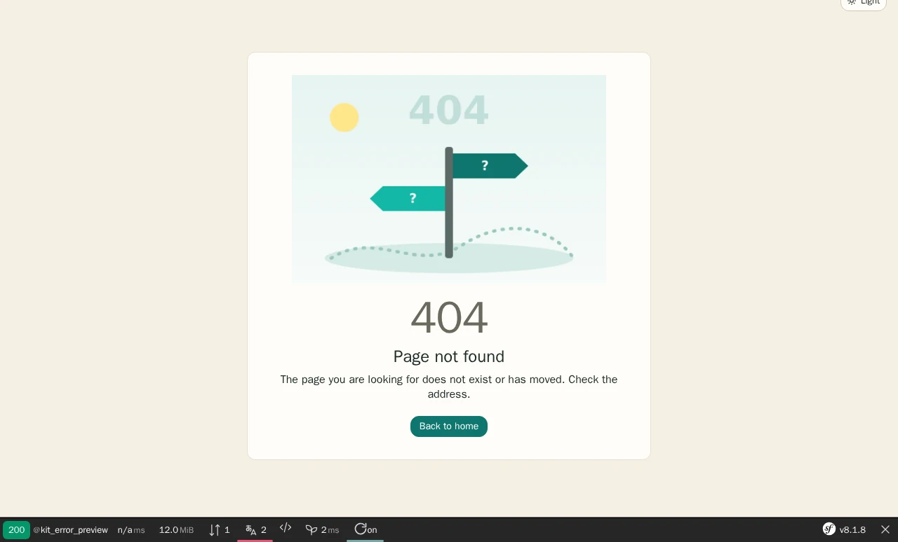
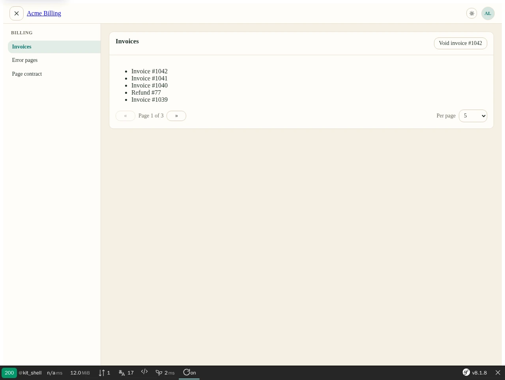

# Usage — Nowo UiKit Bundle

## Table of contents

- [Import macros](#import-macros)
- [Partials](#partials)
- [Assets](#assets)
- [Locale tabs (2.5)](#locale-tabs-25)
  - [Migrating your locale UI](#migrating-your-locale-ui)
- [Page loader and page transitions](#page-loader-and-page-transitions)
- [Open a modal on load (deep link)](#open-a-modal-on-load-deep-link)
- [Filter bar and data table (opt-in)](#filter-bar-and-data-table-opt-in)
- [Host chrome (1.17, opt-in)](#host-chrome-117-opt-in)
  - [Responsive table](#responsive-table)
  - [Foldable filter card](#foldable-filter-card)
  - [Card corner tab](#card-corner-tab)
  - [Disclosure chevron](#disclosure-chevron)
  - [Back link](#back-link)
  - [Page-edge tab and route links](#page-edge-tab-and-route-links)
  - [Thin scrollbars](#thin-scrollbars)
  - [Morphicons (animated icons)](#morphicons-animated-icons)
- [Listing customizer](#listing-customizer)
  - [Host example](#host-example)
  - [Server-side store](#server-side-store)
  - [Multi-select filter (2.14)](#multi-select-filter-214)
  - [Date-range filter (2.15)](#date-range-filter-215)
- [Guided tour](#guided-tour)
- [Kit templates (2.6)](#kit-templates-26)
  - [Error pages](#error-pages-26)
  - [Confirm dialog](#confirm-dialog-26)
  - [App shell](#app-shell-26)
  - [Compact pagination](#compact-pagination-26)
- [Pre-paint theme boot](#pre-paint-theme-boot)
- [App chrome](#app-chrome-aside-avatar-user-menu-footer)
- [Sidebar rail (opt-in)](#sidebar-rail-opt-in)
- [Overriding templates (REQ-TWIG-001)](#overriding-templates-req-twig-001)
- [Override vs upgrade](#override-vs-upgrade)
- [Remap CSS tokens (theming)](#remap-css-tokens)
- [Feature bundles](#feature-bundles)
- [Kitchen sink](#kitchen-sink)
- [Related docs](#related-docs)

## Import macros

```twig


<button class="{{ ui.btn('primary') }}">Primary</button>
<button class="{{ ui.btn('danger', 'sm') }}">Delete</button>
{# Pass a framework override (feature bundle’s own css_framework): #}
<button class="{{ ui.btn('primary', null, 'tailwind') }}">Tailwind</button>

<div class="{{ ui.toolbar() }}">…</div>
<div class="{{ ui.table_wrap() }}"><table class="{{ ui.table() }}">…</table></div>
<span class="{{ ui.badge('success') }}">OK</span>
<div class="{{ ui.card() }}">…</div>
<div class="{{ ui.progress() }}"><div class="{{ ui.progress_bar() }}" style="width:40%"></div></div>
<span class="{{ ui.spinner('sm') }}"></span>
```

Macros always emit semantic `nowo-ui-*` classes. Named stacks also emit Bootstrap / Tailwind / Foundation classes. With `custom` or `none`, only `nowo-ui-*` remain.

`ui.badge()` keeps BC: `ui.badge('tailwind')` is still a framework override; `ui.badge('success')` / `ui.badge('danger', 'bootstrap5')` set variants.

Twig globals (from config):

- `nowo_ui_kit_css_framework`
- `nowo_ui_kit_icon_set`
- `nowo_ui_kit_row_actions_display`

## Partials

| Subpath | Purpose |
|---------|---------|
| `partials/_pagination.html.twig` | Server-side pagination |
| `partials/_empty.html.twig` | Empty state |
| `partials/_flashes.html.twig` | Inline Symfony flashes |
| `partials/_toasts.html.twig` | Fixed toast stack from flashes (string or `{title, message}`). 2.9: `toast_roles`, `timeouts`, `toast_classes`, `toast_type_classes` and the blocks `toast_attributes` / `toast_text` / `toast_dismiss_attributes` — see [Toasts in a host](#toasts-in-a-host) |
| `partials/_row_actions.html.twig` | Edit / delete / view / copy cluster (`display`: `icon` \| `text` \| `icon_text`) |
| `partials/_page_header.html.twig` | Title + intro + toolbar HTML |
| `partials/_tabs.html.twig` | Tab **link** nav (no JS). In-page panels: `nowo-ui-tabs.js` / Stimulus `tabs` peer |
| `partials/_filters.html.twig` | Search + apply/clear + actions slot |
| `partials/_filter_actions.html.twig` | Opt-in filter bar actions: optional pager row + Filter + Clear on one row. See [Filter bar and data table](#filter-bar-and-data-table-opt-in) |
| `partials/_open_modal_on_load.html.twig` | CSP-safe JSON island that opens a modal on load (`?new=1` deep link). See [Open a modal on load](#open-a-modal-on-load-deep-link) |
| `partials/_card.html.twig` | Card / panel (header/body/footer) |
| `partials/_modal_shell.html.twig` | Modal shell (Bootstrap-JS structure, kept for BC) |
| `partials/_dialog.html.twig` | Generic native `<dialog>` (2.1, framework-free; `data-nowo-ui-dialog-open="<id>"`, `js/nowo-ui-dialog.js`) — preferred in page-contract bundles. `placement: 'end'` / `'start'` (2.12) turns it into a full-height **side panel** sliding in from that edge; with `data-nowo-ui-dialog-src="<url>"` on the opener it loads the panel content on demand (help, manuals, customizers) while the opener's `href` stays the no-JS fallback |
| `partials/_confirm.html.twig` | Confirm `<dialog>` (host owns POST+CSRF) |
| `partials/_page_loader.html.twig` | Page loader: veil (`visual: spinner\|orb`) or minimal indicator (`bar`, `bar_loop`, `bar_spinner`, `corner_spinner`, `dots`, `glow`, `corner_mark`). See [Page loader and page transitions](#page-loader-and-page-transitions) |
| `partials/_page_transition.html.twig` | Cross-document page transitions (View Transitions, `<head>`, no JS) |
| `partials/_thinking_orb.html.twig` | Thinking orb canvas (`data-nowo-ui-orb`) |
| `partials/_release_version.html.twig` | Installed-version button + lazy GitHub release dialog (optional `release_check`; renders nothing while disabled). See [CONFIGURATION.md](CONFIGURATION.md#release-check) |
| `partials/_brand.html.twig` | Brand mark (text / img / SVG) |
| `partials/_theme_toggle.html.twig` | Light/dark toggle |
| `partials/_width_toggle.html.twig` | Main full width ↔ content toggle |
| `partials/_locale_switcher.html.twig` | Locale menu (host supplies URLs/forms) |
| `partials/_kebab.html.twig` | Overflow / kebab menu |
| `partials/_burger.html.twig` | Burger / aside toggle |
| `partials/_avatar.html.twig` | Avatar initials or image |
| `partials/_aside.html.twig` | Left sidebar (flat or nested `children`) |
| `partials/_aside_nav_items.html.twig` | Recursive nav items (internal) |
| `partials/_user_menu.html.twig` | Avatar dropdown + links + logout |
| `partials/_footer.html.twig` | Site footer |
| `partials/_shell.html.twig` | Composed chrome |
| `partials/_tour.html.twig` | Guided page tour (2.13): edge tab + Stimulus peer `product-tour` (driver.js). See [Guided tour](#guided-tour) |
| `components/_icon.html.twig` | Icon by `icon_set` |
| `macros/ui.html.twig` | Class macros |
| `demo/kitchen_sink.html.twig` | Full component showcase |

Example:

```twig

```

Row actions (inherits `nowo_ui_kit_row_actions_display`; override with `display`). Full contract: [ROW_ACTIONS.md](ROW_ACTIONS.md).

```twig


{# Visible labels instead of icon-only #}

```

Confirm trigger:

```twig
<button type="button" class="{{ ui.btn('danger') }}"
    {{ ui.confirm_toggle_attrs() }} {{ ui.confirm_target_attr('delete-item') }}>
    Delete
</button>

```

## Assets

Named package **`nowo_ui_kit`** (REQ-ASSETS-004), `base_path` `/bundles/nowouikit`.

Sources are **TypeScript** under `src/Resources/assets/src/`, built with **Vite + pnpm** to `src/Resources/public/js/*.js` (REQ-ASSETS-001):

```bash
pnpm install
pnpm run build
```

```twig
<link rel="stylesheet" href="{{ asset('css/nowo-ui.css', 'nowo_ui_kit') }}">
<script src="{{ asset('js/nowo-ui-modal.js', 'nowo_ui_kit') }}" defer></script>
<script src="{{ asset('js/nowo-ui-shell.js', 'nowo_ui_kit') }}" defer></script>
<script src="{{ asset('js/nowo-ui-toast.js', 'nowo_ui_kit') }}" defer></script>
<script src="{{ asset('js/nowo-ui-confirm.js', 'nowo_ui_kit') }}" defer></script>
<script src="{{ asset('js/nowo-ui-page-loader.js', 'nowo_ui_kit') }}" defer></script>
<script src="{{ asset('js/nowo-ui-clipboard.js', 'nowo_ui_kit') }}" defer></script>
<script src="{{ asset('js/nowo-ui-tabs.js', 'nowo_ui_kit') }}" defer></script>
<script src="{{ asset('js/nowo-ui-theme.js', 'nowo_ui_kit') }}" defer></script>
{# nowo-ui-theme-boot.js: blocking, in <head> — prefer partials/_theme_boot.html.twig (inline + nonce) #}
<script src="{{ asset('js/nowo-ui-orb.js', 'nowo_ui_kit') }}" defer></script>
<script src="{{ asset('js/nowo-ui-release.js', 'nowo_ui_kit') }}" defer></script>{# only with release_check #}
<script src="{{ asset('js/nowo-ui-open-modal.js', 'nowo_ui_kit') }}" defer></script>{# only with _open_modal_on_load #}
```

Strict CSP: kit scripts are external files (no inline JS, no `on*=` handlers). When your CSP uses nonces, pass the per-request nonce your app stores in the request attribute `csp_nonce`: `nonce="{{ app.request.attributes.get('csp_nonce') }}"`.

Run `php bin/console assets:install` after install/update.

`nowo-ui-modal.js` handles `data-nowo-modal-open` / `data-nowo-modal-close` for `custom` / `none` / `tailwind`. Bootstrap stacks use `data-bs-*` and do not require this script for open/close.

`nowo-ui-shell.js` toggles the left aside via `data-nowo-ui-burger`, nested groups via `data-nowo-ui-nav-group-toggle`, and main width via `data-nowo-ui-width-toggle`.

`nowo-ui-clipboard.js` copies via `data-nowo-ui-clipboard*` (text or same-origin URL). `nowo-ui-tabs.js` switches in-page panels via `data-nowo-ui-tabs*` (Twig `_tabs` remains link navigation); 2.5: keyboard, `invalid`, `nowo-ui:tabs:change`, nesting and morph re-sync — see [Locale tabs](#locale-tabs-25).

`nowo-ui-release.js` lazily fetches the release-status JSON the first time a `dialog[data-nowo-ui-release]` opens (`_release_version.html.twig`).

Optional Stimulus peers: `src/Resources/assets/stimulus-peers/` — see [STIMULUS.md](STIMULUS.md).

`nowo-ui-orb.js` mounts Thinking Orbs on `canvas[data-nowo-ui-orb]` (local MIT canvas engine; no CDN). Use `_thinking_orb.html.twig` or `_page_loader.html.twig` with `visual: 'orb'`.

## Locale tabs (2.5)

One panel per locale behind a WAI-ARIA tab list: the shared building block for every per-locale CRUD field (title /
body / slug / SEO text per language). FormKit 2.13+ renders its `locale_tabs` option and `TranslatableMapType` through
this partial when UiKit is installed; hosts and bundles with their own markup call it directly.

```twig


    
        {{ form_row(form['name_' ~ locale]) }}
        {{ form_row(form['description_' ~ locale]) }}
    
    

{{ include(nowo_ui_partial('locale_tabs'), {
    id: 'permission-i18n',
    panels: panels,
    default_locale: 'es',
    required_locales: ['es'],
}, false) }}
```

Load `js/nowo-ui-tabs.js` (the `scripts` partial and the UiKit layouts already do) and `css/nowo-ui.css`.

| Parameter | Default | Notes |
|---|---|---|
| `panels` | — (required) | list of `{locale, content, label?, name?, invalid?, required?, dir?, attr?}`. `content` is the panel HTML: a Twig `Markup` (a `…` capture) prints as is, a plain string is escaped. `label` = tab text (default `ES`), `name` = language name for the legend and screen readers (default `nowo_ui_locale_name(locale)`), `dir` default `nowo_ui_locale_dir(locale)` |
| `id` | random | DOM prefix: tab ids `<id>-<locale>`, buttons `tab-<id>-<locale>`, panels `tab-<id>-<locale>-panel` |
| `label` | `locale_tabs.label` ("Languages") | `aria-label` of the tab list (`Label` or string) |
| `default_locale` | first panel | ★ marker + "default language" for screen readers; listed first (`default_first: false` keeps the given order) |
| `required_locales` | `[]` | `*` marker + "required" (a panel's own `required` wins) |
| `active_locale` | request locale when listed, else `default_locale` | initially open panel |
| `activate_invalid` | `true` | open the first invalid panel when the active one has no errors |
| `mark_default`, `default_marker`, `required_marker`, `error_marker` | `true`, `★`, `*`, `!` | visible markers (always `aria-hidden`, the meaning is in the screen-reader text) |
| `legend` | `true` | `<legend>` per panel (the heading of the no-JS view, visually hidden once tabs are active) |
| `progressive` | `true` | `false`: tab list visible and inactive panels `hidden` server-side (needs JS to switch, like the 1.x tabs) |
| `stimulus` | `false` | Stimulus identifier (e.g. `'tabs'`) to also emit the peer attributes (`data-controller`, targets `trigger` / `tab` / `list`, `click->tabs#open`) |
| `attr`, `bundle` | | root attributes (no `on*`); per-bundle theme exceptions |

Behaviour:

- **No JavaScript**: every panel is visible as a stacked `<fieldset>` with its `<legend>` ("Spanish ES ★ *"); the
  tab list is `hidden`. `nowo-ui-tabs.js` upgrades the root (`data-nowo-ui-tabs-upgrade` → `data-nowo-ui-tabs-ready`):
  shows the tab list, gives the panels `role="tabpanel"` / `aria-labelledby`, hides the inactive ones.
- **Keyboard** (role `tab` triggers): `ArrowRight` / `ArrowLeft` next / previous with wrap-around (mirrored when the
  tab list is right-to-left), `Home` / `End`, roving `tabindex` (only the selected tab is in the Tab order).
- **Errors**: `invalid: true` marks the tab (`data-invalid`, `!`, "contains errors" in the accessible name) and the
  panel (`data-invalid`). Put `aria-invalid="true"` on the invalid controls themselves (FormKit does it).
- **Browser validation**: when a submit finds an invalid control in a hidden panel, the runtime opens that panel (and
  its parent panels) inside the `invalid` event, so the browser can focus the control and show its message.
- **`nowo-ui:tabs:change`** (bubbling `CustomEvent` on the root): `detail = {tabId, previousTabId, trigger, panel,
  reason}` with `reason` `click` | `keyboard` | `invalid` | `api`. Mount editors that need a visible container there:

  ```js
  document.addEventListener('nowo-ui:tabs:change', (event) => {
    event.detail.panel?.querySelectorAll('[data-editor]:not([data-mounted])').forEach(mountEditor);
  });
  ```

- **Nesting**: each root drives only its own triggers and panels (the nearest `[data-nowo-ui-tabs]`).
- **Live Component / Turbo morph**: a re-render that writes the server attributes back keeps the tab the user chose
  (and re-upgrades the root); new roots inserted later (remote dialogs) are upgraded too.
- **Strict CSP**: no inline script / style / `on*`. `lang` and `dir` are set on each panel (Arabic, Hebrew, Persian,
  Urdu… panels get `dir="rtl"`).
- Theme slots `locale_tabs_nav` (list: the `tabs` look without its bottom margin, 2.5.3), `tab` / `tab_active` (buttons; the runtime swaps both class sets, passed as
  `data-nowo-ui-tabs-tab-class` / `data-nowo-ui-tabs-tab-active-class`), `tab_panel` (panels); tokens
  `--nowo-ui-locale-tabs-gap`, `--nowo-ui-locale-tabs-default`.

`window.nowoUiActivateTab(root | id | selector, tabId)` selects a tab from code (reason `api`).

### Migrating your locale UI

Per-bundle tab markup (own `_locale_tabs.html.twig`, Bootstrap `nav-tabs` + CDN JS, `.as-locale-tab` scripts, radio
hacks, stacked fieldsets) becomes one include. Before:

```twig
<ul class="nav nav-tabs" role="tablist">
  
    <li class="nav-item"><button class="nav-link{{ loop.first ? ' active' }}" data-bs-toggle="tab"
        data-bs-target="#t-{{ locale }}" type="button">{{ locale|upper }}</button></li>
  
</ul>
<div class="tab-content">
  
    <div class="tab-pane{{ loop.first ? ' active' }}" id="t-{{ locale }}">{{ form_row(form['title_' ~ locale]) }}</div>
  
</div>
```

After (no Bootstrap JS, works without JS, keyboard and error states included):

```twig


    {{ form_row(form['title_' ~ locale]) }}
    

{{ include(nowo_ui_partial('locale_tabs', 'NowoBlogKitBundle'), {id: 'article-title', panels: panels, default_locale: default_locale, bundle: 'NowoBlogKitBundle'}, false) }}
```

With FormKit installed, prefer its `locale_tabs` option / `TranslatableMapType` (they build the panels for the three
usual shapes: a list of translation entities, `field_<locale>` groups and a JSON `{locale: text}` map) — see
FormKit's [USAGE](https://github.com/nowo-tech/FormKitBundle/blob/main/docs/USAGE.md#locale-tabs). Replace a
`locale-tabs:changed` editor hook with `nowo-ui:tabs:change`.

## Page loader and page transitions

The veil (`visual: spinner` / `orb`) suits slow admin screens. Public sites usually want a **minimal** indicator that never
blocks the page and stays invisible on fast loads:

```twig

```

Tune colour and corner position with CSS variables on `.nowo-ui-page-loader--minimal`:
`--nowo-ui-page-loader-color` (default `--nowo-ui-primary`), `--nowo-ui-page-loader-corner-bottom`,
`--nowo-ui-page-loader-corner-left` (e.g. add a fixed footer height).

Cross-page fades: include once in `<head>` on every page that should take part (both pages must opt in):

```twig

```

It renders a single `<style>` with the request `csp_nonce` (or `nonce:`), so it works under a strict CSP. Browsers
without cross-document View Transitions (e.g. Firefox today) navigate as usual; `prefers-reduced-motion: reduce`
disables it.

## Open a modal on load (deep link)

Links such as `/admin/items?new=1` can land on the list with the create form already open, without inline JS.
Render the island (only emitted when the request carries the parameter) and load the script after the kit modal scripts:

```twig

<script src="{{ asset('js/nowo-ui-open-modal.js', 'nowo_ui_kit') }}" defer></script>
```

Output: `<script type="application/json" id="nowo-ui-open-modal-on-load">{"modal":…,"trigger":…,"clearParam":"new"}</script>`
(JSON with `<`, `>`, `&`, quotes hex-escaped; request `csp_nonce` or `nonce:` added — the island never executes).
The script clicks the trigger (when given), falls back to opening the modal directly (`<dialog>.showModal()` or the
`nowo-ui-modal-open` class, plus a `show.bs.modal` event with `relatedTarget`), retries every 50 ms for up to 2 s while
kit scripts boot, then removes `?new` from the URL (`history.replaceState`). `window.nowoUiOpenModalOnLoad()` re-runs it.

Vite / Encore hosts can import the side-effect-free helpers instead of loading the IIFE:

```ts
import { openModalOnLoad } from '../vendor/nowo-tech/ui-kit-bundle/src/Resources/assets/src/nowo-ui-open-modal-core';

document.readyState === 'loading'
  ? document.addEventListener('DOMContentLoaded', () => openModalOnLoad())
  : openModalOnLoad();
```

Exports: `OPEN_MODAL_ISLAND_ID`, `readOpenModalConfig(doc, islandId?)`, `isModalOpen(el)`, `tryOpenModal(doc, config)`,
`clearQueryParam(win, param)`, `openModalOnLoad(doc?, win?, maxTries = 40, intervalMs = 50)`.

## Filter bar and data table (opt-in)

New classes only — nothing changes for markup that does not use them.

- **`.nowo-ui-filter-bar`** on the filter `<form>`: flex row, fields and actions aligned on the bottom edge, every
  single-line input / select and the Filter / Clear buttons get one explicit height (`--nowo-ui-control-height`,
  default 38px — WebKit selects are otherwise taller). Compact (34px, `--nowo-ui-control-height-compact`):
  `.nowo-ui-filter-bar--compact` or `[data-ui-density="compact"]` on an ancestor.
  Helpers: `__field` (`--search` wider), `__help` (visually hidden help kept for `aria-describedby`), `__actions`,
  `__actions--pager` (pager + Filter + Clear never split), `__pager`, `__submit`, `__clear`.
- **`table.nowo-ui-data-table`**: one header / cell contract for list tables (uppercase muted headers, row hover,
  no border on the last row; works next to `.nowo-ui-table` / Bootstrap `.table`). Tokens
  `--nowo-ui-table-head-py`, `--nowo-ui-table-cell-py`, `--nowo-ui-table-cell-px`, `--nowo-ui-table-font-size`,
  `--nowo-ui-table-head-font-size`; compact via `.nowo-ui-data-table--compact` or `[data-ui-density="compact"]`.

```twig
<form method="get" class="nowo-ui-filter-bar">
    <div class="nowo-ui-filter-bar__field nowo-ui-filter-bar__field--search">{{ form_widget(form.q) }}</div>
    <div class="nowo-ui-filter-bar__field">{{ form_widget(form.status) }}</div>
    
</form>

<table class="nowo-ui-data-table">…</table>
```

`_filter_actions` options: `pager` (pre-rendered trusted HTML — no Symfony Form dependency in the kit), `clear_href`,
`submit_label` / `clear_label` (default `filters.apply` / `filters.clear`), `submit_class` / `clear_class`
(default `ui.btn('primary')` / `ui.btn('secondary')`), `framework`.

Icon actions (1.15): `submit_icon` / `clear_icon` render an icon through `components/_icon.html.twig`
(`nowo_ui_kit.icon_set`; canonical kinds such as `filter` / `close`, or any icon name of the set) before the label.
`icon_only: true` hides the visible label of the buttons that have an icon: the label stays as a visually-hidden
text, `title` and `aria-label`, and the button becomes square (`.nowo-ui-filter-bar__action--icon-only`). Without
any icon option the output is unchanged.

```twig

```

Recommended icon-only pair (1.17): **Filter** = funnel, **Clear filters** = funnel with a slash. With
`icon_set: ux_icon` pass the Tabler names directly; with the other sets use the canonical kinds `filter` /
`filter_off` (1.17: `ti ti-filter-off`, Bootstrap Icons `bi-x-circle`, inline SVG funnel with a slash):

```twig

```

## Host chrome (1.17, opt-in)

Generic chrome extracted from Symfony Beacon (kit spec 005). Every piece is opt-in: new partials, new classes and
three optional Stimulus peers — nothing changes for markup that does not use them. Static icons render through
`components/_icon.html.twig` (`nowo_ui_kit.icon_set`), so every partial works without JS; the peers add the
behaviour and the optional [morphicons module](#morphicons-animated-icons) animates the icons.

New canonical icon kinds (all icon sets): `filter_off`, `scroll_horizontal`, `rows`, `chevron_up`, `chevron_down`,
`chevron_right`, `book`. Every partial below accepts an `icons` hash to use set-specific names instead (e.g.
`tabler:arrows-horizontal` with `icon_set: ux_icon`).

### Responsive table

`partials/_responsive_table.html.twig` (embed) + `_row_detail_head.html.twig` / `_row_detail_cell.html.twig` +
Stimulus peer `responsive-table` ([STIMULUS.md](STIMULUS.md#responsive-table-stimulus-peer-only)).

- **Scroll** mode: every column, horizontal scroll (thin scrollbar with `data-nowo-ui-thin-scrollbars`).
- **Responsive** mode: no horizontal scroll at 320px and above. The peer shows every column, then hides the last
  non-required ones (document order; `data-required="1"` never hides) until the table fits — measured first without
  the detail column, then with it — and recomputes on resize. Cell text wraps — including descendants with
  `white-space: nowrap` (Tailwind `.whitespace-nowrap`, Bootstrap `.text-nowrap`; 1.17.2) — at spaces only. The
  fit measures with words unbreakable (`data-rt-measuring`, 1.17.5), so columns hide before any word splits; only
  when the required columns still overflow (e.g. a long URL at 320px) does the root get `data-rt-overflow` and the
  visible cells may break words anywhere — the last resort that keeps 320px free of horizontal scroll. Padding
  tightens under 30rem.
- Each row ends with an eye button (shown only while a column is hidden, named "Row details: <row title>", row
  title = text of the first two columns). It opens a native `<dialog>` (confirm dialog chrome, centred with `margin: auto` even under Tailwind preflight — 1.17.2) with **every** column
  as label / value pairs; the cell contents are **moved** into the dialog and back on close, so forms, links, ids and
  listeners keep working. Esc, ✕ or a backdrop click closes it; focus returns to the button. On coarse pointers a
  tap on the row (outside links / buttons / fields) opens it too.
- Default mode without a stored choice: responsive on phones (`phone_query`, default `(max-width: 767px)`), scroll
  elsewhere. The toggle switches at once; persistence is **host-owned**: with `save_url` the peer sends
  `{"mode": "scroll"|"responsive"}` as JSON with an `X-CSRF-TOKEN` header (`save_method`, default `PUT`) and
  refreshes a stale token once from `save_token_url` (`{"token": "…"}`); a failed save switches back and dispatches
  `responsive-table:save-failed` (1.17.1: `detail.message` = the `labels.save_error` text, for the host's toast). Without `save_url` the choice stays on the page.

```twig
<div class="nowo-ui-card">
    
        
            <table class="nowo-ui-data-table" data-responsive-table-target="table">
                <thead><tr>
                    <th data-column="name" data-required="1">Name</th>
                    <th data-column="owner">Owner</th>
                    <th data-column="notes">Notes</th>
                    
                </tr></thead>
                <tbody>
                
                    <tr>
                        <td data-column="name">{{ item.name }}</td>
                        <td data-column="owner">{{ item.owner }}</td>
                        <td data-column="notes">{{ item.notes }}</td>
                        
                    </tr>
                
                </tbody>
            </table>
        
    
</div>
```

Options of `_responsive_table`: `table_mode`, `save_url`, `save_token`, `save_token_url`, `save_method`, `save_cookie`
(without `save_url`: keep the mode in that [listing cookie](#listing-customizer)),
`phone_query`, `part_selector` (stacked header parts joined with " · " in the dialog labels, default
`[data-cell-part]`), `mode_toggle` (default true), `corner` (default true: the toggle is a [corner tab](#card-corner-tab)
of the nearest `.nowo-ui-corner-host` / `.nowo-ui-card`; false: a small bar above the table), `morph`, `icons`
(`scroll`, `responsive`, `close`), `labels` (`to_responsive`, `to_scroll`, `details`, `close`, `save_error` — 1.17.1), `attr` (1.17.1: extra root
attributes, hash), `dialog_id`,
`root_class`, `scroller_class`, `dialog_class`, `testids` (adds `data-testid` `responsive-table`,
`table-mode-toggle`, `row-detail-dialog`). `_row_detail_head`: `label`, `th_class`. `_row_detail_cell`: `label`,
`icon` (default `view`), `td_class`, `testids` (`row-detail`). Include the two cell partials with `only`.

Root attributes for CSS / tests: `data-table-mode` (`scroll` | `responsive`; rendered server-side when `table_mode`
is set, so `.nowo-ui-responsive-table:not([data-table-mode])` targets the no-JS state), `data-rt-has-hidden`,
`data-rt-overflow` (1.17.5), `data-rt-measuring` (only during a fit — host CSS must not break words under it);
hidden header / cells get `data-rt-hidden`.

### Foldable filter card

`partials/_filters_collapse.html.twig` + Stimulus peer `filters-collapse`. Include it as the **first child** of the
filter `<form>` (works with `.nowo-ui-filter-bar`), or pass `collapsible: true` to `partials/_filters.html.twig`.
A corner tab (top-right, stacked **under** the fields) folds the card to an "N active filters" line; the fields stay
in the form with their values. The state is a cookie of page keys the partial reads, so a folded card renders
folded (no flash).

```twig
<form method="get" class="nowo-ui-filter-bar nowo-ui-card">
    
    {# …fields… #}
    
</form>


```

Options: `fold_key` (default the current route; empty = not remembered), `fold_cookie` (default
`nowo_ui_filters_collapsed`), `folded` (force the state), `filter_form` (FormView: counts non-empty / checked fields,
skipping `page`, `per_page`, `_token`, `sort`, `dir` and hidden fields), `active_count` (count without a FormView),
`morph`, `icons` (`expanded`, `collapsed`), `labels` (`collapse`, `expand`, `none`, `one`, `many` with `%count%`),
`testids` (`filters-collapse-toggle`, `filters-collapse-summary`).

### Card corner tab

`.nowo-ui-corner-tab` (partial `_corner_tab.html.twig`): a small icon button or link stuck to the top-right corner
of the nearest positioned ancestor — add `.nowo-ui-corner-host` to the card (`.nowo-ui-card` works as is). One size
for every corner control (table mode toggle, filter fold, host tabs): tokens `--nowo-ui-corner-tab-width`
(1.5rem), `--nowo-ui-corner-tab-height` (1.375rem), `--nowo-ui-corner-tab-icon` (0.875rem), accent
`--nowo-ui-corner-tab-accent` (default `--nowo-ui-primary`). `.nowo-ui-corner-tab--under` stacks it under the host's
content (z-index -1; the host gets `isolation: isolate`).

```twig
<div class="nowo-ui-card nowo-ui-corner-host">
    
    …
</div>
```

### Disclosure chevron

`partials/_disclosure_icon.html.twig` inside a toggle: static chevrons (down = open, right = closed) chosen by CSS
from the toggle's `aria-expanded` or the `<details open>` around its `<summary>`. Add
`data-controller="disclosure-icon"` on the toggle (and `morph: true`) for the animated icon. Options: `class`,
`morph`, `icons` (`open`, `closed`).

```twig
<details>
    <summary data-controller="disclosure-icon"> Stack frame</summary>
    …
</details>
```

### Back link

A "Back to <list or parent>" control above the page title: `new PageHeader('Project', back: new BackLink(path('app_projects'),
new Label('project.back')))`, or `{{ include(nowo_ui_partial('back_link'), {href: path('app_projects'), label:
'project.back'|trans, testid: 'project-back'}) }}` on pages without a `PageHeader`. The icon defaults to `prev` (any name
of the configured icon set, e.g. `tabler:arrow-left` with `ux_icon`); classes come from the theme slot `back_link`.
Form footers keep "Cancel" for abandoning a form.

### Page-edge tab and route links

`partials/_edge_tab.html.twig`: a fixed tab on the right edge of the viewport under the header (e.g. "Read this
chapter in the manual"), so page help never pushes the content down. Options: `href` (required), `label` (default
`edge_tab.manual`), `icon` (default `book`), `new_tab` (default true), `slot` (0–7: one tab lower per slot when the
page has other edge tabs; or set `--nowo-ui-edge-tab-top` / `--nowo-ui-edge-tab-step`), `inline` (a text link in the
flow instead), `class`, `testid`; 2.12.1: `attr` (extra attributes: `true` bare, `false` / `null` omitted, `on*` dropped);
2.13: `button` (a `<button type="button">` instead of the link, `href` not needed — the [guided tour](#guided-tour)
tab; `attr` then wires it, e.g. `{'data-action': …}`).

`nowo_ui_route_link(route = current route)` returns `{url, path, testid, prefix}` (or `null`) from the
`nowo_ui_kit.route_links` map ([CONFIGURATION.md](CONFIGURATION.md#route-links)): a key matches the route itself or
any route starting with `<key>_`; the longest key wins.

```twig


    

```

### Thin scrollbars

One thin bar everywhere (6px, rounded thumb from `--nowo-ui-text`, no arrow buttons; light / dark follow the
tokens): `.nowo-ui-thin-scroll` on any scroller, or `data-nowo-ui-thin-scrollbars` on `<html>` for the page and every
kit scroller (`body`, `.nowo-ui-aside`, `.nowo-ui-main`, modals, the row detail dialog, `.nowo-ui-table-wrap`,
responsive table scrollers). Tokens: `--nowo-ui-scrollbar-size`, `--nowo-ui-scrollbar-thumb`,
`--nowo-ui-scrollbar-thumb-hover`. Firefox gets `scrollbar-width: thin` (only where `::-webkit-scrollbar` is not
supported: Chromium 121+ would otherwise draw its wide bar).

Hosts with their own selector lists (Sass via Vite / Encore) use the mixin:

```scss
@use '../../vendor/nowo-tech/ui-kit-bundle/src/Resources/assets/styles/thin-scrollbars' as thin;

@include thin.thin-scrollbars('html, body, .app-sidebar, .modal-body, .overflow-x-auto', $ink: var(--color-ink));
@include thin.thin-scrollbars('.app-sidebar__inner', $size: 3px, $thumb: 22%, $thumb-hover: 40%);
```

### Morphicons (animated icons)

`src/Resources/assets/morphicons/index.ts` — optional module for bundled hosts. Requires the **optional** packages
`morphicons` (^1.7) and `lucide` (^1.0) (peer dependencies of the kit assets). Contract: Twig paints a static icon
of the current state next to an empty `<morph-icon data-…-morph>`; CSS shows the static icon until the host element
gets `is-morph-ready`; the sync helper hydrates the morph-icon (no animation on the first paint) and morphs between
states afterwards. `<html data-motion="reduce">` makes every morph an instant swap.

```ts
// assets/stimulus_bootstrap.ts (host)
import { installMorphiconPeers } from '../vendor/nowo-tech/ui-kit-bundle/src/Resources/assets/morphicons';

installMorphiconPeers(); // responsive-table, filters-collapse, disclosure-icon icons now morph
```

Exports: `prepareMorphHost`, `asMorphIcon`, `resolveReducedMotion`, generic `syncMorphIcon(host, selector, icon,
animate, size)`, icon sets (`themeIcons`, `passwordIcons`, `contentWidthIcons`, `sidebarIcons`,
`listingCustomizerIcons`, `tableModeIcons`, `filtersCollapseIcons`, `disclosureIcons`, `searchIcons`,
`supportIcons`) and helpers `syncThemeMorphIcon`, `syncContentWidthMorphIcon`, `syncSidebarMorphIcon`,
`syncPasswordMorphIcon`, `syncListingCustomizerMorphIcon`, `syncTableModeMorphIcon`, `syncFiltersCollapseMorphIcon`,
`syncDisclosureMorphIcon`, `syncSearchMorphIcon` (magnifier ↔ X ↔ loader + `is-loading`), `syncSupportMorphIcon`
(lifebuoy ↔ X). Each helper takes `{selector, size}` options (defaults `[data-theme-morph]`,
`[data-content-width-morph]`, `[data-sidebar-morph]`, `[data-password-morph]`, `[data-listing-morph]`,
`[data-table-mode-morph]`, `[data-filters-collapse-morph]`, `[data-disclosure-morph]`, `[data-search-morph]`,
`[data-support-morph]`). `morphiconsIconStateHandler` / `installMorphiconPeers()` plug it into
`stimulus-peers/icon_state.ts`.

## Listing customizer

Lets the viewer choose, reorder, hide and stack the columns of a listing table and show / hide / reorder its
filters, with a reset to the defaults. The preferences live **in the browser** (one cookie per listing, no database
table in the host); the server reads the cookie, so the chosen columns render on first paint. A host that wants
server-side preferences plugs its own store (see [Server-side store](#server-side-store)).

Pieces:

| Piece | What |
| --- | --- |
| `Nowo\UiKitBundle\Listing\ListingDefinitionInterface` | One service per listing: `key()`, `columns()`, `filters()` (lists of `ListingField`). Autoconfigured with the tag `nowo_ui_kit.listing_definition`. |
| `ListingField` | `key`, `label` (`View\Label` or string), `required` (always shown), `defaultVisible`, `priority` (`data-priority`), `headClass`, `cellClass` (columns). |
| `ListingCustomizerViewBuilder` | `forRequest(key, Request)` → `['view' => ListingCustomizerView, 'filteredRequest' => Request]`; `build(key, Request)`. |
| `ListingCustomizerView` | `layout` (`ListingLayout`), `tableMode`, `tableOptions()`, `ignoredFilters`, `cookieName`, `dialogId()`, `clientState()`, `withLayout()`. |
| `ListingLayout` | `visibleColumnGroups()` (stacked columns share a cell), `visibleColumnKeys()`, `visibleFilterKeys()`, `hiddenFilterKeys()`, `isColumnVisible()`, `filterRequest()`, `ignoredFilters()`, `withoutColumns()`, `stored`. |
| `ListingLayoutMerger` | `merge()` (lenient: stored layouts survive added / removed fields), `normalize()` / `normalizeLayout()` (strict, for a host save endpoint). |
| `ListingPreferenceStoreInterface` | Port: `load(key, Request)`, `cookieName(key)`. Default `CookieListingPreferenceStore`. |
| `ListingRegistry`, `ListingTableMode` | Definitions by key; `scroll` / `responsive`. |
| Partials | `listing_customizer`, `listing_head`, `listing_cells`, `listing_filter_fields` ([THEME_SLOTS](THEME_SLOTS.md#partials)). |
| Stimulus peer | `listing-customizer` (`stimulus-peers/listing_customizer_controller.ts`), with `responsive-table` for the table mode. |

**Behaviour.** The customizer is a page-edge tab (`sliders` icon) that opens a side panel (the `dialog` partial with
`placement: 'end'`) with *Columns* and *Filters* tabs: a checkbox per field (required ones checked and disabled), a
drag handle, up / down buttons (keyboard: Tab to a button, Enter; or Alt+ArrowUp / Alt+ArrowDown on a row — focus
stays on the moved row and the move is announced), and on columns a *Stack under the previous column* toggle (the
column renders inside the previous visible column's cell, one line each). *Apply* (enabled once something changed)
writes the cookie and reloads; *Reset to default* (enabled when a layout is stored) asks first, then removes it.
Hidden filters are not applied: `filteredRequest` drops them (and a sort on a hidden column), and the customizer shows
a notice ("Hidden filters are not applied: …") with a shortcut to the Filters tab when the URL still carries one.

**Cookie.** `nowo_ui_listing_<key>` (every character outside `[A-Za-z0-9_-]` becomes `_`), URI-encoded JSON
`{"v":1,"columns":[{"key":"total","visible":true,"merged":true}],"filters":[{"key":"q","visible":false}],"mode":"responsive"}`,
path `/`, SameSite=Lax, one year, `Secure` on https. The responsive table stores its mode in the same cookie
(`save_cookie`). Writes over 4000 encoded bytes are refused (the panel shows "too large"); the server ignores values
over 4096 bytes and anything malformed (definition defaults apply).

### Host example

Definition:

```php
namespace App\Invoice\Listing;

use Nowo\UiKitBundle\Listing\ListingDefinitionInterface;
use Nowo\UiKitBundle\Listing\ListingField;
use Nowo\UiKitBundle\View\Label;

final class InvoiceIndexListing implements ListingDefinitionInterface
{
    public const KEY = 'invoices.index';

    public function key(): string
    {
        return self::KEY;
    }

    public function columns(): array
    {
        return [
            new ListingField('number', new Label('invoice.col.number'), required: true, priority: 1),
            new ListingField('customer', new Label('invoice.col.customer'), priority: 2),
            new ListingField('total', new Label('invoice.col.total'), priority: 3, headClass: 'is-numeric', cellClass: 'is-numeric'),
            new ListingField('due_at', new Label('invoice.col.due_at'), priority: 4),
            new ListingField('notes', new Label('invoice.col.notes'), defaultVisible: false),
        ];
    }

    public function filters(): array
    {
        return [
            new ListingField('q', new Label('invoice.filter.q')),
            new ListingField('status', new Label('invoice.filter.status')),
            new ListingField('customer', new Label('invoice.filter.customer'), defaultVisible: false),
        ];
    }
}
```

With `autoconfigure: true` nothing else is needed (the interface carries the tag). Controller:

```php
use Nowo\UiKitBundle\Listing\ListingCustomizerViewBuilder;

#[Route('/invoices', name: 'invoice_index')]
public function index(Request $request, ListingCustomizerViewBuilder $listings, InvoiceRepository $invoices): Response
{
    ['view' => $listing, 'filteredRequest' => $filtered] = $listings->forRequest(InvoiceIndexListing::KEY, $request);

    // Filter with $filtered: hidden filters and a sort on a hidden column are gone.
    $form = $this->createForm(InvoiceFilterType::class, null, ['method' => 'GET'])->handleRequest($filtered);

    return $this->render('invoice/index.html.twig', [
        'listing' => $listing,
        'filters' => $form->createView(),
        'invoices' => $invoices->search($form->getData() ?? [], $filtered->query->getString('sort'), $filtered->query->getString('dir')),
    ]);
}
```

Template (`invoice/index.html.twig`):

```twig
{# Edge tab + side panel (drawer); hidden-filters notice when the URL still carries one. #}


{{ form_start(filters) }}
    {# The viewer's visible filters, in their order; hidden ones are never painted. #}
    
    <button type="submit">{{ 'action.filter'|trans({}, 'NowoUiKitBundle') }}</button>
{{ form_end(filters) }}

<div class="nowo-ui-card">
    {# tableOptions = {table_mode, save_cookie}: the mode toggle keeps its choice in the listing cookie. #}
    
        
            <table class="nowo-ui-data-table" data-responsive-table-target="table">
                <thead><tr>
                    
                </tr></thead>
                <tbody>
                
                    {# WITH context: the cell blocks see `invoice`. #}
                    <tr></tr>
                
                </tbody>
            </table>
        
    
</div>
```

Cells (`invoice/_cells.html.twig`, one `cell_<key>` block per column key) and optional header blocks
(`invoice/_heads.html.twig`, `head_<key>`, e.g. sort links; columns without a block print their label):

```twig
<a href="{{ path('invoice_show', {id: invoice.id}) }}">{{ invoice.number }}</a>
{{ invoice.customer.name }}
{{ invoice.total|format_currency('EUR') }}
{{ invoice.dueAt|date('Y-m-d') }}
{{ invoice.notes }}
```

```twig
<a href="?{{ app.request.query.all|merge({sort: 'total'})|url_encode }}">{{ column.label|nowo_ui_trans }}</a>
```

Assets: register the Stimulus peers `listing-customizer` and `responsive-table` (see [STIMULUS.md](STIMULUS.md));
`js/nowo-ui-dialog.js` (loaded by the UiKit document layout, or the `scripts` partial) opens the side panel. Without
the dialog script the peer opens it itself (`showModal()`).

Options of `listing_customizer`: `toggle` (`edge` default, `button` — a button in the flow — or `none`: put
`data-nowo-ui-dialog-open="{{ listing.dialogId }}"` on your own opener), `slot` (edge tab stack 0–7, when the page
has other [edge tabs](#page-edge-tab-and-route-links)), `size` (`sm` default), `dialog_id`, `labels`, `icons`
(`open`, `grip`, `up`, `down`, `stack`; canonical icon kinds `sliders`, `grip`, `stack` are new), `attr`, `testids`,
`bundle`, and the server-store options below. `listing_head`: `th_class`, `heads_template`, `detail` (default true:
the row detail header of the responsive table), `detail_label`. `listing_cells`: `td_class`, `detail`, `detail_icon`,
`detail_label`, `testids`. `listing_filter_fields`: `row_options` (field ⇒ `form_row` options). Each accepts
`listing` (the view) or `listing_layout` (a `ListingLayout`, e.g. `listing.layout.withoutColumns(['total'])`).
Stacked cells: the lead `<td data-column>` holds one `<div class="nowo-ui-listing-cell__part" data-cell-part="<key>">`
per column; the header joins the labels (`[data-cell-part]`), which the row detail dialog shows as "Total · Customer".

Events: `listing-customizer:saved` (`detail.layout`, cancelable — `preventDefault()` skips the reload, e.g. to
re-render with Turbo), `listing-customizer:save-failed` (`detail.message`). The root carries `data-listing-dirty`
while edits are unapplied.

### Server-side store

The bundle keeps one personal layout per listing and browser. To store layouts per user, per project or per tenant,
implement the port and alias it:

```yaml
# config/services.yaml
Nowo\UiKitBundle\Listing\ListingPreferenceStoreInterface: '@App\Listing\DoctrineListingPreferenceStore'
```

`load(string $listingKey, Request $request): ?array` returns `{columns, filters, mode}` (raw lists, merged leniently)
for whatever scope the request implies (the current user, the project in the route…); `cookieName()` returns null.
Then pass the save endpoint to the partials:

```twig

```

The endpoint validates the body with `ListingLayoutMerger::normalizeLayout($registry->get($key), $payload)` (null =
400) and stores the result; the responsive table takes its own `save_url` for the mode as before.
### Multi-select filter (2.14)

A filter that takes several values (policy status, policy type…) as **chips** with a remove button and a search
inside the control, keyboard accessible (Tab into it, type to search, ArrowUp / ArrowDown + Enter to add, Escape to
close; ArrowLeft / ArrowRight then Backspace / Delete remove a chip). It is a plain Symfony `ChoiceType` with
`multiple: true` progressively enhanced by the `multi-select` Stimulus peer (Tom Select, imported on demand): without
JavaScript, or when Tom Select fails to load, the native `<select multiple>` stays and submits the same GET query
(`status[]=active&status[]=pending`).

```php
use Nowo\UiKitBundle\Form\MultiSelectTypeExtension;

$builder->add('status', ChoiceType::class, [
    'choices' => $statusChoices,
    'multiple' => true,
    'required' => false,
    'attr' => ['placeholder' => 'policy.filter.status_placeholder'],     // text of the empty control (translated)
    MultiSelectTypeExtension::OPTION => true,                             // 'nowo_ui_multi_select'
]);
```

`nowo_ui_multi_select` (a ChoiceType extension registered when symfony/form is installed; EntityType / EnumType
inherit it): `false` (default) | `true` | `['controller' => 'multi-select', 'options' => [...Tom Select settings, e.g.
'maxItems' => 3], 'labels' => ['remove' => …, 'noResults' => …], 'dropdown_parent' => 'auto' | 'body' | 'inline']`.
It adds the class `nowo-ui-multi-select`, the controller to `data-controller` (merged with the field's own) and the
peer's values: the *Remove* / *No results* labels translated from `multi_select.*` (NowoUiKitBundle domain). Expanded
choices (checkbox lists) are left alone; a single collapsed choice becomes a searchable select. Without the form
extension, write the same attributes by hand (`data-controller="multi-select"` + `data-multi-select-labels-value`).

Rendering needs nothing new: `listing_filter_fields`, `list_filters` (the `page/list` scaffold) and `form_row()` render
the field as any other (keep the attributes: pass `row_attr` in `row_options`, not `attr`, which replaces them). The
listing customizer shows / hides it like any filter (a hidden one is not rendered nor applied, also with several
values) and `filters_collapse` counts it once when anything is chosen.

Host side (once):

```ts
// Stimulus app (tom-select ^2.3 in package.json; the peer imports it the first time a multi-select connects)
import MultiSelectController from '…/vendor/nowo-tech/ui-kit-bundle/src/Resources/assets/stimulus-peers/multi_select_controller';
app.register('multi-select', MultiSelectController);
// or lazily (vite-plugin-symfony): app.register('multi-select', createLazyController(() => import('…/multi_select_controller')));
```

```twig
<link rel="stylesheet" href="{{ asset('css/nowo-ui-multi-select.css', 'nowo_ui_kit') }}">
```

`css/nowo-ui-multi-select.css` is a standalone skin (Tom Select's own stylesheet is not needed; load it after Tom
Select's if a host has both). Collapsed, the control is as tall as the other inputs (`--nowo-ui-filter-control-height`
in a `.nowo-ui-filter-bar`, else `--nowo-ui-control-height`), chips wrap onto more lines, colours follow the kit
tokens (light / dark), and it fills its grid cell down to 390 px. The dropdown is attached to `<body>` and positioned
under the control, so a filter card with `overflow: hidden` does not clip it (inside a `<dialog>` it stays inline).
Tokens: `--nowo-ui-multi-select-max-height`, `--nowo-ui-multi-select-z`, `--nowo-ui-multi-select-shadow`,
`--nowo-ui-chip-*`. Peer reference: [STIMULUS](STIMULUS.md#multi-select-stimulus-peer-only).

### Date-range filter (2.15)

One labelled filter field for a from / to pair of days ("Collection date"), in one cell of the filter grid and as
tall as the other controls. It opens a range calendar, shows the chosen range in the viewer's locale
(`01/02/2026 – 15/02/2026`, `From 01/02/2026`) and has a clear button. Without JavaScript it is two native
`<input type="date">` with visible short labels ("From" / "To"). Either way it submits **two plain query parameters
whose names the host chooses**, so the URLs and readers that already use them keep working.

```php
use Nowo\UiKitBundle\Form\DateRangeType;

$builder->add('collection_date', DateRangeType::class, [
    'from_name' => 'min_collection_date',          // default: collection_date_from
    'to_name' => 'max_collection_date',            // default: collection_date_to
    'placeholder' => 'receipt.filter.collection_date', // empty-control text + accessible name (translated in the field's domain)
]);
// GET /receipts?min_collection_date=2026-02-01&max_collection_date=2026-02-15
// $form->get('collection_date')->getData() === ['from' => '2026-02-01', 'to' => '2026-02-15']
```

`DateRangeType` (block prefix `nowo_ui_date_range`, registered with symfony/form) is a compound of two `DateType`
fields (`single_text`, `input: 'string'`, `Y-m-d`). Its two days are named as siblings of the field (rootless GET
filter form: `min_collection_date`; under a `filter` root: `filter[min_collection_date]`); `DateRangeSubmitExtension`
puts them back on the field when the parent is submitted (a nested `collection_date[from]` works too, a flat value
wins). An invalid day is an error of the range field. In a form without a root name, a range's parameters count as a
present field (2.15.1, `DateRangeRequestHandler` decorating the request handler): `?min_collection_date=2026-02-01`
alone submits the form and the field shows the range.

| Option | Default | |
|--------|---------|---|
| `from_name` / `to_name` | `<name>_from` / `<name>_to` | Submitted names (letters, digits, `_ - . :`; different) |
| `placeholder` | `attr.placeholder`, else the label, else the humanized name | Text of the empty control and the group's accessible name (translated with `translation_domain`) |
| `from_label` / `to_label` | `date_range.from` / `date_range.to` (NowoUiKitBundle) | Visible short labels (already translated) |
| `from_options` / `to_options` | `[]` | Extra `DateType` options of each day (`attr`, `constraints`…) |
| `picker` | `true` | `false`: two native inputs only (no peer markup); or `['controller' => 'date-range', 'months' => 0 (auto) \| 1–3, 'first_day_of_week' => 1, 'locale' => null (request locale), 'labels' => ['clear' => …, 'previous' => …, 'next' => …, 'done' => …]]` |

Rendering needs nothing new: the bundle prepends `@NowoUiKit/form/nowo_ui_date_range.html.twig` (only the
`nowo_ui_date_range_*` blocks) to `twig.form_themes` and `form/nowo_ui_layout.html.twig` uses it, so `form_row()`,
`listing_filter_fields` and `list_filters` render the field in any theme. Markup: `<div role="group"
aria-label="Collection date" data-nowo-ui-filter-group class="nowo-ui-date-range" data-controller="date-range" …>`
with two `<label>` (visible "From" / "To") around the inputs, whose accessible names are "Collection date: From" /
"…: To". `filters_collapse` counts a range once (server side: its array value; the peer: `[data-nowo-ui-filter-group]`).

**Listing customizer:** declare the pair as **one** filter, with its two query keys, so hiding it drops both
parameters (`ListingLayout::filterRequest()`) and the hidden-filters notice sees them (`ignoredFilters()`):

```php
new ListingField('collection_date', new Label('receipt.filter.collection_date'), queryKeys: ['min_collection_date', 'max_collection_date']),
```

Host side (once):

```ts
// Stimulus app (cally ^0.9 in package.json; the peer imports it the first time a panel opens)
import DateRangeController from '…/vendor/nowo-tech/ui-kit-bundle/src/Resources/assets/stimulus-peers/date_range_controller';
app.register('date-range', DateRangeController);
// or lazily (vite-plugin-symfony): app.register('date-range', createLazyController(() => import('…/date_range_controller')));
```

No extra stylesheet: the field, the panel and the calendar parts (`calendar-month::part(…)`) are styled in
`nowo-ui.css` from the kit tokens (light / dark), the panel fits a 390 px viewport (one month below 40rem, two above
with `months: 0`). The panel is a `popover="auto"` element positioned by the peer (top layer: a card with
`overflow: hidden` does not clip it); without the Popover API it opens inline. Tokens: `--nowo-ui-date-range-z`,
`--nowo-ui-date-range-shadow`, `--nowo-ui-date-range-day-size`, `--nowo-ui-date-range-range-bg`. Peer reference:
[STIMULUS](STIMULUS.md#date-range-stimulus-peer-only).

**Why Cally:** a small (≈ 9 kB min+gzip), maintained, MIT set of web components (`<calendar-range>`,
`<calendar-month>`) built for keyboard and screen-reader use (a labelled grid, arrow / Page / Home / End keys, live
month heading), localised by `Intl` (no locale files) and styled through CSS parts, so it inherits the kit's tokens.

## Guided tour

A per-screen product tour (2.13, opt-in, ported from Symfony Beacon): a right-edge "Tour this page" tab and
[driver.js](https://driverjs.com) popovers over `data-tour` anchors. It starts once on a viewer's first visit and the
tab replays it. The host builds the steps (which steps a viewer gets — roles, feature flags — is the host's call);
UiKit renders them and runs them. A step whose anchor is not on the page is skipped, so markup hidden by a
permission check needs no matching rule in the step list.

**1. Anchors** in the host templates:

```twig
<aside data-tour="sidebar">…</aside>
<a href="{{ path('app_project_new') }}" data-tour="new-project">New project</a>
```

**2. Steps** in the controller — `Nowo\UiKitBundle\Tour\TourBuilder` turns a step key `k` into the labels
`<prefix>k.title` / `<prefix>k.description` (`View\Label`, translated by the partial); `welcome()` is a centred step:

```php
use Nowo\UiKitBundle\Tour\TourBuilder;
use Nowo\UiKitBundle\Tour\TourStep;

$tour = TourBuilder::create('dashboard', prefix: 'tour.steps.dashboard.')
    ->welcome('welcome', ['%name%' => $user->getName()])
    ->step(TourStep::anchor('sidebar'), 'sidebar', 'right', 'start');
if ($this->isGranted('ROLE_PROJECT_CREATE')) {
    $tour = $tour->step(TourStep::anchor('new-project'), 'new_project', 'bottom', 'end');
}

return $this->render('dashboard/index.html.twig', ['tour' => $tour->build()]);
```

`TourStep(selector, title, description, side, align)` takes own labels or plain strings (`->add(new TourStep(…))`);
`side` is `top` | `right` | `bottom` | `left`, `align` `start` | `center` | `end`. The builder is immutable (worker
safe). `TourBuilder::create($key, $domain = 'messages', $prefix = '', $autoStart = true)`. A Twig hash works too:
`{key: 'dashboard', steps: [{selector: null, title: …, description: …}], auto_start: true}`.

**3. Partial** once per page (replaceable: `theme.partials.tour`):

```twig
{{ include(nowo_ui_partial('tour'), {tour: tour, force: app.request.query.getBoolean('tour'), force_param: 'tour'}) }}
```

It renders nothing without steps. Options (see the partial's docblock): `auto_start`, `force` / `force_param`,
`storage_key`, `seen_url` / `seen_token` / `seen_token_url` / `seen_method`, `labels` (`tab`, `next`, `previous`,
`done`, `close`, `progress` — default the `tour.*` translations), `html_content` (trusted HTML in titles /
descriptions; default: shown as text), `popover_class` (default `nowo-ui-tour-popover`), `show_tab`, `tab_slot`
(edge tab stack position, like the manual tab's `slot`), `tab_inline`, `tab_icon` (default `tour`), `tab_class`,
`attr`, `testids`. The tab is the page-edge tab in its 2.13 `button: true` mode. No inline script or style: the steps
travel as a Stimulus value (JSON in an escaped attribute), so CSP needs no nonce.

**4. Stimulus + driver.js** (host build: AssetMapper / Vite / Encore):

```bash
pnpm add driver.js   # or: php bin/console importmap:require driver.js driver.js/dist/driver.css
```

```ts
import 'driver.js/dist/driver.css';
import ProductTourController from '…/vendor/nowo-tech/ui-kit-bundle/src/Resources/assets/stimulus-peers/product_tour_controller';

app.register('product-tour', ProductTourController);
```

driver.js is imported on demand (dynamic `import('driver.js')`) the first time a tour starts; pages without a tour
never load it. Reduced motion (`prefers-reduced-motion` or `[data-motion="reduce"]`) disables its animation. A step
inside a closed `<details>` (a user menu) opens it during the highlight. Start the tour from elsewhere (a "Replay
tour" menu item) with `window.dispatchEvent(new Event('nowo-ui-tour:start'))`.

**Storage.** The "seen" state lives in the browser: localStorage `nowo-ui-tour-seen` (`storage_key`) holds
`{"<tour key>": <timestamp>}`. Finishing or closing a tour adds its key; it then only runs from the tab (or with
`force`). Storage errors are ignored (the tour auto-starts again next visit). The peer exports `seenTours()` and
`markTourSeen(key, seen = true)` for a "reset tours" preference.

**Optional server persistence.** With `seen_url` the peer also sends `{"key": "dashboard"}` once per page (JSON,
`X-CSRF-TOKEN: <seen_token>`, `seen_method` default POST, `keepalive`; a 403 refreshes the token once from
`seen_token_url`, which answers `{"token": "…"}`) — for hosts that keep the state per user and decide `auto_start`
themselves:

```twig
{{ include(nowo_ui_partial('tour'), {tour: tour, auto_start: not app.user.hasSeenTour(tour.key),
    seen_url: path('app_account_tour_seen'), seen_token: csrf_token('tour_seen')}) }}
```

Events on the root: `product-tour:started` (`detail.key`, `detail.steps`), `product-tour:ended` (`detail.key`,
`detail.completed`), `product-tour:save-failed`, `product-tour:unavailable` (driver.js could not be loaded). See
[STIMULUS.md](STIMULUS.md#product-tour-stimulus-peer-only).

## Kit templates (2.6)

Templates that replace the copies apps kept of the same chrome. Host migration (files to delete, lines to add):
[UPGRADING.md](UPGRADING.md#to-260). Live demo: `demo/symfony8` → `/kit/shell`, `/kit/errors/404`, `/kit/errors/500`.

| Error page (404, demo illustration) | App shell + compact pagination |
| --- | --- |
|  |  |

More: [500 with the self-reload countdown](images/demo/kit-error-500.webp) ·
[confirm dialog wrapper open](images/demo/kit-confirm-dialog.webp).

<a id="error-pages-26"></a>
### Error pages

`templates/bundles/TwigBundle/Exception/error.html.twig` — the only error template the host keeps:

```twig

```

One template for every status: the code (`aria-hidden`), title, lead, optional hint, the illustration of
`error_pages.illustrations` (`<picture>`: WebP `<source>` + PNG `` with `width` / `height`), "Back to home",
"Try again" (408 and 5xx on GET: the same URL), "Go back" (404 with a same-site `Referer`), the 429 `Retry-After` wait
("Try again in 30 seconds.", numeric header only) and, for a 5xx on GET, a self-reload after 10 minutes
(`js/nowo-ui-error-retry.js`; never on POST — no resubmission; the ticking `m:ss` is no live region). The page model is
`nowo_ui_error_page(status_code, exception)` (`View\ErrorPage`: `statusCode`, `illustration`, `retryAfter`, `retryHref`,
`backHref`, `autoRetrySeconds`, `homeHref`), available as `error` in the blocks.

**Layout** (`@NowoUiKit/error/layout.html.twig`): a complete document that needs no session nor host layout — skip
link to `#main-content` (REQ-A11Y-002), inline pre-paint theme boot, top controls with the light / dark toggle,
`<main id="main-content" tabindex="-1">`, `nowo-ui.css` + `nowo_ui_tokens()`, `js/nowo-ui-theme.js` and
`js/nowo-ui-error-retry.js`; every `<script>` / `<style>` carries the request `csp_nonce`, no inline handler. Host
chrome: `error_pages.layout_template` → a template that `` and fills
`nowo_ui_error_head` (icons, Vite tags), `nowo_ui_error_styles`, `nowo_ui_error_theme_boot`, `nowo_ui_error_skip_link`,
`nowo_ui_error_before` (page loader), `nowo_ui_error_top`, `nowo_ui_error_body_end` (chat dock), `nowo_ui_error_scripts`.

**Status blocks**: `title`, `error_illustration`, `error_title`, `error_lead`, `error_hint`, `error_actions` (the whole
row; `{{ parent() }}` keeps home / retry / back), `error_extra_actions` (more buttons at the end of the row) and
`error_extra` (after the row). Per-code tweaks: an `error404.html.twig` extending the status template.

**Texts** (`nowo_ui_error_text(field, code, params)`): `<prefix>.<code>.title|lead|hint|image_alt`,
`<prefix>.generic.*`, `<prefix>.home|retry|back|retry_after|auto_retry|skip_to_content` in
`error_pages.translation_domain`; each key missing there falls back to UiKit's neutral `error.*` (7 locales; title +
lead for 400, 401, 403, 404, 405, 408, 410, 413, 422, 429, 500, 502, 503, 504). A host keeps its branded copy in
`messages` with `translation_domain: messages`.

**Slots**: `document` (`<html>`), `error_page` (`<body>`), `skip_link`, `error_top`, `error_main`, `error_card`,
`error_figure`, `error_image`, `error_code`, `error_title`, `error_lead`, `error_hint`, `error_actions`, `error_home`,
`error_action`. Test hooks: `data-testid` `error-home`, `error-retry`, `error-back`, `error-retry-after`,
`error-auto-retry`; `data-nowo-ui-region="error"` on the card.

Preview a code in development without throwing: render `@NowoUiKit/error/status.html.twig` with `status_code` (and
`exception: {'Retry-After': '30'}` for 429), as the demo's `/kit/errors/{code}` does.

<a id="confirm-dialog-26"></a>
### Confirm dialog

`nowo_ui_partial('confirm_dialog')` — a Stimulus `confirm-dialog` wrapper (`stimulus-peers/confirm_dialog_controller.ts`:
open / close, type-to-confirm, body portal, open on connect) with an optional trigger and a native `<dialog>` whose body
is the `form` block:

```twig

    
        {{ form_start(form) }}
            <h2 id="revoke-title">{{ 'Revoke this key?'|trans }}</h2>
            {{ form_row(form.confirm, {attr: {'data-confirm-dialog-target': 'confirmInput'}}) }}
            <button type="button" data-confirm-dialog-close>{{ 'Cancel'|trans }}</button>
            <button type="submit" data-confirm-dialog-target="submit">{{ 'Revoke'|trans }}</button>
        {{ form_end(form) }}
    

```

Options: `only_dialog` (dialog only; controller and trigger in the parent), `wrapper: false` (same), `trigger_label`,
`trigger_class`, `trigger_title`, `trigger_aria_label`, `trigger_testid`, `trigger_disabled`, `expected_value`,
`open_on_connect` (explicit `true` only), `dialog_id` (a deep-link target for `_open_modal_on_load`; with an id the
dialog also opens **without Stimulus** through `nowo-ui-confirm.js` — `[data-nowo-confirm-close]` closes it),
`dialog_testid`, `aria_labelledby`, `dialog_modifier`, `attr` / `dialog_attr`, `bundle`. Blocks `trigger`, `form`.
Slots `confirm_dialog_root`, `confirm_dialog`, `confirm_dialog_trigger`. For an `Action` with a `View\Confirm` keep the
`confirm` contract (`partials/_confirm.html.twig`); this wrapper is for dialogs whose body is a whole form.

<a id="app-shell-26"></a>
### App shell

The signed-in shell — header (burger, brand, header actions), aside navigation, main region, footer, mobile backdrop —
in two halves, so a base layout keeps its page `` uncaptured:

```twig
{# templates/base.html.twig #}
{{ include('@NowoSearchKitBundle/search.html.twig') }}
{{ include(nowo_ui_partial('app_shell_open'), {brand_html: brand_html, header_end: header_end, aside_html: aside_html,
    aside_label: 'Admin', aside_id: 'app-sidebar', show_user_menu: false, burger_icon: 'morph'}) }}
    <main id="main-content" tabindex="-1"></main>
{{ include(nowo_ui_partial('app_shell_close'), {footer_html: footer_html}) }}
```

or `` with the blocks `nowo_ui_shell_brand`, `nowo_ui_shell_header_actions`,
`nowo_ui_shell_aside`, `nowo_ui_shell_main`, `nowo_ui_shell_footer`.

Options of the opening half: `brand_html` / `brand`, `header_end`, `show_user_menu` + `name`, `email`, `initials`,
`avatar_src`, `user_links`, `logout_*` (UiKit user menu), `aside_html` or `aside_items` + `aside_label`, `aside_id`,
`collapsed` / `rail` (server-rendered state; default from the `nowo_ui_kit.shell.sidebar_cookie` cookie),
`rail_mode` (three-mode expanded / rail / hidden), `content_width` (`full` → `is-full-width`), `attr` / `shell_attr`,
`kit_styles`, `burger_*` (forwarded to the burger). Closing half: `footer_html` (`false` = none) or `footer_brand`,
`footer_links`, `footer_copyright`.

The burger (`app_shell_burger`) names the next action (`aria-label` + `title`) and prints the next-action labels as
`data-label-expand` / `data-label-rail` / `data-label-hide` (rename them with `label_attr_names`, e.g. `{hide:
'data-label-collapse'}`); `icon: 'morph'` paints the static menu / X glyph of the state before JavaScript and an empty
`<morph-icon data-sidebar-morph>` for morphicons' `syncSidebarMorph()`; UiKit CSS swaps them on `.is-morph-ready`.

With `nowo_ui_kit.shell.kit_styles: true` (default) the templates add the kit shell classes, so `nowo-ui.css` paints
the shell and `nowo-ui-shell.js` drives it (load it next to the `scripts` partial). A host with its own shell CSS and
script sets `kit_styles: false` and maps its classes / hooks on the slots `app_shell`, `app_header`,
`app_header_start`, `app_header_end`, `app_brand`, `app_burger`, `app_burger_icon`, `app_burger_morph`, `app_aside`,
`app_aside_inner`, `app_aside_label`, `app_aside_nav`, `app_main`, `app_backdrop` (classes and attributes, e.g.
`attributes.app_burger: {data-sidebar-toggle: true}`). Root state classes: `is-sidebar-collapsed`, `is-sidebar-rail`,
`is-full-width` / `is-content-width` (+ `is-aside-collapsed` / `is-aside-rail` with kit styles).

<a id="compact-pagination-26"></a>
### Compact pagination

```php
$pagination = Pagination::fromRequest($request, $total, 25, [10, 25, 50], variant: Pagination::VARIANT_COMPACT);
// or $pagination->withVariant('compact')
```

The `pagination` partial (and the list scaffold) render the `pagination_compact` partial for a compact model, or with
`variant: 'compact'` on the include: « previous · "Page 2 of 7" · next » and, when the model has `allowedPerPage`
(`fromTotal()` / `fromRequest()`) or `per_page_choices` is given, a per-page `<select>` in a GET form. The form keeps
the other query parameters (filters, sort; nested arrays as `name[key]`) as hidden fields and drops the page, so a new
per-page value starts at page 1. The select carries `data-nowo-ui-autosubmit`: `js/nowo-ui-autosubmit.js` (in the
`scripts` partial) submits the form on change — no inline handler; without JavaScript a `<noscript>` "Apply" button
does. `per_page_selector: false` hides the select, `id` prefixes its id. Slots `pagination_compact`, `pagination_link`,
`pagination_page`, `pagination_per_page`, `pagination_info` (label), `pagination_select`.

```twig
{{ include(nowo_ui_partial('pagination_compact'), {pagination: {page: 2, per_page: 25, total: 160, total_pages: 7}, route: 'device_index'}) }}
```

## Pre-paint theme boot

`partials/_theme_boot.html.twig` (1.15) prints a small blocking script in `<head>` (inline with the request CSP
nonce by default, or `inline: false` for `<script src>` of `js/nowo-ui-theme-boot.js`). It runs before the first
paint and sets the attributes the kit and host CSS read on `<html>`:

| Input on `<html>` (optional) | Output on `<html>` |
|------------------------------|--------------------|
| `data-nowo-ui-pref-theme` = `light` / `dark` (anything else: stored theme → OS) | `data-theme` |
| `data-nowo-ui-pref-density` = `compact` | `data-ui-density` (`comfortable` / `compact`) |
| `data-nowo-ui-pref-motion` = `reduce` / `full` | `data-motion` (`system` / `reduce` / `full`) |
| `data-nowo-ui-pref-font-scale` = `sm` / `lg` | `data-font-scale` (`sm` / `md` / `lg`) |
| `data-nowo-ui-pref-contrast` = `more` (else `prefers-contrast`) | `data-contrast` (`system` / `more`) |
| `data-nowo-ui-pref-sidebar` = `expanded` / `rail` / `hidden` | seeds the [sidebar rail](#sidebar-rail-opt-in) storage |

`data-user-*` with the same suffixes is accepted as an alias. Storage keys, shared with `nowo-ui-theme.js` (the
toggle), so the toggle and the boot never disagree:

- `data-nowo-ui-theme-storage` — localStorage key (default `nowo-ui-theme`);
- `data-nowo-ui-theme-cookie` — optional cookie read before localStorage and written with the theme (lets the
  server render `data-theme` itself);
- `data-nowo-ui-sidebar-storage` / `data-nowo-ui-sidebar-cookie` / `data-nowo-ui-sidebar-hidden-value` — opt-in
  sidebar sync (a valid cookie wins over localStorage, the server default seeds an empty localStorage, then
  localStorage is mirrored into the cookie).

The resolved values are mirrored to `window.nowoUiPrefs` (`theme`, `density`, `motion`, `fontScale`, `contrast`,
`sidebar`); `window.nowoUiThemeBoot()` re-runs the boot.

```twig
<html lang="{{ app.request.locale }}"
      data-nowo-ui-pref-theme="{{ user_theme }}" data-nowo-ui-pref-density="{{ user_density }}"
      data-nowo-ui-theme-storage="app-theme">
<head>
    
    <link rel="stylesheet" href="{{ asset('css/nowo-ui.css', 'nowo_ui_kit') }}">
```

## App chrome (aside, avatar, user menu, footer)

```twig
{% include '@NowoUiKitBundle/partials/_shell.html.twig' with {
    brand: 'My App',
    aside_items: [
        { label: 'Dashboard', href: path('app_home'), current: true },
        {
            label: 'Settings',
            open: true,
            children: [
                { label: 'General', href: path('app_settings') }
            ]
        }
    ],
    name: app.user.userIdentifier,
    initials: 'AB',
    user_links: [
        { label: 'Profile', href: path('app_profile') }
    ],
    logout_href: path('app_logout'),
    footer_links: [
        { label: 'Privacy', href: path('legal_privacy') }
    ],
    footer_copyright: '© 2026',
    main: page_html
} %}
```

Or include `_burger`, `_aside`, `_avatar`, `_user_menu`, and `_footer` individually. Pass `header_end` for theme/locale toggles.

## Sidebar rail (opt-in)

Since 1.15 the shell can run a three-mode desktop sidebar: **expanded**, **icons-only rail** and **hidden**. The
burger walks hidden → rail → expanded → rail → hidden (the direction is kept per tab in sessionStorage); phones keep
the drawer (open / hidden, never persisted). Enable it on `_shell.html.twig`:

```twig

```

or by hand: `data-nowo-ui-sidebar-rail` on `[data-nowo-ui-shell]`, plus optional `data-nowo-ui-sidebar-storage`
(localStorage key, default `nowo-ui-sidebar`), `data-nowo-ui-sidebar-cookie` (cookie name; empty = no cookie),
`data-nowo-ui-sidebar-hidden-value` (value stored for hidden, default `hidden`; `collapsed` is always read as
hidden), `data-nowo-ui-sidebar-default` (server / account default), `data-nowo-ui-sidebar-rail-labels` (selector of
the items that get rail tooltips). The burger reads `data-label-expand` / `data-label-rail` / `data-label-hide`
(`_burger.html.twig` `rail: true` prints them from `nav.sidebar_*`).

`nowo-ui-shell.js` sets `is-aside-rail` / `is-aside-collapsed` / `is-aside-open-mobile` and
`data-nowo-ui-sidebar-mode` on the shell, `aria-expanded` + next-action `aria-label` / `title` +
`data-nowo-ui-sidebar-state` (`closed` / `rail` / `open`) on the burger, `data-nowo-ui-rail-label` (CSS tooltip) and
`data-nowo-ui-rail-initial` (first letter for items without an icon) on aside links, dispatches
`nowo-ui:sidebar-mode`, and exposes `window.nowoUiSetSidebarMode(mode, shell?)`. Rail width:
`--nowo-ui-aside-rail-width` (default `3.75rem`). To render the right mode on the first byte, read the cookie on the
server (`sidebar_mode`) and put the theme boot in `<head>` with the same keys.

Bundled hosts with their own shell markup import the side-effect-free helpers from
`src/Resources/assets/src/nowo-ui-sidebar-core.ts` (`advanceSidebarMode`, `resolveSidebarMode`,
`persistSidebarMode`, `syncSidebarStorageFromCookie`, `syncSidebarToggle`, `applySidebarShellState` with their own
classes / attribute prefix / label lookup, …).

## Overriding templates (REQ-TWIG-001)

Place a file at:

`templates/bundles/NowoUiKitBundle/<subpath>`

Application overrides **always win**. Twig namespace: **`NowoUiKitBundle`**.

### Override vs upgrade

| Depth | How | On package bump |
|-------|-----|-----------------|
| Preferred | Remap `--nowo-ui-*` CSS tokens; keep macros | Vendor UI upgrades apply |
| Surgical | Override one partial (`_row_actions`, `_pagination`, …) | Only that file is frozen |
| Full fork | Copy a whole template under `templates/bundles/…` | That path stays frozen until you delete/merge it |

## Remap CSS tokens

Every colour, radius, font, focus ring, overlay and shadow in kit output reads a `--nowo-ui-*` token
(1.13). Full token list, defaults, framework notes and a worked host example: **[THEMING.md](THEMING.md)**.

```css
/* html:root beats both :root and the kit's [data-theme="dark"] defaults, whatever the load order. */
html:root {
  --nowo-ui-primary: #1f6f54;
  --nowo-ui-danger: #c0392b;
  --nowo-ui-surface: #fff;
  --nowo-ui-text: #0c1210;
  --nowo-ui-font-display: "Montserrat", system-ui, sans-serif;
}

/* Dark: kit ships defaults under [data-theme="dark"]; remap as needed */
html:root[data-theme="dark"] {
  --nowo-ui-primary: #4aad7f;
}
```

Component tokens (`--nowo-ui-btn-*`, `--nowo-ui-input-*`, `--nowo-ui-table-*`, `--nowo-ui-tab-*`,
`--nowo-ui-pagination-*`, `--nowo-ui-list-*`) are optional and resolved where they are used, so they also
work on a scope (`.kit-admin`, a portalled dialog). Bootstrap stacks: add `nowo-ui-bs-tokens` to an
ancestor to paint Bootstrap's own components from the same tokens.

## Feature bundles

Other Nowo admin UIs should import `@NowoUiKitBundle/macros/ui.html.twig` and include partials instead of shipping a private `_ui_macros` / `nowo-ui.css` copy.

Align `nowo_ui_kit.css_framework` with the feature’s `css_framework`, **or** pass the feature framework as the macros’ trailing `framework` argument.

See [ADOPTION.md](ADOPTION.md).

## Kitchen sink

Render `@NowoUiKitBundle/demo/kitchen_sink.html.twig` from a host controller (see `demo/symfony8`). Optional context: `pagination`, `layout_template`.

## Related docs

- [THEMING.md](THEMING.md) — every `--nowo-ui-*` token, defaults, host theme examples
- [STIMULUS.md](STIMULUS.md) — data-attribute contracts / Stimulus peers
- [ADOPTION.md](ADOPTION.md) — consolidating Beacon + feature bundles
- [ROADMAP.md](ROADMAP.md) — phase status

## Toasts in a host

A host that needs its own wiring extends the partial instead of copying it (2.9) and registers the template as the
`toasts` theme partial:

```twig
{# templates/_toasts.html.twig — nowo_ui_kit.theme.partials.toasts #}

                {# the stack is the live region: no double announcement #}
  {# errors stay until dismissed (WCAG 2.2.1) #}


         {# the flash_<type> slots style inline flashes only #}
 data-toast-stack-target="toast"
{{ message|trans }}
 data-action="toast-stack#dismiss"
```

The stack root takes the `toasts` slot classes and attributes (e.g. `data-controller: toast-stack`). Defaults keep
the 1.x markup: a role per toast, 8 s for errors and warnings, 5 s otherwise.
